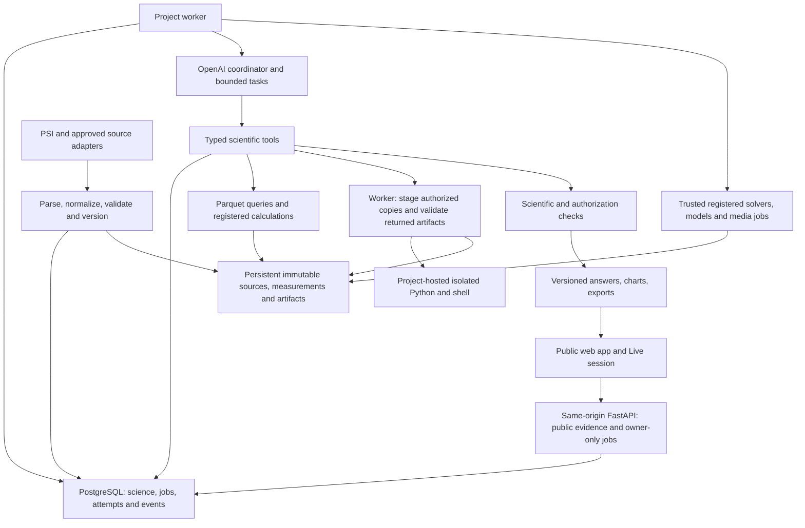

# Nova Ember Master Brief

Baseline and research verification date: 14 November 2026.

**Build Nova Ember: an evidence-first scientific research environment for understanding fire in reduced gravity.** A researcher should move from a question about materials, atmosphere, smoke detection, suppression, or an experimental mechanism to inspectable NASA evidence, meaningful comparisons, reproducible calculations, appropriately validated models, and a reviewable research case. The product is the complete research workflow, with useful intelligence throughout it and direct scientific controls at every step.

The project and application name is **Nova Ember**, developed by team **StrawHat Pirates** for the NASA Space Apps Challenge **Flame in Freefall**. The name connects space and fire: a nova evokes astronomy, an ember evokes combustion, and “Nova” carries a wordplay nod to November. The selected experience is **Ignition Glass**: a calm, light-first scientific instrument with a restrained flame identity, an equally considered dark theme, precise data presentation, and expressive interaction that clarifies the research.

The distinctive product idea has three connected signatures:

1. **Evidence reveal:** every important claim, value, figure, or model result can open its exact supporting passage, table cell, run, frame, or calculation without losing the current research context.
2. **Condition difference:** a comparison makes material, geometry, oxygen, pressure, flow, gravity, sensor, protocol, and endpoint differences visible before polished charts can imply an invalid equivalence.
3. **A reusable research workspace created through conversation:** the agent produces real, versioned dashboards, charts, datasets, code, evidence objects, and research cases that users can inspect and operate without continuing the conversation.

These signatures connect the entire application: investigation discovery, individual runs and measurements, scenario assessment, prevention, detector blind spots, extinction auditing, media analysis, modeling, contradiction review, research planning, personal research cases, teaching, Earth applications, and reproducible export. The feature inventory keeps F01–F20 stable; F19 covers a single researcher's notebook, revisions and evidence updates.

## How this brief is organized

The detailed specification preserves the supplied product/science/engineering/UI brief as **Part A, sections A1–A65**. The full scientific and engineering plan is retained as **Part B, sections B1–B20 and its empirical audit**. These are complementary levels of detail in one master contract. The F01–F20 identifiers remain stable so the complete implementation plan and acceptance matrix can trace every feature.

The source wording, examples, tables, equations, scientific distinctions, investigation details, UI tokens, screen definitions, and research references are retained extensively. Active differences have been reconciled where they occur. The original snapshots remain unchanged, so an earlier statement or source-era choice can still be checked exactly.

| Document or evidence | Role |
|---|---|
| [Implementation plan](IMPLEMENTATION_PLAN.md) | Build order, scientific checks, personal workspaces, provider setup when needed, and hosting qualifications |
| [Original product science engineering and UI UX specification](https://chatgpt.com/space/page_aec4307255548191b89cceb60f6d0007) | Supplied foundation for A1–A65, retained in this brief |
| [Original scientific and engineering plan](https://chatgpt.com/space/page_0525d144642081918b584ff977558690) | Supplied foundation for B1–B20, F01–F20, methods, and the empirical audit, retained in this brief |
| [Reconciled decisions](#reconciled-decisions) | Active resolutions of the source differences |
| [Source and data verification](#source-and-data-verification) and [empirical audit](#b-appendix) | Current checks, complete inventory, source versions, file hashes, schemas, and structural observations |
| [Selected architecture](#selected-architecture) | One application host, a project-run analysis environment, and the conditions for choosing a host |
| [Specified palette](#a41) | All 13 opaque sRGB contrast pairs were independently recalculated; rendered accessibility still requires implementation checks |
| [Challenge overview](challenge.md) and [official challenge](https://www.spaceappschallenge.org/2026/challenges/flame-in-freefall/) | Challenge identity, stated purpose, and official source |
| [Project engineering instructions](AGENTS.md) | Coding skills, working standards, verification, and Git delivery rules |

The two supplied Pages are [Flame in Freefall Product Science Engineering and UI UX Specification](https://chatgpt.com/space/page_aec4307255548191b89cceb60f6d0007) and [Flame in Freefall Scientific and Engineering Plan](https://chatgpt.com/space/page_0525d144642081918b584ff977558690). Their original titles are retained as source references; Nova Ember is the current project and application identity.

## Complete product commitment

| Connected capability | Full application behavior |
|---|---|
| Scientific discovery | Exact and semantic investigation search; deterministic filters; run and measurement discovery; saved searches, collections, and source-version links |
| Evidence inspection | Detailed investigation and run dossiers; objectives versus results; authentic images, clips, traces, methods, calibrations, and precise evidence anchors |
| Comparison and scenarios | Frozen cohorts, condition matrices, comparability classes, scenario assumptions, oxygen/pressure reasoning, applicability passports, and source-supported controls research |
| Explainable ranking | Separate question relevance, scenario applicability, evidence quality, modeling readiness, and research priority; visible unknowns, policy versions, and sensitivity |
| Scientific data and media laboratory | Tables, time series, calibrated image/video measurements, synchronized traces, reviewed transformations, condition coverage, scientific figures, and quality views |
| Prevention, detection, suppression, and recovery | Material/configuration evidence, detector blind spots, smoke/dust instrument lineage, extinction audits, candidate control tradeoffs, and post-fire research context |
| Quantitative methods | Unit-aware calculations, flame-spread and droplet methods, event/censoring definitions, detector metrics, derived dimensionless quantities, and explicit uncertainty propagation |
| Modeling laboratory | Interpretable baselines, hierarchical and other justified statistical models, registered inference, Cantera, qualified FDS research, validation/domain checks, diagnostics, and model cards |
| Scientific intelligence | One lead coordinator and useful bounded specialist roles; source-grounded extraction and synthesis; registered tools; typed scientific claims; verified calculations and artifacts |
| Research Studio and contextual assistance | Full-page conversation/artifact studio, context-aware panel, explicit selected-view sharing, live voice, interruption, correction, and persistent text/evidence outputs |
| Generated research dashboards | Typed components, inspectable queries, explicit linked filters, manual editing, preview/revision review, concurrency protection, live-query/frozen versions, and export |
| Evidence relationships and scientific planning | Assumption ledger, contradiction workbench, coverage/gap maps, hypothesis records, informative next-observation proposals, and conclusion-change analysis |
| Personal research notebook | Save a case or scenario, attach notes to exact evidence, compare and freeze revisions, inspect source changes on return, and export or restore files. |
| Open and reproducible research | Reports, JSON, CSV/Parquet, figures, notebooks/scripts, citations, licenses, frozen inputs, method/model versions, public read-only API and MCP access |
| Learning and terrestrial transfer | Layered explanations, glossary, teaching cases, reproducible exercises, and evidence-backed Earth-application collections |
| Complete interface and operations | All A39–A65 screens, responsive layouts, themes, density, accessible interaction, motion, states, budgets, jobs, settings, stewardship, backups, monitoring, and service-failure recovery |

Scientific evidence gates govern the meaning and validation state of results; they do not delete these capabilities from the build. The application must implement useful preparation, inspection, experimental, review, and unsupported-domain experiences as well as validated numerical paths. It must never fabricate a measurement or prediction merely to make a feature appear complete.

## Selected architecture

Start locally. Serve the web interface and scientific API from one HTTPS origin, with a supervised worker and PostgreSQL on the same Linux host. A request never needs a NASA or OpenAI account belonging to the visitor. The team supplies the model key when live AI is integrated.

| Responsibility | How it works |
|---|---|
| Interface and API | Next.js/React/TypeScript and Python/FastAPI share versioned contracts. A scientist can discover, inspect, compare, calculate, save and export directly; Studio and voice call those same tools. |
| Personal work | Browser storage holds settings, drafts, saved queries, frozen cohorts, scenarios, cases, sessions and dashboards. Back up to a file and import on another device. Compare watched sources with public release metadata on return. There is no cloud sync or case-sharing service. |
| Private remote tasks | Only selected inputs leave the browser for requested analysis, upload or voice. An opaque browser credential protects that visitor’s job events, results and downloads until expiry or deletion. No public visitor can write the canonical corpus. |
| Data and search | A scheduled importer uses the NASA PSI catalog, versioned manifests and selective file acquisition; NTRS and other primary sources supply supporting evidence. PostgreSQL handles relationships, full text and pgvector retrieval. Keep content-addressed originals and artifacts on persistent disk, Parquet/Arrow for analytical subsets, and a restorable copy on separate storage. |
| Jobs and models | One worker consumes persistent PostgreSQL jobs for acquisition, scientific analysis, training, media and exports. The same database keeps job progress, checks, model versions and source references. Use a larger project-controlled worker only if a measured trusted workload needs it. |
| Python and shell | The worker launches the project's pinned scientific environment directly on qualified Linux compute. Each exploratory session is isolated from the app, credentials, other workspaces and the network; no external execution API or sandbox subscription. See [A21](#a21). |
| AI and voice | OpenAI is the only required model integration: grounded text and image work, semantic retrieval, bounded classifications, and live voice. Typed tools and independent evidence checks determine what may be reported. |
| Operations | One release configuration, redacted logs, resource and spend limits, job status, backup and rollback. Use a temporary copy with separate data for release tests. |

**Hosting decision, 14 November 2026.** No host has been selected or provisioned. The signed-in [Space Apps Global Offers](https://www.spaceappschallenge.org/2026/global-offers/) list GoDaddy Registry/Porkbun, Google Cloud and Azure. The GoDaddy listing advertises a non-premium domain, hosting and SSL for one year; the [partner terms](https://www.spaceapps.earth/scholarship-terms) specify domain registration and renewal, not a hosting tier or card-free checkout. Use it for a domain if useful; Python, workers, disk and isolation support are unverified. The listed [Google trial](https://docs.cloud.google.com/free/docs/free-cloud-features) offers eligible new customers $300 for 90 days, requires payment verification and restricts GPUs. The listed [Azure free account](https://azure.microsoft.com/en-us/free/free-account-faq/) offers eligible new customers $200 for 30 days and requires a qualifying payment card. Separately, [Azure for Students](https://azure.microsoft.com/en-us/pricing/offers/ms-azr-0170p/) offers eligible full-time students aged 18+ $100 for 12 months without a card. Team eligibility, VM capacity and continuing costs are unverified. Hosting credits are not a budget for the direct OpenAI API.

Choose at deployment time: check an eligible no-card student offer or existing suitable compute first; otherwise present the owner with the specific host, terms, cost, expiry and alternative before enabling any cloud or billing integration. Qualify persistent storage, concurrent research and analysis, the local execution boundary, restore and voice connectivity on the actual host. A static site can publish an evidence snapshot but cannot host the whole application.

For live AI, use the **OpenAI Developers** plugin's secure setup flow at the integration milestone to reuse or create a scoped project key and confirm its ignored local destination. Place the key only in the model-calling backend's secret configuration, outside Git, browser bundles, logs, and research environments. No key setup or provider activation is part of this documentation revision.

## Reconciled decisions

| Decision | Active contract |
|---|---|
| Product identity | Nova Ember is the project name and application wordmark, selected on 14 November 2026. StrawHat Pirates remains the team name; Flame in Freefall remains the official challenge title. Retain original source titles and URLs. |
| Complete target | Preserve every feature and the detailed A/B contracts; order work by dependencies and evidence, without substituting a smaller MVP |
| Hosting | One portable Linux deployment; offer eligibility, budget, local execution support and the owner's decision determine the host. No mandatory cloud provider. |
| Data status | The 24-record PSI inventory, 15 sampled file hashes, and three manifest hashes were independently reproduced on 14 November 2026; full scientific interpretation remains source-specific work |
| Ranking | `question-relevance-v1` retains B's .30/.25/.25/.10/.10 heuristic; `scenario-applicability-v1` retains A's .25/.20/.20/.20/.15 heuristic; both are inspectable product policies, not safety probabilities |
| Sandbox budgets | Default commands/cells are capped at 60 seconds; a separately approved extended-cell profile permits 90 seconds; a five-minute lease renews only within authorized cumulative runtime/spend limits |
| Evaluation | A's 100-question/300-field/30-adversarial set is a development subset; B's at-least-300-task/1,000-field stratified benchmark is the full acceptance target; answer-level support and claim/extraction precision remain distinct metrics |
| Models | Simple reference baselines and justified hierarchical candidates are both retained, evaluated on grouped independent units, and promoted for an explicit intended use |
| Parsing | Deterministic format-specific readers first; Docling for appropriate structure/layout recovery; targeted OCR/vision where required; source anchors and raw representations remain intact |
| Repository | A's canonical `services/workers` and explicit domain/analysis/data-adapters/evidence/modeling/agent-tools/contracts packages; B's broader package names map to those responsibilities |
| Tools and context | One typed tool registry; distinguish search/read, proposal/validation/save, run/cohort comparison, applicability/domain checks, and exploration/registered fitting. Client `ViewContext` is resolved into an authorized server `WorkspaceContext` |
| UI | A39–A65 resolve the previous open visual-design questions. Preserve Ignition Glass, flame identity, Inter/IBM Plex Mono, the six-destination shell, full Studio/contextual assistance, tokens, screens, interactions, and acceptance tests |
| Model integration | OpenAI supplies the live endpoints. Lock and evaluate the actual available model/SDK versions. Keep deterministic workflows and reproducible exports available without paid model credentials. |
| Scientific status | Notes or corrections apply to a specific personal revision. Support depends on the source and validation evidence; annotations do not establish accuracy. |
| Evaluation units | The 95-percent fully-supported-answer development threshold is distinct from 98-percent supported-claim and accepted-field precision; no known critical scientific or authorization failure is accepted |
| Scientific integrity | Investigation/run/measurement independence, composition basis/location, endpoint meaning, uncertainty, model domain, and source provenance remain enforceable contracts |
| Cost and status | Dated provider-price examples remain estimates requiring current recheck. Research verification, implementation, hosting, latency, model validation, and submission are distinct states; no resources or keys are claimed as created |
| Attribution and competition | Use the configured owner identity and add no assistant/bot Git authors or co-author markers. Preserve licenses, citations, scientific origin labels, and any competition-required tool-use declarations or generated-media acknowledgments/watermarks |

**Change of plan, 14 November 2026:** the earlier Google-managed stack, Temporal, E2B, additional model providers and multi-user review workflow are superseded. Original source documents and dated data observations remain available. “Checked” or “validated” below means that the stated evidence or method-specific tests support a result in its stated domain. Record precisely which checks ran. Researchers can inspect or annotate their own work; no one has to invite a collaborator or obtain sign-off. If the checks cannot establish a value or meaning, leave it unresolved.

The original source-era ranking policies are intentionally retained as different scientific-discovery views. Permission checks and mandatory exact filters run first; hybrid retrieval produces candidates; applicability rules determine permitted analytical use. A high semantic score cannot override a hard incompatibility.

Current primary evidence confirms 133 returned public PSI investigations, 24 tagged Combustion Science, and 13,496,771,103,733 declared bytes across those records. Ten experimental CSVs totaling 121,053 bytes were downloaded and structurally inspected; five supporting files totaling 4,120,870 bytes were downloaded and hashed; the three sampled full manifests were also reproduced. All 15 file hashes and all three manifest hashes matched the supplied empirical audit. These are access, structure, and provenance observations, not a count of independent valid trials or proof of predictive accuracy. The exact details, unresolved units/licenses, and scientific qualifications remain in Part B and the linked verification manifest.

## Source and data verification

The public [NASA PSI catalog](https://psi.nasa.gov/geode-py/ws/repo/search?source=psi&type=investigation&size=200) and all 24 combustion metadata records were checked on 14 November 2026. All 15 sampled file hashes and three full-manifest hashes reproduce the supplied empirical audit. The ten experimental CSVs were structurally inspected; the five supporting files were hashed without claiming scientific analysis of their contents. The full inventory, resolver requests, versions, file hashes, and table interpretation remain in [the empirical audit](#b-appendix).

The official challenge's saved HTML contains its Resources content in Next.js data strings. Decoding those strings as data recovered the exact listed source [PSI Data Repository: Combustion Science](https://psi.nasa.gov/physci/repo/search?q=combustion), together with the challenge's NASA combustion, researcher-guide, incident, and fire-equipment references. This confirms the required PSI source identity; the current Resources list and organizer terms must still be rechecked when submitting. No webpage JavaScript was executed to recover the links.

The 24 records declare a combined 13,496,771,103,733 bytes. That figure is repository metadata, not unique bytes downloaded or a requirement to mirror the archive. All 24 investigation families remain in the acquisition plan, with complete catalog/manifests and selective large-asset retrieval. File access, scientific interpretation, normalized data, and validated prediction remain distinct states.

All 13 opaque palette contrast pairs in A41 were independently recalculated and agree with the specified two-decimal ratios. No rendered application, cloud resources, provider keys, trained model, or measured application performance is claimed by these research checks.

## Full implementation and completion

[IMPLEMENTATION_PLAN.md](IMPLEMENTATION_PLAN.md) starts with real, versioned NASA inputs, then discovery, comparison, calculations and local save/export. Studio, locally executed code, voice, personal research cases and hosted delivery build on those verified paths. The complete F01–F20 and A39–A65 workflows remain traceable to acceptance checks.

The plan's ordering is a dependency graph for implementing everything. Evidence and software are checked at the level of the claim being made. A successful code commit, provider connection, image build, or hosted health endpoint cannot stand in for a correctly authorized research workflow or a scientifically supported result.

# Part A Product science engineering and UI UX specification

**Engineering and experience baseline dated 14 November 2026.** This specification defines an ambitious scientific intelligence application for the NASA Space Apps challenge **Flame in Freefall**. Sections A1 through A38 establish the product, experiments and data, scientific methods, agent behavior, software architecture, security, verification, and implementation sequence. Sections A39 through A65 define the complete UI and UX direction: branding, visual styling, light and dark themes, screen layouts, navigation, scientific visualization, contextual and full-page AI experiences, responsive behavior, accessibility, interaction states, implementation contracts, and design acceptance criteria.

**Core decision:** build an evidence-first combustion research environment in which scientists can discover investigations, inspect individual tests, compare conditions, construct reproducible analyses, evaluate the applicability of findings, and develop better-supported fire safety research decisions. AI should operate throughout that environment, but calculations, permissions, data integrity, and scientific validity must not depend on a language model being persuasive.

This is a target specification, not a claim that the application or its predictive models have already been implemented. The dataset assessment distinguishes inspected public records from raw files that still require acquisition and profiling. Numerical accuracy, dataset coverage, and operating costs become measured properties during implementation, not invented promises.

<a id="a1"></a>

## A1 Product mission and success contract

The application should answer five connected questions: **What evidence exists? Which evidence applies to my problem? What does it actually show? What can we calculate or predict defensibly? What additional evidence or controls would reduce uncertainty?** The interaction must support both direct scientific investigation and agent-assisted work.

The intended outcome is not merely a faster literature search. A scientist should be able to move from a mission-relevant question to an inspectable research case containing the selected experiments, excluded experiments, condition differences, calculations, model limits, uncertainty, relevant controls, and source-linked conclusions. Another scientist should be able to reproduce the numerical analysis and challenge the interpretation without reconstructing the entire conversation.

The word **SI** follows the challenge terminology. The product should describe its actual capabilities as scientific intelligence, tool-assisted analysis, evidence synthesis, and bounded prediction. It should not claim that its AI has achieved a scientifically established level of superintelligence.

### A1.1 The central product loop

A user defines a question or scenario. The system retrieves relevant investigations and individual runs. The user or agent creates a cohort, checks comparability, explores measurements, and invokes an approved calculation or model. The system produces findings with source anchors and applicability limits. The user saves an evidence-backed research case, annotates or freezes a revision, or exports a reproducibility package.

Every stage remains accessible without chat. Natural language is an additional control surface over the same functions, not an alternative database with different answers.

### A1.2 What excellence means

| Dimension | Product commitment | Evidence of completion |
|---|---|---|
| Scientific usefulness | Connect investigations to prevention, detection, suppression, and unresolved research needs | Scientists complete representative research tasks and identify actionable next investigations |
| Traceability | Every factual scientific claim has identifiable supporting evidence | Claim-to-source links resolve to a versioned record, passage, table cell, run, or calculation |
| Reproducibility | Numerical results can be regenerated from frozen inputs | Exported analysis executes within documented numerical tolerances |
| Applicability | Explain why evidence does or does not transfer to a scenario | An explicit applicability assessment accompanies comparisons and predictions |
| Usability | Users can browse, filter, inspect, compare, and export without prompting an agent | End-to-end non-chat workflows pass testing |
| Intelligence | AI performs useful research work rather than cosmetic narration | Measured task quality exceeds retrieval-only and simple classification baselines |
| Honesty | Missing data, unsupported predictions, and conflicts remain visible | Adversarial tests do not convert unknowns into reassuring conclusions |

<a id="a2"></a>

## A2 Scope and scientific boundaries

The primary domain is fire safety in **habitable crew environments**: spacecraft, space stations, lunar and Martian habitats, and pressurized rovers. The initial scientific center of gravity is NASA PSI combustion research, supplemented by clearly labeled NASA technical reports, experiment documentation, and relevant primary publications. Rocket engine and propellant combustion are outside the primary product scope, consistent with the challenge. [S1]

The application supports research and engineering assessment. It is not a certified spacecraft safety system, flight rule interpreter, autonomous emergency controller, medical advisor, or replacement for material qualification and configuration-specific testing.

### A2.1 Distinctions the system must preserve

**Hazard is not operational risk.** An experiment can establish flame spread or sustained burning under specified conditions. That does not, by itself, establish the probability of a fire during a mission. Operational risk also requires information about ignition opportunities, exposure, geometry, crew behavior, detection reliability, mitigation, and consequences. The application must not convert laboratory burning observations into an invented mission-wide risk percentage.

**Relevance is not evidence quality.** A paper can closely match a question but provide weak, indirect, or incomplete evidence. A rigorous experiment can be less relevant to a particular habitat configuration. These are separate attributes.

**A model prediction is not a measurement.** A mechanistic calculation, statistical estimate, image-derived measurement, literature interpretation, and directly measured sensor value must have different provenance labels.

**A material is not an assembly.** Thickness, backing, coatings, seams, fasteners, neighboring materials, and installation can change the problem. Material-level evidence must not silently become approval of an installed configuration. NASA configuration-analysis guidance explicitly addresses this distinction. [S12]

**Missing evidence is not evidence of safety.** An empty search, inaccessible file, unreported sensor uncertainty, or untested condition must produce an explicit unknown or limitation.

### A2.2 Capability states

Every analytical capability has a visible state: **available for exploration**, **validated for a specified domain**, **experimental**, or **unavailable pending evidence**. These states apply to individual models and workflows, not just the whole application. A polished interface does not promote an experimental model into a validated one.

<a id="a3"></a>

## A3 Users and research workflows

The primary users are aerospace researchers and engineers, professors, graduate students, and undergraduate students. The application should adapt explanations to experience without changing the underlying evidence.

| User | Principal task | Required output |
|---|---|---|
| Aerospace fire safety engineer | Assess evidence relevant to a candidate cabin or rover configuration | Applicability-qualified research case and evidence gaps |
| Combustion researcher | Compare mechanisms and experimental conditions across investigations | Reproducible cohort, measurements, figures, and competing interpretations |
| Detection engineer | Understand smoke, aerosol, and instrument behavior | Sensor-response evidence with calibration and nuisance-source limitations |
| Suppression researcher | Compare extinction evidence under specific atmospheres and fuels | Endpoint-specific comparison, not a universal extinguisher ranking |
| Professor or graduate student | Develop a research question and interrogate prior work | Literature map, dataset readiness assessment, and analysis notebook |
| Undergraduate student | Understand an experiment and reproduce a result | Guided explanation, glossary, source material, and constrained exercises |

### A3.1 Representative workflows

**Material and atmosphere assessment:** define an illustrative cabin atmosphere, select a material family and geometry, identify relevant solid-fuel investigations, inspect actual condition coverage, compare compatible tests, and identify which conclusions remain unsupported for the target gravity or assembly.

**Smoke detection assessment:** start with a sensor or aerosol question, discover SAME and SAME-R, follow the instrument relationship to DAFT, compare particle characteristics and measurement conditions, and distinguish smoke response from dust-related nuisance behavior.

**Suppression research:** inspect FLEX runs and publications, separate fuel and droplet conditions, analyze an appropriate extinction endpoint, and explain why a droplet result does not automatically specify a cabin suppression system.

**Research planning:** identify an evidence gap, formulate competing hypotheses, propose informative measurements, estimate which experimental conditions would best discriminate between models, and export the proposal with its assumptions, falsifiers and limits.

**Education:** open an investigation overview, view an authentic example, inspect one real run, reproduce a documented calculation, and switch to deeper technical explanation without losing the original source context.

<a id="a4"></a>

## A4 Functional organization

The product consists of connected workspaces. This section defines their functional responsibilities. Sections A44 through A56 specify how those responsibilities become navigation, responsive layouts, and individual screens.

| Workspace | Responsibilities |
|---|---|
| Research overview | Corpus coverage, saved research cases, recent dataset changes, unresolved scientific questions |
| Investigation explorer | Search, deterministic filters, experiment and run discovery, saved queries, dataset availability |
| Investigation detail | Objectives, conditions, hardware, runs, measurements, examples, findings, limitations, sources |
| Comparison workspace | Cohort construction, condition differences, comparability assessment, linked analyses |
| Scenario workspace | Mission-relevant assumptions, applicability assessment, evidence coverage, safety research questions |
| Data laboratory | Tables, time series, images and video, transformations, statistics, chart construction |
| Modeling laboratory | Registered models, domain checks, uncertainty, validation, parameter studies |
| Evidence and relationships | Claims, source links, hardware relationships, contradictions, dependencies |
| Controls and technology | Prevention, detection, suppression, recovery, terrestrial transfer, equipment-specific evidence |
| Research cases and exports | Saved conclusions, review, reports, citations, reproducibility bundles |
| Data stewardship | Ingestion, source conflicts, inspectable corrections, quality checks, and versioned snapshots |

A persistent research context links these workspaces: selected scenario, corpus snapshot, investigation set, cohort, units, and analysis history. Moving from a chart to a source document should not discard the selected run or filter.

Direct links must resolve to stable entities and versions. The browser back button, shareable filter state, saved selections, and return-to-analysis behavior are product requirements. Scientists should not need to remember an experiment acronym to recover their work.

<a id="a5"></a>

## A5 Investigation explorer and filtering contract

The explorer is a core scientific feature, not an ornamental list beside the agent. It must work quickly and reliably when AI services are unavailable.

### A5.1 Three levels of discovery

**Investigation level:** find a research program or study, such as BASS-II or FLEX, and understand its objectives and available evidence.

**Run level:** find individual tests meeting conditions, such as a particular fuel, measured oxygen range, pressure, flow direction, or observed outcome.

**Measurement level:** select specific sensor channels, derived quantities, time intervals, or image sequences within a run.

Counts must identify their level. “12 investigations,” “340 runs,” and “85,000 samples” are different statements. The application must never inflate apparent scientific replication by counting time samples or video frames as independent experiments.

### A5.2 Required filters

| Filter group | Fields and interpretation |
|---|---|
| Identity | Investigation, acronym and aliases, accession, release version, publication, campaign, run identifier |
| Scientific purpose | Prevention, detection, suppression, fundamental mechanism, validation, terrestrial transfer |
| Fuel and specimen | Solid, liquid, gas; material identity; formulation; batch; mixture; geometry; dimensions; backing; coating; support |
| Atmosphere | Oxygen mole fraction, composition basis, total absolute pressure, derived partial pressure, diluent identity, temperature, humidity where reported |
| Flow | Speed, direction, concurrent or opposed relation to spread, imposed versus measured flow, time variability |
| Gravity | Nominal class, measured acceleration, vector orientation, platform, centrifugation or other method, duration and variability |
| Hardware | Facility, chamber or duct, apparatus version, burner or holder, instrument, sensor placement |
| Measurement | Variable, sensor principle, sampling rate, calibration availability, uncertainty availability, usable time interval |
| Outcomes | Ignition, sustained burning, spread, extinction, smoke or aerosol properties, censoring and run validity |
| Availability | Metadata only, documents available, raw files acquired, normalized runs available, analysis-ready cohort, reviewed findings |
| Provenance | Measured, derived from measurement, simulation, publication statement, AI proposal, human-reviewed extraction |

A numerical filter must declare whether it applies to a nominal setpoint, measured mean, time-dependent range, minimum, or maximum. Filtering a changing oxygen signal by its average is not equivalent to requiring that the entire run stayed within a range.

### A5.3 Deterministic behavior

Use AND across filter groups and OR within a multi-select group unless the user explicitly chooses another Boolean expression. Show the compiled meaning of a natural-language filter before applying an ambiguous interpretation. A request for “high oxygen” must map to a stated threshold or return a clarification within the application; it must not become an invisible model-specific definition.

Unknown values are a separate category. A missing flow measurement must not match “zero flow.” An unreported suppressant must not become “no suppressant.” A material family must not automatically include every formulation or commercial grade.

Facet counts must use the same corpus snapshot and permission scope as the result set. Numeric ranges must use consistent units and clearly state whether missing values are excluded. Filtering, sorting, pagination, and aggregation use database or analytical code, not language-model calls.

### A5.4 Search and saved collections

Support exact acronyms and identifiers, full-text scientific terminology, synonyms, semantic questions, and combinations with hard filters. Preserve exact matches for names such as CFI and CFI-G instead of collapsing them through semantic similarity.

Users can save a query, freeze its result set into a versioned cohort, collect investigations for reading, or compare selected runs. A saved query can change when the corpus changes; a frozen cohort cannot. Both objects should be available because they serve different scientific purposes.

Save these objects in the current browser without registration. A workspace backup preserves both the query and the exact IDs and versions of any frozen cohort. If a referenced version becomes unavailable, show its identifier and status on restore.

<a id="a6"></a>

## A6 Investigation detail and AI summaries

Each investigation has a structured, source-linked dossier with progressively deeper information. The scientific content is stable across presentation styles.

### A6.1 Required dossier content

The overview includes the investigation identity, authoritative source, study purpose, experimental platform, evidence availability, and a short explanation of fire safety relevance. Objectives, hypotheses, measured outcomes, and later interpretations are separate sections of the data model.

The experimental description includes fuel or material, specimen and burner geometry, dimensions, atmosphere, flow, gravity characterization, ignition method where documented, apparatus, sensors, measured quantities, and experimental factors. Each attribute carries a source and a completeness status.

The run explorer identifies what changed between tests and what was held constant. Where a full experimental matrix exists, users can inspect it. Where only a subset of files is available, the application labels that subset instead of implying completeness.

The evidence section includes original documents, publications, raw and processed assets, calibration documents, analysis scripts when licensed, version history, known discrepancies, and links to related investigations.

### A6.2 Authentic examples

Every investigation should have at least one useful example when licensed source material is available: a representative image, short experiment clip, documented run, instrument trace, or reproduced figure. The example must identify its source, run association, and whether it is representative, illustrative, or analytically selected.

Generated images must never masquerade as experiment footage. A general explanatory animation may be useful in educational mode, but it must be labeled as an illustration and excluded from the evidence corpus.

A figure digitized from a publication is not equivalent to a raw sensor series. Its digitization method, axis calibration, resolution limits, and additional uncertainty must remain attached.

### A6.3 Summary modes

Provide a brief overview, a technical summary, a method-focused summary, and a scenario-specific interpretation. These are alternative views over the same evidence, not independent opportunities to invent facts.

The summary contract contains the research question, methods, reported findings, applicable conditions, limitations, fire safety relevance, and unresolved questions. An empty findings field is acceptable when only objectives are available. A proposed experiment must not receive a fabricated results summary.

Generated scientific statements are represented as structured claims before rendering. Every claim has supporting evidence identifiers, a claim type, scope, and verification status. Numerical claims must resolve to a source value or an executed calculation. Unsupported claims are removed, qualified as hypotheses, or returned as unresolved questions.

Summary caches are keyed by investigation version, evidence set, prompt version, model identifier, language, and summary mode. A changed source invalidates dependent summaries. A human-reviewed summary remains identifiable as such; a newly generated version does not inherit that review automatically.

<a id="a7"></a>

## A7 Comparability engine

The most important scientific feature is the ability to explain **whether a comparison is meaningful**. Shared subject matter, hardware, or an experiment acronym is not sufficient.

### A7.1 Comparison dimensions

The engine evaluates material identity and formulation, geometry and thickness, scale, support and backing, atmosphere and composition basis, total pressure, temperature, diluents, flow magnitude and direction, gravity vector and variation, confinement, ignition protocol, sensor response, observation window, endpoint definition, and data-processing method.

Each dimension produces an explicit relation: matched, meaningfully different, transformable using a documented method, unknown, or not relevant to the requested comparison. Missing information is visible rather than silently treated as a match.

Shared apparatus creates a useful relationship, not automatic interchangeability. An instrument can have different calibration, configuration, sampling, or placement across campaigns. The apparatus record therefore has versions and configurations, not just a name.

### A7.2 Comparison classes

**Direct comparison:** the endpoint and important conditions are sufficiently aligned for the stated question.

**Condition-adjusted comparison:** a documented normalization or validated model supports adjustment, with propagated uncertainty and residual differences.

**Mechanistic comparison:** the investigations inform a common mechanism but their numerical outcomes should not be pooled.

**Insufficient or incompatible comparison:** the requested numerical comparison is not supported. The system can still explain the mismatch and suggest an alternative question.

These labels are scoped to the question. The same pair of experiments might be suitable for comparing measurement methods and unsuitable for comparing flame-spread rates.

### A7.3 Analysis behavior

The default is separate groups until comparability is established. The agent cannot bypass a blocked pooling operation by generating its own unreviewed analysis. It can propose an exploratory override, but that override must be explicit, recorded, and prevented from producing a validated conclusion.

Show within-investigation factors separately from cross-investigation differences. Preserve stratification by material, campaign, apparatus, and endpoint. Summaries should identify when an apparent overall trend disappears or reverses within comparable groups.

Normalizations are named analytical operations, each with assumptions, units, input requirements, and validation references. Dimensionless scaling is useful only when its characteristic lengths, transport properties, and relevant physical assumptions are actually known. The application must not manufacture Reynolds, Damköhler, or other dimensionless numbers from incomplete inputs.

<a id="a8"></a>

## A8 Investigation ranking and evidence assessment

The application needs several rankings, not a single list that conflates relevance, quality, and danger.

**Question relevance** ranks investigations by how well they address the user’s research question. **Scenario applicability** ranks evidence by closeness to the scenario and the availability of justified transfer. **Modeling readiness** ranks datasets by the availability of usable inputs, labels, uncertainty, and independent tests. **Research priority** identifies unresolved questions where additional work could change a decision.

### A8.1 Retrieval and ranking sequence

First enforce access permissions and explicit constraints. Next retrieve exact identifier, keyword, and semantic matches. Then assess endpoint and condition compatibility. Finally apply the selected ranking policy and produce an explanation of inclusion, exclusion, and uncertainty.

The initial search implementation uses PostgreSQL full-text search and pgvector semantic search with reciprocal-rank fusion. This is preferable to semantic search alone because scientific identifiers, acronyms, sensor names, and units often require exact matching. Supabase documents this hybrid pattern. [S24]

### A8.2 Initial applicability policy

For the scenario-applicability-v1 research-discovery policy, use an explicit, configurable heuristic with the following starting weights: endpoint alignment 0.25, material and geometry alignment 0.20, atmosphere alignment 0.20, flow and gravity alignment 0.20, and apparatus or measurement alignment 0.15. These are engineering defaults to be evaluated with scientists, not experimentally established importance weights. The separate question-relevance-v1 policy is specified in F05 in Part B and B9; do not interchange the two scores.

For each dimension, the score is based on an inspectable matching rule. Unknown dimensions do not receive a match and do not cause the remaining weights to be silently renormalized. Show evidence coverage separately. A hard incompatibility can prevent a numerical use even when a discovery score is high.

The displayed score is a relevance heuristic, never a probability that a conclusion is true or a percentage of spacecraft safety. Users can change weights, inspect rank sensitivity, and see which investigations move. Ranking versions are saved with research cases.

### A8.3 Evidence quality as a profile

Represent evidence quality through specific properties: source type, method detail, calibration, uncertainty reporting, number of independent runs, replication, completeness, processing transparency, applicability, and review status. Do not generate a decorative “96 percent scientific confidence” value.

A peer-reviewed publication, an official catalog record, a raw measurement, and a technical presentation have different roles. The best source depends on the claim. Raw data is stronger for checking a measured trace; a methods report may be necessary to interpret it; a catalog is useful for identity but can contain mistakes.

<a id="a9"></a>

## A9 Scenario workspace and atmosphere reasoning

A scenario is a versioned description of a research question, not a simulated spacecraft merely because a user enters a few sliders.

### A9.1 Scenario contract

The scenario stores environment type, gravity assumptions, atmosphere composition and basis, total absolute pressure, temperature, humidity when relevant, nominal and limiting conditions, ventilation characteristics, relevant dimensions, materials and assemblies, potential ignition context, detection assumptions, suppression constraints, and the endpoint under investigation.

Each value is tagged as measured, taken from a named specification, user-assumed, or derived. A mission preset stores the source document and edition. It must not represent a changing exploration architecture as a timeless approved NASA configuration.

NASA’s December 2024 JSC 29353D configuration guidance includes specific example vehicle atmosphere limits and notes the significance of control tolerances and measurement error. The application should retain such edition-specific values with their context, rather than copying them into an unlabeled “Moon atmosphere” preset. [S12]

### A9.2 Oxygen concentration is not interchangeable with partial pressure

For an ideal gas mixture, the basic relation is:

```math
p_{O_2}=x_{O_2}P_{\mathrm{absolute}}
```

As an illustrative calculation using the challenge’s example values, 30 percent oxygen at 10.2 psia gives an oxygen partial pressure of 3.06 psia. A comparison atmosphere of 21 percent oxygen at 14.7 psia gives 3.087 psia. Similar oxygen partial pressure does not establish identical flammability. The system must retain concentration, total pressure, gas composition, transport conditions, and material behavior rather than collapsing them into one number.

The increase from 21 to 30 percent oxygen is about 42.9 percent relative to the original oxygen fraction. It is **not** evidence of a 42.9 percent increase in fire probability, flame speed, or overall risk. Those are different quantities.

The calculation service must distinguish mole fraction from mass fraction, percent from fraction, absolute from gauge pressure, and local burner-stream composition from chamber atmosphere. Unit conversion cannot repair an unknown composition basis; that requires source clarification.

### A9.3 Spacesuits and habitat context

The challenge’s discussion of low-pressure oxygen-filled spacesuits and reduced-pressure habitats motivates scenario comparison, but the application should not recommend breathing protocols or operational atmosphere changes. Its role is to expose the combustion evidence relevant to a specified atmosphere and identify missing material or configuration tests. [S1]

<a id="a10"></a>

## A10 Partial gravity and transfer limits

The data model must distinguish microgravity, normal gravity, actual partial-gravity conditions, centrifugally produced effective gravity, drop-tower and parabolic conditions, and electric-field analogues. These are not synonyms.

The supplied challenge states that partial-gravity combustion data is not available in PSI and mentions LUCI and FM2 as relevant directions. Separately, NASA has published a LUCI report describing a suborbital centrifugal lunar-gravity investigation. Therefore the correct product distinction is **availability in PSI versus availability in supplementary literature**, not “partial-gravity evidence does not exist.” The current availability of raw LUCI data still requires verification before ingestion. [S1, S10]

Electric-field forcing can help investigate selected transport effects, but an electrically influenced flame is not a measurement made under lunar gravity. The evidence graph must represent the relationship as an analogue with specific limitations.

NASA’s JSC 29353D guidance notes that limited data indicate partial-gravity flammability may exceed Earth-gravity or microgravity conditions without forced convection. Consequently, microgravity and normal-gravity results cannot be assumed to bound every intermediate case. Linear interpolation in gravity is prohibited as a default scientific method. [S12]

A future partial-gravity model must identify the physical mechanism being transferred, characterize acceleration and experimental geometry, evaluate rotation-related effects where applicable, and validate against relevant partial-gravity observations. Until then, the system can provide a qualitative evidence synthesis and an explicit research gap, not a fabricated lunar or Martian numerical prediction.

FM2 is included as a tracked investigation and supplementary source of research objectives. The application must distinguish proposed objectives, published status, measured results, and publicly accessible files rather than inferring that a project page proves a completed dataset. [S11]

<a id="a11"></a>

## A11 Modeling laboratory and calculation strategy

The modeling laboratory should be ambitious in methods and conservative in the scope of its claims. Its purpose is to make scientifically supportable prediction accessible, not to fit one universal model to every combustion experiment.

### A11.1 Separate model families

| Model family | Possible endpoint | Essential restriction |
|---|---|---|
| Solid-fuel flammability | Sustained burning or an experiment-defined flammability boundary | Specific material, geometry, protocol, and atmosphere |
| Flame spread | Spread rate, front position, or growth over time | Compatible geometry, flow relation, and measurement definition |
| Droplet combustion | Diameter evolution, burning-rate parameter, extinction behavior | Fuel, droplet support, atmosphere, and mechanism domain |
| Aerosol and detection | Particle properties, instrument response, detection timing where available | Sensor calibration, aerosol generation, transport, and endpoint validity |
| Suppression research | Experiment-defined extinction outcome under stated conditions | No direct translation into a whole-cabin discharge prescription |
| Coverage and transfer | Distance from tested conditions and unresolved assumptions | This is applicability analysis, not a physical fire model |

A model of sustained burning following a controlled ignition is not a model of spontaneous ignition probability. A detector-response model is not a model of whole-system detection reliability unless the required system-level evidence exists.

### A11.2 Data readiness gate

Training requires a defined prediction target, a defensible mapping from source records to labels, a documented population of independent runs, usable explanatory variables, explicit exclusions, and an assessment of missingness and measurement quality. If essential input variables or outcomes cannot be reconstructed, the dataset remains useful for exploration but is not promoted into predictive training.

The first modeling task is to reproduce a documented result or trend in a well-characterized subset, not to maximize a machine-learning leaderboard metric across incompatible experiments.

### A11.3 Selected statistical approach

Begin with interpretable baselines: generalized linear models for appropriate categorical outcomes, simple regression or mechanistic fits for well-defined continuous outcomes, and Gaussian-process models for small, structured datasets where their assumptions are defensible. Use hierarchical Bayesian models when partial pooling across related campaigns is supported by the experimental structure.

Use scikit-learn for baseline estimation and evaluation and PyMC for hierarchical models and uncertainty analysis. Prior and posterior predictive checks are mandatory for Bayesian models; posterior intervals alone do not demonstrate model adequacy. PyMC’s documentation describes these checks as part of model assessment. [S35]

A more flexible tree-based model can be evaluated as a challenger when enough independent data exists. A neural surrogate or physics-informed model is a later option, not the default simply because it sounds advanced. It must outperform the baseline on held-out, scientifically meaningful tests and preserve appropriate uncertainty behavior.

Do not impose monotonic effects of airflow or gravity without evidence. Do not use a global model to hide distinct regimes. Treat chamber, campaign, material batch, and shared apparatus as possible sources of dependence.

### A11.4 Validation design

Split by independent runs or campaigns, never by random frames from the same video. Evaluate leave-campaign-out and, where the intended use requires it, leave-investigation-out transfer. Fit preprocessing, feature selection, and calibration only within training folds. Keep the final test set untouched until model selection is complete.

For classification, report class balance, sensitivity, specificity, precision-recall behavior, Brier score, and calibration with uncertainty. For regression, report errors in meaningful units, residual structure, prediction-interval behavior, and performance by condition group. For boundary estimation, assess the boundary and its uncertainty, not just overall classification accuracy.

An experiment stopped before extinction is not an observed extinction time. Below-detection measurements, aborted runs, incomplete videos, and endpoint ambiguity require appropriate censoring or exclusion logic. Missing data handling must be fitted and documented; an imputation must never appear as a measured value.

### A11.5 Domain checks and abstention

A registered model specifies admissible materials, mixtures, geometry, pressure, oxygen, flow, gravity conditions, endpoint definitions, and required metadata. Domain checking evaluates both individual ranges and combinations of conditions. Being inside every marginal minimum and maximum does not establish that a combination was tested.

The inference response reports whether the case is within domain, near a boundary, outside domain, or indeterminate because inputs are missing. Out-of-domain requests return no validated numerical prediction. They can return nearby evidence, an exploratory result explicitly separated from validated inference, and the additional measurements needed to support transfer.

Conformal or Bayesian intervals do not automatically remain reliable under domain shift. The application must not use an uncertainty band to cosmetically legitimize unsupported extrapolation.

### A11.6 Mechanistic calculations and simulation

Use **Cantera 3.2** as the initial chemistry and transport calculation engine for appropriate gas-phase and reduced-order problems. It provides thermodynamic, kinetic, transport, reactor, and one-dimensional flame capabilities. It is not a complete model of spacecraft solid-fuel pyrolysis, enclosure radiation, or cabin-scale fire propagation. [S30]

Every mechanistic run records the mechanism file and version, species and reactions, transport model, numerical tolerances, boundary conditions, and validation evidence. A mechanism valid for one fuel, pressure, or temperature range is not presumed valid elsewhere.

CFD integration is an advanced research capability with its own verification program. NIST FDS is a candidate for applicable fire-dynamics questions, but its suitability for the particular microgravity, combustion, and radiation problem must be established, not assumed from its existence as a fire simulator. Mesh, timestep, conservation, numerical convergence, and experimental comparisons must be documented. [S31]

The product must not use the term “digital twin” for a generic simulation with no validated connection to a specific physical system.

<a id="a12"></a>

## A12 Detection suppression and safety controls research

The controls workspace organizes evidence by **prevention, detection, suppression, and recovery**. Its output is a supported research assessment, not an executable emergency instruction.

### A12.1 Prevention

Link materials, configurations, ignition context, atmospheres, and ventilation to relevant flammability evidence. Identify what has actually been tested and where extrapolation is required. Capture material preparation, thickness, exposed area, neighboring materials, and installation details when available.

A research comparison can identify which material configurations have stronger supporting evidence under a specified test protocol. It cannot declare a material universally “space safe.”

### A12.2 Detection

Connect aerosol generation, particle distributions, transport, sensor principle, sensor placement, response, and nuisance sources. Distinguish a laboratory instrument used to characterize smoke from an operational smoke detector. A particle counter reading is not automatically a detector alarm threshold.

SAME and SAME-R provide the direct smoke-research pathway, while DAFT and DAFT-2 provide related aerosol and instrument context described in the challenge. NASA’s combustion program also describes DAFT’s role in validating an instrument for subsequent smoke work. This relationship should be represented explicitly rather than merging dust and smoke datasets. [S1, S9]

### A12.3 Suppression

Compare suppressant-related evidence by fuel, atmosphere, endpoint, apparatus, and observation period. Include reignition or continued low-temperature reaction when documented. Visible flame disappearance alone must not be treated as proof that every relevant combustion process has stopped.

Separate a suppressant’s observed combustion effect from its crew, equipment, cleanup, logistics, and environmental constraints. The application can identify these as assessment dimensions, but it must not invent toxicity limits, exposure guidance, or approved operating procedures.

FLEX-based gaseous suppression evidence and fine-water-mist equipment evidence belong to different evidence chains. A result about a gas diluent cannot validate a water-mist extinguisher.

### A12.4 Recovery and configuration consequences

Allow researchers to document post-fire contamination, residual heat, atmosphere changes, equipment damage, cleanup, and monitoring requirements where supported by sources. This remains a research synthesis. The app must never directly control ventilation, isolate electrical systems, vent a compartment, or release a suppressant.

A controls comparison presents the supporting studies, applicability, resource requirements, unresolved tradeoffs, and required qualification work. It does not collapse everything into a single automatically recommended action.

<a id="a13"></a>

## A13 Data and media laboratory

The data laboratory provides direct inspection of tables, time series, images, video, and derived measurements. It supports agent-authored analyses, but all computational results use the same typed analytical services available to users.

### A13.1 Tables and numerical analysis

Users can select columns, inspect units and missingness, filter rows, group by experimental factors, compute descriptive statistics, examine distributions, and export subsets. Every transformation is recorded as an ordered, versioned operation.

The system must show sample counts at the correct level, distinguish repeated measures from independent replicates, and preserve exclusions. Aggregation labels identify whether they refer to runs, specimens, frames, or time samples.

A standard analysis library includes unit conversion, condition coverage, uncertainty-aware summaries, regression diagnostics, matched-cohort comparisons, and calculation of experiment-specific quantities. Each operation declares required inputs and does not silently substitute assumed constants.

### A13.2 Time series

Store native timestamps, sampling rates, clock offsets, resampling methods, and gaps. Align signals only through documented synchronization rules. Interpolation is a derived operation with an identified method, not an invisible preprocessing step.

For interactive viewing, use bounded downsampling that preserves important extrema and discontinuities. Export and computation must use the selected full-resolution data or explicitly state the sampling transformation.

### A13.3 Images and video

Support frame navigation, annotated regions, calibration references, sensor synchronization, and comparison of compatible views. Derived quantities can include front position, projected flame area, droplet diameter, or other measurable features when the image formation and calibration permit them.

The initial pipeline uses classical image processing with masks checked against annotated reference frames and calibration. Keep optional manual inspection and mask corrections. If a method lacks an independent reference or fails its validation, show the candidate track without reporting a validated physical measurement. A vision model can propose regions or identify candidate frames, but it cannot silently establish a temperature, physical scale, or chemical state from an uncalibrated image.

Perspective, distortion, pixel scale, occlusion, exposure, saturation, background subtraction, and frame timing must be considered. Two-color pyrometry or tomography requires the appropriate instrument response and method; ordinary RGB color is not a thermometer.

The derived-data record retains the original frame identifier, transformation parameters, calibration, algorithm version, reviewed masks, and uncertainty. Researchers can inspect how a measurement changed when a segmentation or calibration was revised.

### A13.4 Scientific chart contract

The agent generates a constrained chart specification, not arbitrary JavaScript. The backend validates datasets, fields, units, aggregations, filtering, and uncertainty before rendering.

Every chart exposes its data source, cohort, units, transformations, sample counts, missing-data treatment, and exportable values. Error bars identify whether they represent measurement uncertainty, standard deviation, standard error, credible intervals, or prediction intervals.

Use Vega-Lite as the primary declarative chart grammar. Its structured specification supports reproducible interactive graphics; our implementation restricts available expressions and external data loading. More elaborate graphics should be added only when the scientific task requires them. [S36]

### A13.5 Agent generated research dashboards

The agent can assemble and revise a complete custom research dashboard, not merely produce an isolated chart. A request such as “Build a workspace comparing the available solid-fuel studies for this atmosphere, show the condition coverage, and explain the largest evidence gaps” should produce a saved collection of linked scientific artifacts. This section defines composition and behavior; Section A52 specifies the dashboard builder and its visual interaction model.

A dashboard contains a research question, owner, corpus snapshot, scenario and cohort references, shared filter state, and a collection of typed components. The permitted component registry includes an investigation collection, run table, condition-coverage plot, comparison report, measurement chart, evidence-linked summary, applicability assessment, model-result artifact, assumption list, and unresolved-question list. Each component references a validated query or existing artifact. Arbitrary generated HTML, JavaScript, external scripts, or unrestricted data URLs are prohibited.

Use a versioned `DashboardSpec` with `schema_version`, `dashboard_id`, `revision`, `question`, `corpus_snapshot_id`, `scenario_version_id`, `cohort_ids`, `components`, `filter_bindings`, `selection_bindings`, and `artifact_dependencies`. Each component declares its type, authorized data source, fields, units, transformations, scientific status, evidence references, and empty-state meaning. Titles and summaries must be supported by the same data as the components they describe.

The creation pipeline is: resolve the question and context, retrieve the available evidence, propose a typed specification, validate permissions and field compatibility, estimate query and computation cost, execute authorized operations, verify results, and save the resulting dashboard version. A failed component remains an explicit failed or unavailable component rather than disappearing into an apparently complete answer. A dashboard containing pending calculations is marked incomplete until those dependencies resolve.

Shared filters and selections propagate only through explicit, unit-compatible bindings. Selecting a run may update its measurement chart and source summary; it must not silently filter an unrelated investigation using a coincidentally similar column name. Filters disclose which components they affect. The same empty selection cannot mean “all runs” in one component and “no runs” in another without an explicit rule.

Users can inspect, edit, duplicate, freeze, and export a dashboard without using the agent. The agent proposes revisions as a meaningful change set, identifying added sources, changed filters, removed artifacts, new assumptions, and affected conclusions. Compare the base revision before applying a proposal: a result from an older tab or agent run must never overwrite the researcher’s latest edits.

A dashboard can operate as a live saved query or a frozen research artifact. A live dashboard identifies the current corpus release and highlights source changes; a frozen dashboard retains the exact inputs and results used for the research case. Converting between these modes is an explicit action. Public examples use public evidence only. Personal dashboards stay in the browser; export only the selected, permitted data and show what the file will contain.

Acceptance tests cover a dashboard composed from real evidence, a component with unavailable data, linked filters across compatible datasets, prevention of incompatible bindings, reproducible export, expired private job access, a stale model proposal after a manual edit, and source-version updates. The agent-created and manually created versions of an equivalent dashboard must return the same numerical results.

<a id="a14"></a>

## A14 Evidence graph and distinctive research capabilities

The knowledge layer should connect evidence, not merely display a network of related keywords.

Entities include investigations, runs, specimens, materials, apparatus, sensors, publications, datasets, claims, models, controls, and scenarios. Relationships distinguish measured-by, performed-with, derived-from, supports, contradicts, uses-the-same-instrument-family, and potentially-applicable-to.

A relationship asserted by an AI model is a proposal until validated. The graph must not transform co-occurrence in a document into causation or experimental equivalence.

### A14.1 Applicability passport

Every finding and model receives a compact, machine-readable description of the conditions under which it is supported. It includes material and configuration, atmosphere, flow, gravity, endpoint, measurement method, unresolved assumptions, and exclusions.

The passport travels with an exported chart or conclusion. This prevents a correct result from becoming misleading when copied out of its original context.

### A14.2 Assumption ledger

Research cases contain explicit assumptions with their source, owner, status, and downstream dependencies. Changing a pressure assumption or material thickness marks affected analyses and conclusions as requiring review.

The agent can identify hidden assumptions and suggest sensitivity analyses. It cannot silently convert an assumption into a measured input.

### A14.3 Contradiction workbench

Preserve competing assertions and their sources. Classify disagreements as metadata conflict, different experimental conditions, different endpoint definitions, measurement uncertainty, model disagreement, or unresolved scientific conflict.

Anyone can compare the source assertions and suggest a correction with its evidence. A change to the public corpus retains the original text, the supporting reference and a new version. If the sources do not resolve the disagreement, keep both assertions. The output may explain that two apparently contradictory findings concern different regimes.

### A14.4 Evidence coverage and gap map

Map the tested condition combinations, not just separate one-dimensional ranges. Identify sparse regions, missing combinations, absent sensor calibration, limited independent replication, and missing endpoint definitions.

A gap statement must specify its search scope: for example, “No matching run was found in corpus snapshot X under these filters.” It must not claim global novelty merely because the local database lacks a record.

### A14.5 Next informative investigation

Use sensitivity analysis and, where justified, expected information gain to propose which additional observations could discriminate between competing models or reduce uncertainty in a particular research decision.

The output is a research-planning brief: scientific question, competing hypotheses, variables that need characterization, expected discriminating evidence, and required expertise. Physical experimental execution, especially in oxygen-enriched environments, remains subject to appropriate facilities and qualified review.

The system must not present an optimization result as a safe experimental procedure.

### A14.6 Conclusion change analysis

For a saved conclusion, answer: What evidence supports it? Which assumption matters most? Which source revision would affect it? What observation would contradict it? What additional data would make it more transferable?

This capability is more valuable than generic chatbot agreement because it helps scientists understand the fragility or robustness of a research judgment.

<a id="a15"></a>

## A15 Dataset inventory and acquisition assessment

### A15.1 What has and has not been verified

The public PSI catalog, all 24 combustion metadata records, ten experimental CSVs, five selected supporting files, and three full file manifests were independently retrieved and checked on 14 November 2026. The inventory, all 15 sampled file hashes, and all three manifest hashes match the empirical audit retained in Part B. The CSVs were structurally inspected; the five supporting files were downloaded and hashed without scientific analysis of their contents. No bulk combustion archive was downloaded and profiled end to end. These observations establish access, file identity, schemas, row roles, and specific interpretation problems; they do not establish complete independent-run coverage, calibrated outcome labels, or predictive performance. See [the current verification status](#source-and-data-verification) and [the exact audit provenance](#b-appendix).

The implementation must turn the following inventory into an acquisition ledger. A named investigation is a scope commitment, not a claim that all of its raw assets are already available locally.

### A15.2 Primary and supplementary corpus

| Investigation family | Intended scientific use | Required extraction and principal caution |
|---|---|---|
| BASS and BASS-II | Solid-material burning, spread, extinction, and atmosphere or flow dependence | Material formulation, shape, dimensions, flow relationship, oxygen, run outcomes, video calibration; avoid pooling dissimilar geometries |
| Saffire I, II, and III | Larger-scale solid-fuel and spacecraft-relevant fire behavior | Sample, enclosure and duct configuration, environmental measurements, imaging, scale effects, and run-specific conditions |
| SAME and SAME-R | Smoke and aerosol properties relevant to detection | Generation conditions, material, aerosol measurement methods, sensor configuration, sampling, contamination and collection limitations |
| DAFT and DAFT-2 | Aerosol instrument behavior and dust-related context | Instrument lineage and calibration; do not treat dust response as direct smoke-detection validation |
| FLEX and FLEX-2 | Liquid-droplet combustion and extinction | Fuel identity, droplet size, support, atmosphere, dilution, pressure, drift or imposed motion, extinction definition |
| CFI | Droplet cool-flame behavior and low-temperature combustion | Distinguish hot-flame loss, continued reaction, measurement sensitivity, and extinction endpoint |
| ACME BRE | Material-flammability mechanisms represented through a gaseous-fuel emulator | Distinguish modeled material behavior from a direct burn test of the actual solid material |
| ACME E-FIELD Flames | Electric-field effects and selected transport analogies | Field configuration and measured responses; not equivalent to lunar-gravity data |
| ACME s-Flame | Spherical gaseous diffusion-flame structure and response | Fuel and oxidizer streams, burner geometry, radiation, and endpoint-specific relevance |
| ACME CLD Flame | Laminar diffusion-flame and model-validation evidence | Flow and flame conditions, soot and kinetic-model context; relevance may be mechanistic rather than direct habitat safety |
| ACME Flame Design | Soot, oxygen-enriched diffusion flames, and combustion mechanisms | Distinguish optimized burner behavior from uncontrolled material fires |
| ACME CFI-G | Gaseous cool flames and oxygen-rich inverse-flame configurations | Store chamber mixture and burner-stream composition separately; 85 percent burner oxygen is not an 85 percent cabin-atmosphere test |
| SPICE and SLICE | Gaseous-fuel flame behavior, smoke point, structure, and liftoff context | Burner and duct configuration, fuel, flow, diagnostics, and relationships to the shared MSG hardware |
| Related PSI modeling studies | Derived analysis and model-development evidence | Preserve links to original experiments; do not count reanalysis as independent experimental replication |
| LUCI and FM2 material | Partial-gravity research and future or supplementary coverage | Verify actual publication status and file availability; distinguish centrifugal, lunar-surface, planned, and measured evidence |
| Later Saffire and SoFIE material | Expanded supporting research where public and relevant | Treat as supplementary until exact PSI coverage and assets are verified |

The supplied challenge establishes the core families and hardware relationships. NASA’s ACME material identifies the six constituent experiments and their different scientific roles. The PSI catalog is the authority for whether a particular investigation is listed as available; availability must still be checked at the asset level. [S1, S2, S8]

### A15.3 Concrete accession records inspected

The following source-era examples are included in the independent 14 November 2026 re-verification of all 24 combustion metadata records. The current evidence ledger also reproduces 15 sampled file hashes and three sampled manifest hashes; the complete accession table is retained in Part B.

| Record | Verified public identity | Initial engineering use |
|---|---|---|
| PSI-69 | FLEX, version 5; DOI 10.60555/mbq8-0451; catalog license CC0-1.0 | Droplet-combustion dossier and first suppression-related data adapter |
| PSI-98 | Saffire I, version 4; DOI 10.60555/0t15-1z43; catalog license CC0-1.0 | Large-scale fire dossier, imaging assets, and metadata-conflict regression fixture |
| PSI-101 | SAME-R, version 4; DOI 10.60555/2np7-jv14 in the indexed record | Smoke-detection dossier, engineering documentation, and aerosol-method extraction |
| PSI-62 | Secondary modeling record linked to BASS and BASS-II source investigations | Derived-evidence lineage and prevention of duplicate experimental counting |

These are observed versions, not a promise that they will remain the latest. The independently checked catalog assigns BASS to PSI-26 and BASS-II to PSI-25. The complete 24-record mapping, investigation versions, DOI values, declared sizes, license fields, download provenance, and source-specific caveats are retained in Part B and the verification manifest. Related-record identifiers remain evidence of lineage rather than permission to count a reanalysis as a new experiment. [S4, S5, S6, S7]

### A15.4 File-level examples and what they imply

The Saffire I record exposes a camera distortion-grid archive and a document concerning image-frame sizes and region-of-interest offsets. That makes geometric calibration and image-coordinate reconstruction first-class ingestion requirements, not optional cleanup. File presence does not establish that a particular derived measurement has already been validated. [S5]

The SAME-R record lists an engineering requirements document and a final report. These are high-priority sources for instrument meaning, experimental context, and interpreting the raw measurement files. A file-count change in version history is not a count of independent tests. [S6]

The FLEX record describes both free and supported droplets and the relevance of slow relative motion. The adapter therefore needs support configuration and motion fields instead of assuming every run is an ideal stationary isolated droplet. [S4]

### A15.5 A real metadata conflict to handle

In the inspected Saffire I record, the project table identifies ISS and dates that do not align with the record’s own description of the experiment aboard Cygnus after departure from ISS. The hardware entry also identifies a Cygnus enclosure. This is an internal source conflict, not permission for the app to choose whichever text is convenient. [S5]

The ingestion system must preserve both assertions, flag the conflict, consult experiment-specific reports and NASA mission material, and record a reviewed resolution. This example becomes a permanent regression test for the data-stewardship pipeline.

### A15.6 Access strategy

Use the current PSI repository and official record links as the primary entry points. Retain investigation accession, DOI, investigation version, file version, source URLs, retrieval time, and an asset manifest. The public frontend catalog, metadata, file-listing, and download-resolver paths were exercised during the retained audit and independently reproduced; their exact requests are in Part B and the verification manifest. These are observed website services, not a confirmed supported/versioned public API. The PSI guide describes investigation metadata, experiment tables, associated documents, files, and version history. Large downloads may use an asynchronous preparation process rather than a simple permanent URL. [S3]

Do not invent a public combustion API. Build an adapter around verified supported interfaces and downloaded manifests. Where machine-readable access is unavailable, allow curator-mediated import of officially downloaded files with the same checksum and provenance requirements.

The public AWS NASA PSI registry describes a bucket, but its listed resource description is not evidence that every combustion archive is mirrored there. Validate every required object before making that bucket a dependency. A consolidated OSDR and PSI web presence likewise does not establish that a biological-data API serves combustion records. [S13, S14]

<a id="a16"></a>

## A16 Data ingestion and stewardship pipeline

The importer preserves the path from NASA's original file to each displayed value. A failed or incomplete import must not replace the last usable snapshot.

### A16.1 Processing stages

**Discover:** register the investigation, version, publications, and expected assets. Record the discovery source and distinguish metadata availability from file availability.

**Acquire:** retrieve through permitted interfaces, preserve source bytes, record content type and checksum, and store an immutable original. Never execute downloaded scripts as part of ingestion.

**Inspect:** enumerate archives safely, detect file types from content where possible, inspect schemas, identify units and time bases, and generate a machine-readable quality report.

**Extract:** prefer native metadata, tables, structured files, and deterministic parsers. Use document extraction and AI only where source structure requires interpretation. Image-based extraction is a fallback when native text is insufficient.

**Normalize:** map units, names, controlled vocabularies, experiment identifiers, and conditions while retaining raw representations. Never silently correct an impossible value.

**Check:** compare critical fields and endpoint labels against source anchors, protocols and independent references. Keep ambiguous extractions as proposals and unresolved conflicts visible. Optional corrections include their evidence and origin; they do not substitute for passing the applicable checks.

**Release:** create an immutable corpus snapshot with a manifest, quality results, known limitations, licensing information, and versioned transformation code.

**Index:** build search, evidence links, summary caches, and model-ready cohorts from the released snapshot. Draft ingestion records do not enter the public scientific corpus by default.

### A16.2 Deterministic extraction before AI

A sensor named explicitly in a structured column should be parsed and mapped through a controlled vocabulary. A unit conversion should use a unit library. A date should use an unambiguous parser. A classification model should not replace these operations.

AI is appropriate for interpreting an unstructured methods paragraph, proposing a synonym mapping, identifying candidate table headers, or suggesting that two descriptions refer to related apparatus. The output is a typed proposal with exact source spans and an abstention option.

Critical fields include material identity, composition basis, pressure type, geometry, gravity conditions, endpoint, and sensor calibration. These receive stricter source and validation checks than descriptive tags because mistakes can change scientific conclusions.

### A16.3 Quality checks

Check uniqueness and referential integrity; detect duplicate files and duplicate scientific runs; validate unit compatibility; inspect gas fractions and their basis; distinguish negative physical values from signed vectors or offsets; check timestamps and sampling; compare nominal and measured conditions; identify absent calibration; and quantify missingness by investigation and variable.

Plausibility rules produce flags, not automatic truth. A value outside an expected range may be an extraction error, a different unit, a sensor problem, or a scientifically interesting condition. Preserve the original and require an explained correction.

Do not join tables by a filename fragment without a validated key mapping. A many-to-many join can multiply rows and create fictitious replication. Every dataset adapter includes expected join cardinalities and reconciliation checks.

### A16.4 Release and correction policy

Corrections create a new normalized version and a changelog. Raw source files remain unchanged. Downstream models, cached summaries, figures, and cases record the version they used and are marked stale when affected.

A publication based on the same underlying experiment is linked as an interpretation or reanalysis, not ingested as a new independent run. Dataset and publication deduplication are separate tasks.

<a id="a17"></a>

## A17 Scientific data model

Use a relational canonical model for identity, conditions, provenance, and workflow state, with columnar assets for large measurements. Do not put the whole scientific corpus into unstructured JSON or a vector database.

### A17.1 Core entities

| Entity | Required responsibility |
|---|---|
| Investigation and investigation version | Stable identity, acronym aliases, objectives, platform assertions, DOI, version and source dates |
| Campaign and test run | Experimental grouping, run identifiers, protocol, independent-unit identity, validity and censoring |
| Material and specimen | Composition, formulation, batch, geometry, dimensions, support, coating, backing and preparation |
| Assembly configuration | Material relationships, fasteners, seams, adjacency, confinement and installation assumptions |
| Apparatus and apparatus configuration | Facility, chamber, duct, burner, holder, configuration version and operating context |
| Sensor and calibration | Principle, model, placement, units, sample rate, calibration interval, uncertainty and response characteristics |
| Condition and condition series | Nominal, measured and derived atmosphere, flow, temperature, gravity and other settings |
| Observation and endpoint | Quantity, definition, value or series reference, uncertainty, censoring, quality and measurement method |
| Asset and source document | Original bytes, checksum, license, URI, MIME type, version, extraction status and access scope |
| Evidence anchor | Page and bounding box, table and cell, row and column, frame and region, or time interval |
| Claim and claim evidence | Statement, type, applicable conditions, supporting and conflicting anchors, review status |
| Cohort and analysis | Frozen selection, transformations, code, parameters, inputs, outputs, execution environment and logs |
| Model and model version | Training snapshot, target, domain, validation, calibration, mechanism or algorithm and approval status |
| Dashboard and dashboard revision | Typed scientific components, source and artifact dependencies, shared filters, selection bindings, live or frozen mode, ownership and change history |
| Scenario and research case | Assumptions, selected evidence, conclusions, review, exports and dependency graph |
| Personal workspace and activity | Browser-local settings, cases, notes and revisions; provenance and event history for explicitly requested server jobs |

### A17.2 Numerical value contract

A scientific number stores the raw text, original unit, normalized value and unit, quantity kind, composition or pressure basis where relevant, source anchor, measurement method, uncertainty description, and missing-value status.

Uncertainty may be a standard uncertainty, interval, resolution bound, covariance reference, or unreported. These are not interchangeable. Significant figures in a source are not automatically a complete uncertainty model.

Gas composition stores the species, fraction, fraction basis, and physical location. An atmosphere can have separate chamber, inlet, burner, exhaust, and local sensor compositions. This prevents the CFI-G burner mixture from being misrepresented as a habitat atmosphere.

Gravity stores a vector or a defined scalar convention, nominal and measured status, time dependence, source platform, and experimental method. Do not substitute the label “microgravity” for a precise measurement when one is needed for modeling.

### A17.3 Missingness vocabulary

Use explicit states such as not reported, not measured, not applicable, inaccessible, unreadable, below detection limit, censored, conflicting, and pending review. A database null can implement missing storage, but a separate reason field gives it scientific meaning.

An imputed value belongs to a derived analysis record, not the canonical measured field. A corrected value retains both the original assertion and the reviewed correction.

### A17.4 Storage boundaries

PostgreSQL stores canonical metadata, normalized scalar conditions, source anchors, relationships, private job ownership and temporary execution state. The browser stores private workspace state by default. Parquet stores large tabular measurements. HDF5 or original scientific formats remain preserved where present, with normalized extracts generated only as needed. Images and video stay in immutable files with indexed metadata and derived assets.

A materialized search record is a projection, not the canonical scientific record. Rebuilding the search index must not change the facts, citations, or review status.

<a id="a18"></a>

## A18 Agent architecture and tool contracts

The primary agent should be a capable scientific coordinator with a limited, audited tool surface. It should not be an unconstrained browser-and-terminal agent with access to the entire backend.

### A18.1 Selected agent arrangement

Use one lead research agent and a small set of specialist roles invoked when useful: evidence retrieval, data extraction proposal, analysis planning, model assessment, and claim verification. These can share an implementation and differ by instructions and allowed tools. A multi-agent conversation is not required for every query.

The coordinator decomposes a research question, selects relevant tools, maintains the scenario and cohort, and produces a concise action plan. The verification stage checks source support, numerical consistency, domain restrictions, and unresolved contradictions. Agreement between two AI agents is not independent scientific validation.

Use the OpenAI Responses API and the Python OpenAI Agents SDK. The application worker persists job steps, approvals and evidence references in PostgreSQL, including when a model request or tool execution is interrupted. [S17]

### A18.2 Model allocation

The selected lead model is **gpt-6-astra** for complex synthesis, competing explanations, analysis planning, and final research-case assessment. **gpt-6.1-sol** handles routine source-grounded summaries, extraction proposals, and less demanding tool-assisted tasks. Use structured responses for bounded classifications; evaluate **gpt-6-luna through the Decisions API** only if available and useful on the same project. These are chosen from the current official model documentation, not asserted to be universally best for combustion research before evaluation. [S15, S16, S18]

All production roles require domain-specific evaluation. A model upgrade is a versioned change with regression tests. Use dated snapshots when the provider exposes them; otherwise record the exact model identifier, request metadata, and deployment date, and treat provider drift as an operational risk.

### A18.3 Tool surface

| Tool | Allowed behavior and scientific contract |
|---|---|
| search_investigations | Search authorized corpus snapshot with typed filters and explicit result grain |
| get_investigation | Retrieve the versioned dossier and evidence availability |
| search_runs | Return individual runs matching validated conditions |
| get_run | Retrieve conditions, specimens, endpoints, assets and quality flags |
| search_evidence | Search authorized source passages with bounded retrieval and source locators |
| read_evidence | Read exact source anchors, not an unrestricted filesystem |
| inspect_dataset | Return schema, units, missingness, counts and known limitations |
| create_cohort | Freeze a selection with query and source versions |
| compare_runs | Evaluate explicitly selected runs and their condition/endpoint differences |
| compare_cohort | Evaluate a frozen cohort and its condition/endpoint comparability |
| check_applicability | Apply versioned finding/evidence applicability rules to a scenario |
| compute_quantity | Execute a registered deterministic calculation with units |
| query_dataset | Run restricted analytical queries over approved data views |
| propose_chart | Produce a validated declarative chart specification |
| propose_dashboard | Compose or revise a typed collection of linked research components with evidence and explicit filter bindings |
| save_dashboard | Save an authorized, validated dashboard revision with concurrency checks and a recorded change set |
| run_python | Execute analysis in an isolated, bounded sandbox |
| list_models | Find registered models and their supported domains |
| check_model_domain | Evaluate input completeness and applicability before inference |
| fit_registered_model | Fit an approved model profile with prescribed independent-unit evaluation |
| run_model | Execute an approved model under a recorded contract |
| save_artifact | Save a versioned authorized scientific artifact with its provenance |
| assess_evidence | Assemble support, contradictions and applicability without inventing a confidence percentage |
| propose_case_update | Draft changes to a research case for user review |
| export_case | Produce a traceable report and reproducibility package |
| propose_metadata_correction | Create a review item without changing canonical facts |
| find_research_gaps | Identify corpus-scoped gaps and possible discriminating evidence |

Tool schemas include workspace, corpus snapshot, entity versions, purpose, row and runtime limits, and output types. Permissions are enforced by the backend, not supplied by the model. The model cannot choose a more privileged identity by changing a tool argument.

### A18.4 Execution policy

Routine searches and small registered calculations run immediately. Show the requester the cost or scope before expensive work, including private data in an export, or replacing a personal revision. Changing a public source mapping requires write access and a traceable correction. None of these actions calls an outside reviewer.

The agent can retry recoverable technical errors within a bounded budget. It cannot keep changing a scientific question until it obtains a pleasing result. Failed analyses are logged and reported with the part that failed.

A research session records sources, tool requests, returned data, code, assumptions, model identifiers, approvals, and conclusions. The user sees useful action summaries and evidence, not private model reasoning traces.

<a id="a19"></a>

## A19 Bounded decisions and deterministic scientific rules

Use a parser or registered function when the input determines the answer. For a genuinely semantic choice, ask the existing OpenAI integration for a typed answer with an explicit unknown option. A valid schema does not make a label scientifically correct.

### A19.1 Decision allocation

| Task | Selected implementation | Reason |
|---|---|---|
| Sort runs by oxygen or pressure | SQL or analytical engine | Exact, reproducible, fast and inspectable |
| Convert units | Pint and tested numerical code | Dimensional validation rather than probabilistic arithmetic |
| Identify an explicitly named sensor in a table | Parser and controlled vocabulary | Source already contains the answer structurally |
| Extract a sensor from an unstructured methods paragraph | Structured extraction with evidence spans, then validation | Requires reading context, not merely selecting an unsupported label |
| Route a question to detection versus suppression tools | Bounded OpenAI classification with an unknown option | Limited semantic choice; retain the original question |
| Propose research-purpose tags | Structured classification and source span | A proposed tag is not a measurement |
| Resolve contradictory source values | Compare source assertions and record substantiated corrections | If the sources cannot resolve a conflict, retain it; a classifier cannot settle it |
| Decide whether a model is inside its registered domain | Deterministic domain checks | Must not depend on model mood or wording |
| Establish a conclusion's support | Evidence anchors, applicability checks and documented limits | The app cannot certify spacecraft safety |

### A19.2 Provider decision

Start with the existing OpenAI connection. A dedicated Decisions endpoint is an optional optimization only after it passes the same tests for the same task and has a measured benefit. No second provider account or challenger implementation is required. [S18]

The benchmark measures task accuracy, abstention behavior, confusion by class, latency, cost, and stability under paraphrase. Labels are established from a reviewed dataset, not by asking another language model to be the unquestioned judge.

Probabilities returned by a decision model are not automatically calibrated for this corpus. Use an explicit abstain or needs-review outcome and evaluate calibration before interpreting probabilities operationally. A schema-valid wrong answer remains wrong.

<a id="a20"></a>

## A20 Contextual assistant and live mode

The assistant should understand what the scientist is examining, but reading the whole screen is not the best default mechanism.

### A20.1 Structured context first

The application provides a context envelope containing the active investigation, selected runs, filters, scenario version, chart specification, selected data interval, visible evidence anchors, and current research case. This is more precise, cheaper, and easier to audit than repeatedly inferring application state from screenshots.

The agent can answer “Why does this curve differ?”, “Which condition changed?”, “Show the relevant sensor documentation,” or “Compare these two runs” using exact identifiers. It must distinguish what the user selected from what merely exists elsewhere in the workspace.

The assistant may propose navigation, add a chart to a research case, create a comparison, or run an analysis through the same typed tools as ordinary controls. A separate AI-only path must not bypass permissions or scientific checks.

### A20.2 Screen and image context

Optional screenshot or image context is useful for externally supplied figures or visually ambiguous annotations. It requires explicit user action, a visible sharing state, and the smallest necessary capture. Redact unrelated content and keep retention limited.

Screen interpretation is not authority to click arbitrary controls or operate a live spacecraft system. For this application, agent actions remain confined to its approved research tools.

### A20.3 Live voice

Select **gpt-live-1** for an optional voice interface, with deeper reasoning and scientific operations delegated to the same backend agent. Official documentation supports this separation between live conversation and backend work. [S20]

Voice should support interruption, cancellation, references such as “this run,” and concise verbal explanations. Scientific numbers, citations, assumptions, and charts must also be captured in text. A speech transcript with an ambiguous value or unit must not silently become a calculation input.

Confirm consequential numerical input when recognition is uncertain, such as 0.3 versus 30 percent or absolute versus gauge pressure. Live interaction does not lower the evidence requirements.

The contextual assistant uses a restrained blue-core flame mark within a labeled launcher, an expandable research panel, and a full-page AI Research Studio. Section A51 defines the optional orb and live-mode behavior. The launcher must never conceal data, imply that the microphone is active when it is not, or become the only way to access assistance.

<a id="a21"></a>

## A21 Controlled Python sandbox

The agent receives a small, isolated analysis environment because executable calculations are valuable. It does not receive access to the production host, unrestricted credentials, or an open network by default.

### A21.1 Selected execution environment

Run the researcher's or agent's Python and bounded shell directly on project-controlled Linux compute. The worker starts a disposable sandbox using a local isolation runtime such as [gVisor/runsc](https://gvisor.dev/docs/), with a pinned scientific image, a read-only copy of the selected inputs, and a size-limited writable work area. Guests receive no network, public listener, host control socket, credentials, other jobs' files or access to the application database. Check artifact types, sizes and hashes on return. This uses installed software, not a hosted sandbox or an OpenAI code-execution endpoint. Qualify actual package compatibility and isolation on the chosen host. If unavailable, show the reason and retain the pending work; never fall back to executing generated commands in the API or the worker's own shell.

Interactive policy targets are two virtual CPUs, approximately four GiB of memory, and 60 seconds for an ordinary command or cell. A separately approved extended-cell profile permits 90 seconds. A five-minute session lease can renew only when the task still has explicitly authorized cumulative runtime and spend remaining; renewal is not an unlimited timeout bypass. Bound input files, output size, process count, and storage. These are application limits to validate against the actual host and runtime, not assumptions about a hosting offer.

The same trusted worker can schedule long-running registered profiles in their separately locked environments. Run a profile on larger project-controlled compute only where needed and authorized. Interactive notebook limits never grant access to the trusted modeling environment.

### A21.2 Input and dependency policy

The backend supplies only the authorized, frozen data subset and required documentation. Original production credentials, database connections, signing keys, and arbitrary environment variables are absent.

Packages are preinstalled in a pinned image. Runtime package installation and network downloads are disabled by default. A request for a new dependency creates an environment change requiring review and testing. Downloaded research code is not automatically safe to execute.

Input paths are generated by the application, not accepted as arbitrary host paths. The sandbox cannot fetch internal URLs or cloud metadata endpoints. Artifact upload and download occur through a controlled broker with MIME, size, and content checks.

### A21.3 Execution and output

Record code, seed, inputs, package lock, image digest, resource limits, standard output, errors, and artifacts. Validate output tables against expected schemas. A chart image must have an accompanying numerical dataset or traceable specification.

Static code checks can catch obvious problems but are not the security boundary. Isolation, absent secrets, denied network access, resource limits, and controlled artifact handling are the boundary.

Do not execute generated HTML or JavaScript in the main application origin. Treat notebook output as untrusted. Escape text, sanitize supported markup, and serve files from an appropriately restricted origin.

### A21.4 Reproducibility guarantee

Aim to reproduce numerical outputs within documented tolerances from the saved environment. Do not promise bit-for-bit regeneration of every AI response or nondeterministic numerical library operation. Preserve the original model output and execution artifacts so the scientific record remains inspectable even if a future provider changes behavior.

<a id="a22"></a>

## A22 Selected technical stack

The stack is selected for scientific correctness, modern capabilities, inspectability, and a realistic path from hackathon demonstration to a serious research tool. It is not a collection of every fashionable framework.

The concrete technologies below are the baseline. Exact dependency resolution, security advisories, and transitive compatibility must be captured in lockfiles during the first build. Where a verified release is named, it is a starting pin, not permission to ignore a later security fix.

### A22.1 Application and data infrastructure

| Layer | Selected baseline | Decision rationale |
|---|---|---|
| Web application | Next.js 16.4.6, React 19.3.1, TypeScript strict mode | Mature application structure with a typed client and server boundary; use patched stable releases rather than canary features |
| JavaScript runtime and package management | Node.js 24 LTS and pnpm with committed lockfile | Reproducible builds and predictable supported runtime |
| Scientific API | Python 3.13, FastAPI, Pydantic 2 | One typed scientific service layer close to the numerical ecosystem |
| Database access | SQLAlchemy 2 and psycopg 3, versioned SQL migrations | Explicit transaction and schema control |
| Canonical database | PostgreSQL 17 on the app host | Transactions, scientific relationships, job state, permissions and provenance; no managed database required |
| Private job access | An opaque server-issued browser credential for requested remote operations | No registration or sign-in. Check ownership of private jobs, events, artifacts and downloads; public evidence is open. |
| Search | PostgreSQL full-text search, pgvector, reciprocal-rank fusion | Exact terminology plus semantic retrieval without a separate search cluster initially |
| Scientific files | Immutable, content-addressed storage on persistent disk, with an independent backup | Preserve originals, frozen inputs and results; authorize delivery and verify hashes on restore |
| Large-data analysis | DuckDB, Polars, Arrow and Parquet | Efficient subset queries and transformations without loading all media into the database |
| Scientific arrays | NumPy, SciPy, xarray and h5py as required by source formats | Standard numerical and multidimensional data handling |
| Units and schemas | Pint, Pydantic and Pandera | Unit-aware calculations and typed dataset validation |
| Document processing | pypdf and pdfplumber for native content; Docling for complex layout; image extraction only when required | Prefer recoverable source structure over indiscriminate OCR |
| Visualization engine | Vega-Lite 6, with a restricted specification validator | Reproducible charts that the agent can safely propose |
| Evidence relationship engine | Relational edge tables and recursive queries; Cytoscape.js only when a relationship view is needed | Preserve graph semantics without introducing a second canonical database |

Verify the web/API version combination and lock it at the first build. Test PostgreSQL permissions and hybrid retrieval against the actual research data; a hosted database or identity service is not needed for either. [S21, S22, S24, S32]

Do not add Neo4j, Elasticsearch, Kafka, Kubernetes, and a second vector store before measured requirements justify them. The data model should permit later migration, but initial operational complexity should be spent on scientific quality rather than redundant infrastructure.

### A22.2 AI and scientific execution

| Layer | Selected baseline | Decision rationale |
|---|---|---|
| Lead reasoning | OpenAI gpt-6-astra through Responses | Complex evidence synthesis and planning, subject to domain evaluation |
| Routine language work | OpenAI gpt-6.1-sol | Lower-cost source-grounded work with escalation on difficult cases |
| Bounded decisions | Deterministic rules first, then typed OpenAI classification with abstention | Test extraction, routing and tags against independent reference labels |
| Embeddings | text-embedding-3-large with 1536 output dimensions | Deliberate quality and index-size tradeoff; evaluate against exact-search baselines |
| Agent framework | OpenAI Agents SDK for Python | Typed tools, bounded roles, handoffs and tracing |
| Job execution | Supervised Python worker with PostgreSQL jobs, attempts and ordered events | Recover progress, explicit user confirmations, cancellation and artifact publication after reconnect or restart |
| Exploratory code | Local, disposable sandbox with pinned Python/shell environment and no network | Real execution on project hardware without a sandbox provider; see [A21](#a21) |
| Statistics | scikit-learn and PyMC | Interpretable baselines and explicit uncertainty modeling |
| Chemistry | Cantera 3.2 | Appropriate kinetics, thermodynamics and transport calculations |
| Model tracking | Versioned PostgreSQL records plus immutable local artifacts | Preserve model cards, frozen inputs, evaluation results, registered domain, status and history |
| Optional voice | gpt-live-1 with delegated backend reasoning | Live conversation without creating a separate scientific truth system |

OpenAI documents embedding dimension reduction; the chosen 1536-dimensional representation is an application choice that must be evaluated on this corpus. It is not a claim that a shorter embedding is always as accurate as the full representation. [S27]

### A22.3 Deployment and engineering tools

Use one repeatable configuration for Next.js, FastAPI, PostgreSQL and the worker. Serve the UI and API through the same HTTPS origin; only the application needs public ingress. Keep the persistent data directory separate from builds. A host timer schedules bounded NASA refreshes. Test a release against a disposable database and file tree before promoting the same build.

Track queue age, failed imports, model usage, spend, disk and backup age in the app's existing records and redacted logs. Protect the keys used by the backend. Budget paid and expensive tasks globally as well as by browser/workspace, so a new anonymous browser cannot reset the app's total budget. Keep an independent backup of the database and referenced files; demonstrate restoring and rerunning a frozen case.

Use pytest and Hypothesis for numerical and data checks, Vitest for client behavior, and Playwright plus accessibility checks for end-to-end research tasks. Test hosting capacity, host isolation, libraries, restart, recovery and cost before choosing a provider. Eligibility and billing decisions belong at deployment; see the [hosting decision](#selected-architecture).

### A22.4 Portability and service independence

The core scientific functions must remain usable without a paid AI call: browsing, filtering, source inspection, comparison rules, registered calculations, cached reviewed summaries, and exports.

Keep tool contracts, original model outputs, evaluation fixtures and scientific code portable. If live AI is unavailable, explain the limitation and continue with the public evidence and calculation workflows. Changing a model would require the same measured quality and scientific checks; an outage must not trigger an untested substitute.

<a id="a23"></a>

## A23 System architecture and execution boundaries

Use a modular monolith for the scientific application domain, with separate processes for API traffic, ingestion, trusted computation, and isolated agent-authored code. This gives clear responsibilities without prematurely multiplying services.

### A23.1 Request path

A public lookup resolves the requested corpus snapshot without identifying the visitor. For a private remote action the API also checks the device credential and ownership of that specific job or temporary artifact. Simple queries use the data layer; Studio uses the same tools. Long-running ingestion or computation returns a durable job ID.

The coordinator can retrieve evidence, invoke registered calculations, and request sandbox execution. All outputs pass through schema and permission checks before becoming application artifacts. A generated conclusion is stored with its evidence and processing lineage.

The browser receives ordered progress events and artifact references. It does not need access to model-provider credentials, database service credentials, or internal object-store paths.

### A23.2 Durable workflows

PostgreSQL stores jobs, steps, attempts, approvals and numbered events. The worker leases work, records progress and checks cancellation before publishing. Restart recovers expired leases; reconnect replays persisted events. Record uncertain outcomes of external calls rather than reissuing a potentially charged request blindly. The UI distinguishes queued, running, awaiting user confirmation, completed, failed, cancelled and partial work.

Activities are idempotent where possible. Retrying a job must not create duplicate corpus releases, publish a report twice, or charge repeatedly without visibility. Exactly-once side effects are not assumed merely because a workflow engine exists.

Large files and model artifacts stay in the content-addressed file store. Workflow history stores references and hashes, not huge raw payloads. Long-lived sessions must manage history growth and retain the source records needed for audit.

### A23.3 State and caching

A scientific operation is bound to a corpus snapshot, scenario version, cohort version, calculation or model version, and permission scope. Cache keys include those dependencies. A cached answer from a private workspace cannot be reused in a public response.

Cache metadata and reviewed summaries aggressively; cache scientific results only when their full input and environment identity is known. Do not cache solely by the text of the user’s question.

Cancellation propagates to queued work and, where supported, active compute. A cancelled job may have produced partial artifacts; those must be labeled incomplete and must not become final conclusions.

<a id="a24"></a>

## A24 API contracts and repository structure

The API is contract-first. OpenAPI is generated from Pydantic schemas, and the TypeScript client is generated from that contract. Scientific enum values and units are not independently reimplemented in three different places.

### A24.1 Principal application endpoints

| Endpoint family | Purpose |
|---|---|
| GET /v1/investigations | Search and filter investigations with a specified snapshot |
| GET /v1/investigations/{id}/versions/{version} | Retrieve a versioned dossier |
| POST /v1/runs/query | Execute typed run filters and return a bounded result |
| POST /v1/cohorts | Resolve selected public records to exact versions and hashes for a cohort saved by the browser |
| POST /v1/comparisons | Produce a comparability assessment and condition differences |
| POST /v1/analyses | Start a registered calculation or sandbox analysis |
| POST /v1/dashboards/validate | Validate a proposed dashboard specification, dependencies, bindings, permissions and estimated cost |
| GET /v1/models | List models, targets, domains and validation states |
| POST /v1/models/{id}/check-domain | Evaluate applicability before inference |
| POST /v1/models/{id}/predict | Run a versioned model after passing policy checks |
| POST /v1/agent/runs | Start a bounded agent task with explicit application context |
| GET /v1/jobs/{id}/events | Stream job progress and artifact events |
| POST /v1/exports | For exports needing server computation, process only the frozen inputs selected by the researcher; return a temporary private job |
| GET /v1/snapshots/{version}/changes | Read the public change list. The browser matches it to watched sources without uploading a private case. |

These are proposed app endpoints, not NASA endpoints. Creating, saving, annotating, freezing and reopening personal cases or dashboards are browser operations. The same typed revision and provenance contracts apply when importing a file or applying a Studio suggestion. Producing a report does not publish a case online.

### A24.2 Scientific claim contract

A claim object contains `claim_id`, `statement`, `claim_type`, `evidence_ids`, `applicability`, `limitations`, `verification_status`, and `created_from`. The latter records the corpus snapshot, model or calculation version, and analysis identifier.

Allowed claim types include directly reported result, derived numerical result, cross-source synthesis, model prediction, exploratory extrapolation, hypothesis, and unresolved question. A hypothesis cannot be serialized as a directly measured result merely by changing its display label.

For a numerical claim, `value`, `unit`, `endpoint_definition`, `uncertainty`, and `calculation_id` or `measurement_id` are required where applicable. A citation to a general experiment overview is insufficient support for an exact numerical value.

### A24.3 Prediction contract

A prediction response contains the model version, target, input values and units, domain assessment, predicted quantity when permitted, interval type and level, validation reference, important assumptions, and provenance.

When the domain check fails, the response has `status: outside_validated_domain` and no validated prediction value. It can include relevant evidence and a description of the missing support. The frontend cannot turn this into a green success state because the HTTP request succeeded.

### A24.4 Proposed monorepo

```text
apps/web                    Next.js application
services/api                FastAPI endpoints and authorization
services/workers            Ingestion and trusted computation
packages/contracts          Generated schemas and TypeScript client
packages/domain             Scientific entity and applicability rules
packages/agent-tools        Typed tool definitions and policies
packages/analysis           Registered numerical methods
packages/data-adapters      Investigation-specific importers
packages/evidence           Claim anchors and provenance logic
packages/modeling           Training, domain checks and inference
sandboxes/python-analysis   Pinned isolated execution image
infra                       Deployment configuration and policies
evals                       Reviewed evaluation cases and scoring
tests/fixtures              Licensed small datasets and regression cases
docs                        Architecture decisions and scientific methods
```

Keep raw scientific archives outside the source repository unless small and explicitly appropriate for redistribution. Store manifests and checksum references in the repository, with a small licensed fixture set for reproducible tests.

<a id="a25"></a>

## A25 Security privacy and adversarial resilience

Scientific correctness and privacy matter wherever a source, calculation, or model result enters a personal case. Preserve provenance and restrict access to private processing inputs and results.

### A25.1 Authorization

The public corpus, read-only research API and MCP queries, and personal browser workspace work without registration. Save cases in the browser. When a researcher requests private remote processing, the server issues an opaque, high-entropy credential for that browser in a secure HttpOnly cookie. Use it only for that browser’s private jobs, uploads, voice sessions, and temporary results. A submitted job receives only the selected inputs. The originating browser can reconnect after a tab closes to inspect, cancel, download, or delete the job and its results before expiry.

Check ownership on private reads and writes, event streams, uploads, and downloads. Check that a job still exists and has not been canceled before recording a result. A private job address alone grants no access. Keep server credentials out of browser bundles and execution environments. The public read-only interfaces expose released NASA evidence and registered methods; only the project maintainer can release a change to the public corpus. Personal corrections stay in the researcher’s case.

Send the selected evidence to the assistant within the stated scope. Keep personal analysis, notes, and transient results out of public search indexes, summary caches and external read APIs.

### A25.2 Prompt injection

Treat papers, web pages, metadata, uploaded files, tool outputs, and retrieved text as untrusted content. Instructions inside them cannot modify system policy, grant permissions, or authorize network access.

Separate source text from tool instructions structurally. Allow only declared tools and schemas. Never let a document request credential disclosure or command execution. Include adversarial fixtures containing hostile instructions in otherwise plausible methods sections and dataset files.

### A25.3 Query and file security

Prefer typed query builders and read-only analytical views. Where SQL is permitted, enforce an allowed statement and function set, row limits, timeout, memory limits, and an isolated data source. A language-model assertion that a query is safe is not validation.

Reject archive traversal, decompression bombs, unexpected executable files, excessive nesting, and unsupported active content. Validate content type rather than trusting extensions. Scan uploads, bound conversion resources, and isolate document parsing.

Network fetchers use an allowlist or constrained destination policy, block private and link-local addresses, revalidate redirects, and prevent access to cloud metadata services. Do not let an agent fetch arbitrary internal URLs.

### A25.4 Privacy and retention

Collect only what a requested calculation, model call, or voice session needs. Screen and microphone access are separate, explicit choices. Keep private files out of public summaries and extraction training.

Document distinct retention periods for transient uploads, audio, screenshots, provider requests, job results, and operational logs. Show which inputs an action sends, its expiry, and how to delete temporary server data earlier from the originating browser. Remove expired private artifacts and their derived caches, and disclose any applicable backup/provider retention. A local case deletion, a remote job deletion, and deletion of a downloaded backup are separate actions. Offer deletion of outstanding remote work before a browser reset removes its credential. A downloaded file remains under its holder’s control.

Do not promise zero provider retention unless the actual account and API configuration support it. Record the selected service data policies as part of deployment review.

<a id="a26"></a>

## A26 Evaluation and release gates

The release standard is evidence of correct behavior, not the number of features on a demo slide. The targets below are proposed acceptance criteria, not achieved results.

### A26.1 Reviewed evaluation corpus

Build a development subset covering at least 300 critical extracted fields, 100 research questions, 30 misleading or adversarial questions, and representative comparison/modeling tasks. The full acceptance benchmark expands to at least 1,000 labeled field extractions and 300 representative research tasks, stratified across solids, droplets, gases, aerosols, hardware, units, endpoints, missingness, and domain mismatch. Preserve a held-out portion and explicit adversarial cases. Include all major scientific families in discovery tests and the deeply normalized families in calculation tests.

Ground expected answers in independent source passages, published reference analyses or known-answer calculations. Keep conflicting or ambiguous labels explicit; do not count them as correct by default. Keep development and final evaluation cases separate. Rewriting prompts against the same small test set does not establish general reliability.

### A26.2 Core gates

| Area | Proposed release gate |
|---|---|
| Source traceability | Every published scientific claim has a resolvable evidence or calculation anchor |
| Critical extraction | Each released critical value passes the relevant deterministic checks or is substantiated by a documented independent reference with exact source context. Ambiguous values stay unresolved. Report sampled error rates. |
| Numerical integrity | Registered calculations pass unit, boundary, dimensional, and reference-value tests |
| Citation validity | No fabricated source identifiers, nonexistent files, or invented quoted values in the acceptance set |
| Scientific boundaries | All mandatory adversarial cases preserve measured versus modeled distinctions and unsupported-domain abstention |
| Retrieval | Report recall and ranking quality against independently source-labeled relevant sets, by investigation and query type. Record label provenance; model agreement is not ground truth. |
| Agent task quality | Target at least 95 percent fully supported answers on the reviewed benchmark, with sample size and uncertainty reported |
| Private data | A second browser cannot read another browser's uploads, job state, events, downloads or cached results |
| Reproducibility | Each release demonstration can be rerun from its frozen inputs and environment |
| Human usability | Representative users complete discovery, inspection, comparison, and export tasks without agent assistance |

The 95 percent target is a development threshold, not an acceptable failure rate for operational safety decisions. A critical scientific or authorization failure blocks release even when aggregate accuracy is high.

### A26.3 Required scientific regression tests

The system must distinguish CFI from CFI-G; burner oxygen from chamber oxygen; nominal pressure from measured pressure; absolute from gauge pressure; oxygen mole fraction from mass fraction; an investigation from a run; repeated frames from independent replicates; a proposed experiment from published results; a raw observation from an AI extraction; and a simulation from physical data.

It must reject automatic lunar-gravity interpolation, flag unsupported material transfer, preserve the Saffire I metadata conflict, avoid treating DAFT dust observations as smoke-detector certification, and prevent droplet-suppression results from becoming cabin discharge instructions.

It must return an incomplete-coverage explanation when a source is unavailable, not invent missing rows. It must not interpret an unknown sensor as a sensor that was not used.

### A26.4 Model-specific release gates

Each predictive model has its own scientific acceptance criteria, set before final testing and reviewed for the intended use. There is no universal error threshold that makes every combustion model useful.

Require a model card, independent-unit split, held-out performance, calibration assessment where relevant, sensitivity analysis, failure examples, domain definition, and explicit unsupported uses. For mechanistic models, include numerical convergence and comparison with relevant measurements.

Register a model version for a specific use only when its recorded validation meets criteria fixed before final testing. If support is absent or inconclusive, keep it exploratory or unavailable and explain why. Neither the agent nor a manual status change can override those checks.

<a id="a27"></a>

## A27 Reliability performance and cost controls

### A27.1 Performance targets

Set initial targets of p95 under 500 milliseconds for indexed filter queries on the agreed reference corpus, under two seconds for retrieving cached summaries, and prompt progress feedback for long-running work. These are load-test targets, not claims of measured performance.

Separate time to first useful evidence from time to complete an analysis. A scientist should see which sources were found and whether data is available before a lengthy computation completes.

Keep large media on demand. Use thumbnails and selected clips for exploration, permission-checked range downloads where supported, and server-side subset queries for large tables. The application should not download an entire archive merely to populate an experiment overview.

### A27.2 Failure behavior

When an AI provider fails, retain browsing, filtering, source access, calculations, and cached reviewed content. When the data source is temporarily unavailable, use the last complete local snapshot with its date and status. Never substitute a partial refresh for a complete released corpus without labeling it.

When computation fails, return the failure stage, available partial artifacts, and whether any conclusions remain valid. A successful tool invocation is not proof that the resulting analysis passed scientific checks.

Back up the public corpus manifests, source and method versions, calibration and model artifacts, and corresponding database records together. Restore them away from the live data and rerun a frozen analysis. The user's own workspace backup is separate; a server backup cannot recover browser-only notes.

### A27.3 Cost model

Track cost by research session, ingestion job, model role, dataset, and export. The main variables are model tokens, decision requests, local execution time, trusted compute, storage, media transfer, database workload, and observability retention.

The cost estimator uses the currently configured provider rate sheet and actual usage categories. It must include cached-input and reasoning or output charges where applicable rather than counting only the text visible to the user. Provider prices and account limits are configuration, not hardcoded scientific facts. [S28]

Use deterministic filters, precomputed metadata, cached reviewed summaries, bounded retrieval, and on-demand media analysis to keep the main model focused on work that needs it. Avoid repeatedly sending whole reports when source anchors and relevant passages suffice.

Users can choose standard and deep-analysis budgets. The system estimates expensive work before execution and stops at the authorized limit. Budget exhaustion produces a partial-result explanation, not an undisclosed downgrade or an endless retry loop.

### A27.4 Observability

Operational traces identify slow queries, queue delays, failed parsers, extraction conflicts, model calls, sandbox failures, missing citations, and stale dependencies. Scientific quality metrics are separate from uptime and latency.

Use identifiers and redacted summaries in operational logs. The researcher can inspect the inputs and evidence for their own analysis without private source text appearing in public diagnostics.

<a id="a28"></a>

## A28 Personal research cases, reports and reproducibility bundles

A research case contains the question, scenario, assumptions, selected and excluded evidence, analyses, claims, personal notes, unresolved issues, and conclusions. Save the case privately in this browser. To move it between devices, export and import a portable workspace backup. The researcher chooses separately whether to give anyone a file outside the app.

The researcher can annotate a claim, source anchor, figure, or assumption and record a proposed correction beside its source, reason, and version. Keep original assertions visible. Freeze a revision for reuse or export. Changed evidence marks dependent conclusions stale and proposes a successor; frozen revisions retain their original inputs.

### A28.1 Export formats

Provide a human-readable report, CSV or Parquet data subsets, a machine-readable JSON manifest, a runnable Python script or notebook, chart specifications, and bibliographic references. The report identifies the corpus snapshot, analysis versions, assumptions, unsupported transfers, and any source checks or unresolved comments attached to that revision.

The reproducibility bundle includes source identifiers and hashes, transformation code, model or mechanism version, package lock, environment description, seeds, execution parameters, resulting tables and figures, and known limitations. Include original assets only when their license and size permit redistribution; otherwise include verified acquisition instructions and checksums.

An exported conclusion retains its applicability passport. Removing the limitations section must not be an automatic “make it shorter” operation for safety-relevant reports.

### A28.2 Evidence updates

A researcher can choose **Watch evidence** for a case or **Check for changes** once. Store watched source, model, and version IDs locally. On the next visit with connectivity, compare them against the public release manifest. Show new datasets, source corrections or retractions, metadata changes, and revised model validation beside the conclusions they affect. Record the last successful check, preserve unread changes in the local workspace, and allow the watch to be turned off. Checks run while the app is open; a refresh proposes a new revision and leaves the frozen analysis intact.

<a id="a29"></a>

## A29 Education and terrestrial transfer

Educational mode should reduce the reading barrier without diluting the science. It provides definitions, unit explanations, experiment walkthroughs, guided comparisons, and reproducible exercises. It must preserve the difference between an analogy and a validated physical relationship.

A student can ask for a simple explanation of diffusion, buoyancy, extinction, or a sensor measurement and then inspect the original method. The educational explanation should link back to the technical record rather than becoming an unsourced parallel encyclopedia.

Terrestrial transfer is a dedicated research pathway. Organize potential applications in smoke detection, confined-space fire research, protective equipment, and suppression technologies. Label each transfer as **documented application**, **supported engineering connection**, or **research hypothesis**.

NASA’s fine-water-mist research provides a concrete technology-transfer thread, but its supporting equipment and validation evidence must be ingested separately from PSI experiments that studied other suppression mechanisms. [S1, S29]

The application should ask which physical constraints transfer and which do not: gravity, ventilation, scale, material, atmosphere, exposure, and equipment configuration. Similar vocabulary is not sufficient evidence that a space result solves an Earth problem.

<a id="a30"></a>

## A30 Implementation roadmap with scientific gates

Maximum ambition should define the destination. Evidence gates should determine when each capability becomes trustworthy. The plan is not to remove difficult features; it is to avoid presenting unearned capabilities as complete.

### A30.1 Gate A Data foundation

Deliver the canonical schema, source and license ledger, acquisition manifests, versioned original storage, investigation registry, and adapter framework. Register every challenge-named family, even when some entries remain metadata-only.

Deeply normalize an initial evidence set covering solid-fuel prevention, droplet suppression, smoke detection, and scale effects. The preferred anchors are BASS-II, FLEX, SAME-R, Saffire-II experimental-condition records, and Saffire I calibration/metadata context, with BASS and the other families normalized through their own adapters. Access to the sampled files is verified; scientific interpretation and analysis readiness still require source-specific checks. A blocked adapter is shown as blocked, not replaced with invented measurements.

Exit criterion: at least one end-to-end real-data path exists for each demonstrated scientific question, with reproducible source-to-result lineage.

### A30.2 Gate B Complete investigation workflow

Deliver the explorer, filters, individual dossiers, authentic examples, source-linked summaries, saved queries, cohort freezing, and the comparison engine. Users must complete the core discovery and inspection tasks without AI.

Exit criterion: the system correctly handles known metadata conflicts, unknown fields, condition differences, and source versions.

### A30.3 Gate C Agentic research

Deliver the coordinator, typed tools, bounded decision routing, evidence verification, chart generation, controlled sandbox, research cases, and reproducibility exports. Add contextual application state before screenshot-based context.

Exit criterion: the agent completes representative tasks with supported claims, correct calculations, controlled costs, and no permission bypasses.

### A30.4 Gate D Validated modeling

Deliver one or more narrow model families only after the dataset-readiness and evaluation gates pass. Reproduce a documented analysis before extending to new scenarios. Add domain checks and uncertainty before a general prediction feature is exposed.

Exit criterion: a model has a documented intended use and passing held-out validation for that use. Unsupported partial-gravity predictions remain unavailable unless supported by an appropriate validation program.

### A30.5 Gate E Advanced research system

Add image-derived measurements, evidence-gap analysis, next-informative-investigation proposals, contradiction review, advanced mechanistic work, and broader corpus coverage. Introduce live voice once the underlying workflows are reliable.

Exit criterion: advanced features improve real scientific tasks and preserve the same source, domain, and reproducibility contracts.

### A30.6 Hackathon demonstration target

The demonstration should show a coherent vertical slice of the full architecture rather than a shallow simulation of every feature. Register the full investigation landscape, deeply support a documented subset, and make coverage states visible.

The strongest demonstration is a sequence of real tasks: filter investigations, inspect one experiment, compare selected runs, ask a contextual question, produce a source-grounded chart, expose an unsupported transfer, and export a reproducible research case.

A fully functioning abstention with a useful explanation is a scientific feature. A fabricated numerical forecast is not a more ambitious implementation.

<a id="a31"></a>

## A31 Build work packages and dependency order

### A31.1 Build order

1. Take real PSI files from manifest to anchored, checked values. Publish coverage and unresolved fields.
2. Build discovery, comparison, registered methods, personal cases and reproducible exports on those records.
3. Connect Studio and voice to the same tools; add direct isolated analysis, modeling and media workflows against real fixtures.
4. Run the scientific and interface checks throughout. Qualify the chosen host with a real workload and a restore before release.

These are units of work. One developer can complete them without assigning leads or waiting for sign-off.

### A31.2 Critical path

The first dependency is not the agent or a visual concept. It is acquiring and understanding enough real data to support the intended scientific workflows. Next come the canonical schema and endpoint definitions, then deterministic exploration and analysis, then agent orchestration over those capabilities.

Do not postpone citation architecture until the end. A result without provenance is expensive to repair after it has propagated through summaries, charts, and models.

Do not begin with cross-investigation machine learning. Begin with one traceable experiment-to-calculation path, then expand. This does not lower the target; it prevents a sophisticated architecture from being built on incorrect labels.

### A31.3 Suggested hackathon allocation

Allocate early effort to access verification, the schema, and real fixtures. Build the explorer and backend contracts in parallel once those fixtures exist. Integrate the agent only after its first tools return correct typed data. Reserve substantial final effort for scientific regression tests, source and license verification, deployment recovery, and demonstration rehearsal.

Avoid a schedule in which the first real dataset is connected shortly before submission. A convincing scientific product depends more on a verified evidence path than on a large number of untested integrations.

<a id="a32"></a>

## A32 Demonstration scenarios

### A32.1 Scenario A Materials in an illustrative exploration atmosphere

The user defines a hypothetical oxygen-enriched, reduced-pressure habitat scenario and selects a solid-material question. The explorer retrieves relevant investigations. The user opens a dossier, inspects conditions and an authentic example, and selects compatible runs.

The agent explains which variables match, identifies geometry or flow differences, generates an approved comparison, and separates measured findings from scenario interpretation. When asked for a lunar-gravity numerical forecast that is unsupported by the registered model, it returns the relevant evidence and the missing validation rather than inventing a prediction.

The final artifact is a research case with a clear conclusion, an applicability passport, and unresolved tests.

### A32.2 Scenario B Smoke and sensor interpretation

The user selects SAME-R and asks which instrument and measurement characteristics matter for a detection question. The assistant retrieves the exact methods evidence, connects related DAFT instrument context, and explains why dust and smoke records should not be pooled as identical hazards.

The user inspects the supporting source, compares available measurements, and saves a detector-research brief with explicit limits.

### A32.3 Scenario C Suppression evidence and reproducible computation

The user selects a documented FLEX subset. The agent inspects its schema, confirms the endpoint and units, computes an approved quantity or reproduces a supported analysis, and produces a chart backed by exported numerical data.

The final explanation states what the experiment supports and why it does not specify a universal cabin suppression procedure. The exported bundle includes the dataset selection, code, environment, and citations.

### A32.4 Scenario D The application catches a problem

Show the Saffire I metadata conflict or an intentionally incompatible comparison. The system flags it, preserves both sources, and prevents a misleading downstream inference. This demonstrates a scientifically meaningful advantage over an assistant that simply repeats the first retrieved paragraph.

No demonstration should use synthetic values while presenting them as NASA measurements. Synthetic fixtures are permitted for software testing only when unmistakably labeled and excluded from scientific outputs.

<a id="a33"></a>

## A33 NASA requirement traceability

| Challenge requirement or suggestion | Concrete implementation | Acceptance evidence |
|---|---|---|
| Summarize investigations | Versioned dossiers and evidence-linked summary modes | Summary claims resolve to source anchors |
| Rank investigations | Separate relevance, applicability and modeling-readiness policies | Ranking explanation and sensitivity tests |
| Interpret findings | Scenario-aware synthesis and applicability passports | Unsupported transfers are identified |
| Identify crew-environment relevance | Scenario workspace and safety-purpose taxonomy | Relevant studies retrieved for representative habitat questions |
| Support predictive modeling | Exportable cohorts, endpoint definitions, model laboratory and domain gates | Reproducible model-development package |
| Inform future controls | Prevention, detection, suppression and recovery evidence workspace | Equipment and condition-specific research brief |
| Show objectives | Separate objective and result fields | Planned studies do not acquire fabricated outcomes |
| Show fuels and dimensions | Material, specimen and geometry entities | Original units and source anchors retained |
| Show oxygen and airflow | Typed spatial and temporal conditions | Chamber and burner conditions remain distinct |
| Explain within-study variables | Run matrix and controlled-versus-varied attributes | Users identify changed factors accurately |
| Show sensors and measurements | Instrument, placement, calibration and observation records | Sensor facts trace to documentation |
| Compare investigations | Comparability engine and condition-difference reports | Incompatible pooling is blocked or explicitly exploratory |
| SAME and DAFT connection | Instrument lineage and application-specific evidence edges | Dust and smoke evidence are not conflated |
| BRE relevance | Emulator-specific applicability description | Gas-emulator results are not represented as direct material tests |
| Shared ACME hardware | Versioned CIR and ACME apparatus relationships | Hardware sharing is discoverable without assuming equivalence |
| FLEX and CFI hardware | MDCA and CIR relationships | Droplet studies link through apparatus while preserving endpoints |
| MSG duct relationships | BASS, BASS-II, SPICE and SLICE apparatus lineage | Shared hardware and different fuels remain visible |
| Spacesuit and habitat atmospheres | Versioned scenario assumptions and oxygen-pressure calculations | No breathing or operational atmosphere prescription is generated |
| CFI-G oxygen configuration | Chamber and burner-stream composition fields | High burner oxygen cannot be mislabeled as cabin oxygen |
| Partial-gravity limitations | Gravity taxonomy, supplementary-source register and model domain checks | No unjustified interpolation or bounding claim |
| Earth applications | Terrestrial transfer evidence ledger | Demonstrated applications separated from hypotheses |
| Clear and accessible data | Non-chat explorer, filters, overviews, detail and export | Users complete the principal workflow without prompting |

The requirement mapping follows the user-supplied NASA challenge and preserves its distinction between core objectives and suggested investigation connections. [S1]

<a id="a34"></a>

## A34 Decision register and rejected alternatives

| Decision | Selected approach | Alternative rejected and reason |
|---|---|---|
| Product identity | Scientific research environment with agentic assistance | Generic chatbot beside static cards cannot provide reproducible scientific work |
| AI coverage | AI available throughout meaningful workflows | A model call for every sort or filter adds variability and cost without value |
| Numerical authority | Registered code and validated models | Language-model arithmetic and improvised risk scores are not a scientific engine |
| Ranking | Separate relevance, applicability and quality | One unexplained score confuses different scientific questions |
| Data grain | Investigation, run, specimen and measurement | A single flat experiment table loses essential structure |
| Comparison | Explicit compatibility assessment | Shared acronyms or hardware do not justify pooling |
| Partial gravity | Evidence-specific transfer and abstention | Linear interpolation or assumed bounds can be scientifically wrong |
| Context awareness | Structured application state first | Continuous screen capture is less precise and creates unnecessary privacy exposure |
| Live mode | Optional interface over the same backend | A separate voice agent with looser rules creates inconsistent answers |
| Microdecisions | Deterministic rules first, bounded models second | Typed AI output is not proof of factual correctness |
| Agent design | One coordinator with constrained specialist roles | A large mandatory agent swarm adds failure paths and duplicated work |
| Workflows | Agents SDK for tools; PostgreSQL jobs and a local worker for execution | No separate workflow service is needed for restart, progress or cancellation |
| Sandbox | Isolated, no-secret, no-egress execution | Running generated code in the API server is an unacceptable trust boundary |
| Storage | Relational metadata plus immutable scientific assets | A vector database alone cannot serve as the scientific record |
| Modeling | Narrow models validated for explicit endpoints | A universal spacecraft fire predictor is unsupported by the available heterogeneous evidence |
| Ambition | Full capability roadmap with evidence gates | Either a tiny unambitious viewer or an unvalidated all-knowing simulator misses the objective |
| Visual design | White-first, flame-inspired design with restrained glass, explicit scientific states, and a complete responsive screen system in Sections A39 through A65 | Excessive translucency, ornamental dashboards, hidden navigation, and spectacle that obscures evidence |

<a id="a35"></a>

## A35 Competition compliance and open research

Use **Apache-2.0 for the original application code**, with a clear NOTICE and third-party license inventory. Preserve individual dataset and media licenses rather than relicensing everything as our own. NASA’s participant terms require appropriate openness, source attribution, rights, and license documentation for submitted materials. They also restrict certain personal information in submissions. [S39]

Document every NASA dataset, publication, library, model, AI tool, and external service used. The submission should explain how AI contributed and what the team implemented and verified; current official Space Apps discussion guidance permits AI tools and asks for disclosure. [S40]

The organizing team’s 6 November 2026 guidance requires a visible generation watermark for generated imagery/video, and acknowledgment in descriptive text and metadata for generated audio, code, and data. Generated material must not use or modify NASA branding. These submission obligations are distinct from Git authorship: use the owner’s configured identity, add no unsolicited assistant/bot author or co-author markers, and preserve the required competition disclosures, media labels, third-party notices, and scientific provenance. Recheck the governing requirements before submission. [Official organizer clarification](https://github.com/nasa/spaceapps/discussions/1849); [current verification](#source-and-data-verification).

Do not assume that publishing our source code automatically resolves every question about proprietary hosted APIs or third-party model materials. Maintain a public non-agent evidence workflow and a documented portability path, and verify any unresolved eligibility interpretation with the organizers before submission. No claim of guaranteed eligibility is made here.

Use NASA names and imagery only under the applicable rules and attribution requirements. Do not imply NASA endorsement or certification. Keep the submission focused on the challenge rather than advertising commercial providers.

For a participant under 18, check the current submission rules concerning recognizable names, voices, and likenesses before recording the demo. Use a screen-focused demonstration and appropriate narration rather than assuming personal footage is permitted. [S39]

<a id="a36"></a>

## A36 Principal risks and mitigation plan

| Risk | Consequence | Planned mitigation |
|---|---|---|
| Raw data is inaccessible or fragmented | Features depend on nonexistent normalized inputs | Verify acquisition first, support curator import, publish coverage states |
| Official metadata contains conflicts | Wrong filters and misleading conclusions | Preserve assertions, source-level conflict review, regression fixtures |
| Experimental endpoints differ | Invalid cross-study comparison | Endpoint ontology and comparability gate |
| Missing calibration or uncertainty | False precision | Preserve missingness, restrict derived measurement and prediction claims |
| Repeated measures leak across splits | Inflated model performance | Independent-unit grouping and held-out campaigns |
| Domain shift | Misleading habitat prediction | Applicability passport, combination-aware domain checks, abstention |
| AI invents evidence | Persuasive but unsupported results | Resolve exact anchors, verify calculations and units, qualify or withhold unsupported claims |
| Prompt injection or generated code escapes scope | Data exposure or compromised output | Tool permissions, isolated execution, denied network, no secrets |
| Cross-workspace caching leaks data | Privacy breach | Permission-scoped retrieval, cache and artifact keys, adversarial tests |
| Vendor model or API changes | Behavior drift and broken integrations | Version recording, regression evaluation, provider adapters and non-agent fallback |
| Excessive architecture or feature breadth | Nothing works end to end | Vertical-slice dependencies and stage gates without deleting the long-term target |
| Submission licensing ambiguity | Eligibility or redistribution problems | License ledger, public evidence workflow, documented services and organizer verification |

<a id="a37"></a>

## A37 Definition of a completed release

A release is complete when the supported corpus is explicitly identified; the named features operate on actual data; all released critical fields have provenance and validation; the principal workflows work without chat; the agent uses the same governed tools; calculations and model outputs retain their domains and assumptions; and a research case can be exported and reproduced.

The demonstration release must include an investigation explorer, detailed experiment records, evidence-linked summaries, meaningful filtering, at least one scientifically valid comparison, an executable analysis with inspectable inputs and outputs, a useful unsupported-domain response, and a reproducible case export.

The full research release additionally requires broader corpus coverage, controlled image and time-series analysis, qualified model families, evidence-gap and contradiction workflows, personal notes and frozen case revisions, operational resilience, and evaluated contextual or live assistance.

The guiding standard is straightforward: **the application should make it easier to reach a defensible conclusion, easier to see why a conclusion is limited, and easier for another scientist to check the work.** Maximum ambition belongs in the capability target. Maximum rigor belongs in every result.

<a id="a38"></a>

## A38 Sources and verification notes

The following references support external factual statements and technology capabilities. Product requirements, proposed architecture, acceptance targets, ranking weights, and implementation choices are design decisions, not claims that those systems have already been built or evaluated. The challenge text supplied in the conversation is also part of the requirements baseline.

### NASA challenge data and science

**S1.** [NASA Space Apps 2026 Flame in Freefall challenge](https://www.spaceappschallenge.org/2026/challenges/flame-in-freefall/). Requirements baseline supplied by the user. The implementation should preserve a dated copy of the challenge and its resources.

**S2.** [NASA PSI investigations by research area](https://www.nasa.gov/physical-sciences-informatics-psi/psi-investigations-by-research-area/). Investigation discovery and catalog coverage, not proof that every asset has been acquired.

**S3.** [NASA Complete PSI Database Guide](https://assets.science.nasa.gov/content/dam/science/bps/bps-general/bps-data_osdr_psi/Complete_PSI_Database_Guide.pdf). Repository organization, experimental tables, supporting assets, versions, and download workflow.

**S4.** [NASA PSI FLEX record PSI-69](https://psi.nasa.gov/physci/repo/data/investigations/PSI-69). Version 5 observed; DOI 10.60555/mbq8-0451. Record identity and methodological context were inspected; raw arrays were not fully profiled.

**S5.** [NASA PSI Saffire I record PSI-98](https://psi.nasa.gov/physci/repo/data/investigations/PSI-98). Version 4 observed; DOI 10.60555/0t15-1z43. Includes a source-internal platform and project-metadata conflict requiring review.

**S6.** [NASA PSI SAME-R record PSI-101](https://psi.nasa.gov/physci/repo/data/investigations/PSI-101). Version 4 observed; indexed record and supporting-document listings assessed.

**S7.** [NASA PSI secondary modeling record PSI-62](https://psi.nasa.gov/physci/repo/data/investigations/PSI-62). Example of derived research connected to BASS and BASS-II source investigations.

**S8.** [NASA Space Station research on the six ACME experiments](https://www.nasa.gov/humans-in-space/space-stations-quest-for-the-secrets-of-fire/). ACME experiment identities and scientific roles. Older NASA pages may describe earlier project configurations; version and publication context matter.

**S9.** [NASA Glenn combustion science program](https://www.nasa.gov/glenn/glenn-expertise-space-exploration/physical-sciences-program/combustion-science/). Program context and investigation relationships, including aerosol and detection research.

**S10.** [NASA LUCI report record 20250010653](https://ntrs.nasa.gov/citations/20250010653). Supplementary partial-gravity research outside the specific claim about PSI availability. Publication availability does not establish public access to every raw measurement.

**S11.** [NASA Flammability of Materials on the Moon investigation](https://www.nasa.gov/glenn/glenn-expertise-space-exploration/physical-sciences-program/combustion-science/flammability-of-materials-on-the-moon-fm2/). Research objectives and context; status and released results must be checked separately.

**S12.** [NASA JSC 29353D Flammability Configuration Analysis for Spacecraft Applications](https://standards.nasa.gov/system/files/tmp/JSC%2029353D%20Flammability%20Configuration%20Analysis%20for%20Spacecraft%20Applications.pdf). December 2024 edition inspected. Supports configuration-specific caution, atmosphere-limit context, and the partial-gravity bounding warning. This citation does not assert that edition D will remain the latest governing document.

**S13.** [NASA PSI on the AWS Open Data Registry](https://registry.opendata.aws/nasa-psi/). Public storage discovery; the listed bucket description is not proof of complete combustion coverage.

**S14.** [NASA consolidated OSDR and PSI website announcement](https://science.nasa.gov/science-research/biological-physical-sciences/osdr-and-psi-unveil-new-consolidated-website/). Shared web access context, not evidence of interchangeable dataset APIs.

### AI and application engineering

**S15.** [OpenAI model catalog](https://developers.openai.com/api/docs/models). Current model selection reference; application-specific scientific performance remains to be evaluated.

**S16.** [OpenAI GPT-6 family guidance](https://developers.openai.com/api/docs/guides/latest-model). Model-family and API capability reference. Public page caches can differ in freshness; implementation must resolve the deployed model identifiers against the active API documentation.

**S17.** [OpenAI agent documentation](https://developers.openai.com/api/docs/guides/agents). Agent and tool-based workflow reference.

**S18.** [OpenAI Decisions API guide](https://developers.openai.com/api/docs/guides/decisions). Bounded classification capabilities and supported model documentation.

**S19.** [TypeSafe Jev 1.14 release notes](https://typesafe.ai/blog/jev-1-14). Historical provider comparison; not an implementation dependency.

**S20.** [OpenAI GPT-Live delegation documentation](https://developers.openai.com/api/docs/guides/live-delegation). Separation of live conversation from backend reasoning and tools.

**S21.** [Next.js official release records](https://github.com/vercel/next.js/releases). Starting stable release selection and subsequent security-update checks.

**S22.** [React official release records](https://github.com/react/react/releases). React 19.3.1 starting version and compatibility verification.

**S23.** [Cloud SQL PostgreSQL deployment and connectivity](https://docs.cloud.google.com/sql/docs/postgres/connect-run), [Identity Platform sign-in](https://docs.cloud.google.com/identity-platform/docs/web/google), and [Firebase server ID-token verification](https://firebase.google.com/docs/auth/admin/verify-id-tokens). Historical managed deployment alternatives; the current design uses PostgreSQL on the selected host and has no app accounts.

**S24.** [Supabase hybrid search documentation](https://supabase.com/docs/guides/ai/hybrid-search). Full-text and vector retrieval with rank fusion.

**S25.** [Temporal OpenAI Agents integration documentation](https://docs.temporal.io/develop/python/integrations/openai-agents) and [Temporal Python SDK releases](https://github.com/temporalio/sdk-python/releases). Source-era references for a superseded hosted workflow design.

**S26.** [E2B network access controls](https://e2b.dev/docs/network/internet-access). Historical provider reference; execution now uses project-controlled Linux. See [gVisor architecture and security](https://gvisor.dev/docs/architecture_guide/security/) and [application compatibility](https://gvisor.dev/docs/user_guide/compatibility/) for runtime qualification.

**S27.** [OpenAI embedding guide](https://developers.openai.com/api/docs/guides/embeddings). Embedding models and configurable output dimensions.

**S28.** [OpenAI API pricing](https://developers.openai.com/api/docs/pricing). Runtime cost-estimation input, subject to change and account configuration.

### Scientific software and supporting research

**S29.** [NASA fine-water-mist fire suppression research record](https://ntrs.nasa.gov/citations/20100001376). A supplementary suppression-technology evidence thread, distinct from droplet gas-dilution experiments.

**S30.** [Cantera stable reference documentation](https://www.cantera.org/stable/reference/index.html). Chemistry, thermodynamics, transport and supported calculation domains.

**S31.** [NIST Fire Dynamics Simulator documentation and manuals](https://pages.nist.gov/fds-smv/manuals.html). Candidate advanced simulation infrastructure requiring problem-specific validation.

**S32.** [FastAPI documentation](https://fastapi.tiangolo.com/). Typed API and OpenAPI contract implementation.

**S33.** [Polars documentation](https://docs.pola.rs/). Columnar processing, transformations and data inspection.

**S34.** [DuckDB documentation](https://duckdb.org/docs/stable/). Analytical queries over scientific table extracts.

**S35.** [PyMC prior and posterior predictive checks](https://www.pymc.io/projects/docs/en/stable/learn/core_notebooks/posterior_predictive.html). Bayesian model checking.

**S36.** [Vega-Lite documentation](https://vega.github.io/vega-lite/). Declarative interactive chart specifications.

**S37.** [NASA BASS-II summary report record](https://ntrs.nasa.gov/citations/20210011385). Primary methods and investigation context to prioritize during detailed ingestion.

**S38.** [Qwen3-32B model card](https://huggingface.co/Qwen/Qwen3-32B). Historical portability research; no additional model endpoint is required.

### Competition rules

**S39.** [NASA Space Apps participant terms](https://www.spaceappschallenge.org/legal/). Source attribution, openness, third-party materials, rights, participation and submission requirements. Save the live applicable version at submission; retrieved caches showed differing update dates.

**S40.** [Official NASA Space Apps resource and AI discussion](https://github.com/nasa/spaceapps/discussions/1849) and [submission guidance discussion](https://github.com/nasa/spaceapps/discussions/1973). AI-tool use and disclosure context. Challenge-specific and current organizer instructions take precedence over assumptions derived from prior years.

**Verification boundary:** this specification establishes a researched product and engineering baseline. It does not certify an apparatus, approve a spacecraft configuration, establish dataset completeness, prove a model’s accuracy, or guarantee competition eligibility. Those claims require the corresponding acquisition, validation, review, and organizer checks defined above.

<a id="a39"></a>

## A39 Experience direction and visual ambition

**Selected direction: a precision scientific instrument with the calm of a premium personal application and the restrained energy of a flame.** The interface is white-first, spacious, quietly dimensional, and unmistakably about combustion research. The visual system is named **Ignition Glass** for internal design and implementation work. This is a design-system name, not another product the user must learn.

The desired first impression is sophistication and clarity, followed immediately by the discovery that the application contains serious research tools. The desired hundredth-use impression is speed, predictability, and trust. A design that succeeds only in a promotional screenshot fails the product.

Award-level craft is the ambition, not an award claim or a guarantee. The distinctive quality should come from typography, proportion, meaningful transitions, beautiful real experiment imagery, excellent data presentation, and the seamless movement from a question to inspectable evidence. It should not come from hiding controls or requiring users to watch a cinematic introduction before doing work.

### A39.1 Experience principles

**Content is solid; controls may be glass.** Scientific tables, charts, numerical outputs, and source documents sit on stable opaque surfaces. Restrained translucency distinguishes navigation, command surfaces, and temporary controls. This adapts Apple’s distinction between a functional glass layer and the content beneath it to a scientific web application. It does not attempt to reproduce a proprietary native renderer. [D1]

**One clear next action, with depth available.** Every screen identifies its primary task. Advanced operations remain discoverable without filling the first view with every possible control.

**Beauty must reveal structure.** Alignment reveals comparison. Spacing separates evidence from interpretation. Motion shows where an artifact came from. Material changes indicate an overlay, not a supposedly more trustworthy result.

**The scientist remains in control.** Filters are inspectable, computations are cancellable, AI context is visible, changes are reversible where possible, and consequential actions require clear review.

**Precision does not require visual aggression.** The app should not resemble a spacecraft emergency panel, a trading terminal, or a red-alert cybersecurity dashboard. It is a research environment, not live fire monitoring.

### A39.2 The three signature experiences

The first signature is an elegant **evidence reveal**: selecting a cited claim opens its exact supporting passage, row, frame, or calculation without losing the analysis context. The second is a **condition difference view** that makes incompatible experimental assumptions immediately legible. The third is an **agent-created research workspace** in which a conversation produces real, reusable charts and evidence objects rather than a wall of prose.

A restrained flame mark connects these experiences visually. It is a brand illustration, not a simulated flame, thermometer, model-confidence indicator, or representation of measured chemistry.

<a id="a40"></a>

## A40 Brand identity and expression

### A40.1 Product naming and voice

Use **Nova Ember** as both the project name and the in-application wordmark, preserving its spelling and space. Apply it consistently in the public introduction, About view, loading shell, workspace recovery, reports, export previews, and presentation mode. Where space permits only the mark, retain Nova Ember as its accessible name. Flame in Freefall identifies the official NASA challenge; StrawHat Pirates identifies the team. Trademark and domain clearance are not established by this specification.

The descriptive line is **Combustion research, made clear.** A supporting public sentence is: **Explore experiments, compare conditions, and build evidence-backed fire safety insights.** Avoid claims such as “Predict any spacecraft fire,” “NASA-approved intelligence,” or “The world’s safest AI.”

The writing voice is intelligent, direct, composed, and useful. Use short action verbs: Explore, Compare, Inspect, Analyze, Save, Review, Export. Avoid personifying the model as an infallible scientist. A helpful assistant can be warm without adding jokes to hazard explanations.

### A40.2 Mark and wordmark construction

The proposed mark is a near-circular open contour containing a small blue core, with a short ember-colored arc and a restrained gold highlight. The open contour suggests inquiry and an unfinished boundary. It should read as a distinctive abstract research mark, not a conventional emoji flame, atom clip-art, or a copy of the NASA insignia.

Construct the master on a 24-unit grid. Preserve generous internal negative space. Supply a one-color silhouette for tiny sizes, a two-color mark for ordinary navigation, and an expanded three-color version for larger public-facing uses. At 16 to 20 pixels, remove the gold detail rather than shrinking it into noise. Minimum clear space equals one-quarter of the mark width.

Use the wordmark in a medium-weight, carefully spaced sans serif. Do not replace individual letters with flames or spacecraft. The mark must remain recognizable on white, graphite, monochrome print, and a browser tab. Final vector artwork must be drawn and inspected before release; this specification defines its construction rather than supplying finished logo files.

### A40.3 Imagery and graphic language

Prioritize authentic experiment images, apparatus details, calibrated frames, and source-linked scientific figures. Present images in simple frames with captions and credits. Preserve the original scientific image and distinguish display adjustments from measurement inputs.

Decorative imagery is limited to the abstract flame mark and occasional soft color fields outside data regions. No floating astronauts, star-field wallpaper behind tables, unrelated rocket launches, generic laboratory stock imagery, or photorealistic generated experiment footage.

Public and onboarding compositions may use one generous flame illustration. The working dashboard uses a small mark and lets the evidence provide visual interest. The experience should not require a full-screen GPU animation to communicate its identity.

### A40.4 Brand application rules

The product mark identifies the app; it is not a badge that a result is certified. NASA attribution belongs beside the relevant data source and in project credits, without suggesting endorsement. Provider logos are absent from the main scientific workspace unless needed for transparent service information.

Use the same identity in the loading shell, workspace recovery, report cover, favicon, export preview, and presentation mode. Reports use a restrained one-color header and preserve source attribution. Do not stamp large promotional gradients over scientific figures.

<a id="a41"></a>

## A41 Color system and semantic rules

The palette combines **blue, ember coral, and warm yellow** within a predominantly neutral workspace. These colors express the flame theme without turning the interface into a universal heat map.

Blue is the primary interaction color. Ember identifies the brand and selected editorial moments. Yellow provides a small luminous accent and has a darker companion for readable text. Destructive actions, caution, success, and data-series colors use separate semantic tokens even when they belong to similar hue families.

### A41.1 Light theme tokens

| Token | Value | Intended use |
|---|---|---|
| canvas | #F7F8FA | Quiet outer application canvas |
| surface | #FFFFFF | Charts, tables, documents and principal cards |
| surface subtle | #EEF1F6 | Grouped controls and secondary regions |
| ink primary | #151922 | Headings, data values and principal text |
| ink secondary | #586273 | Supporting explanations and metadata |
| ink muted | #667085 | Tertiary readable labels on white |
| divider | #D7DEE8 | Decorative separators, not sole control boundaries |
| control boundary | #7B8798 | Required input boundaries and recognizable controls |
| action blue | #2459D3 | Primary buttons, links, selection and focus |
| blue wash | #EDF3FF | Selected-row or active-navigation background |
| ember brand | #F06449 | Small brand accents, not ordinary small text |
| ember ink | #AE3925 | Readable warm text on #FFF1ED |
| solar brand | #F3BF35 | Decorative highlights and large illustration details |
| solar ink | #775800 | Readable warm text on #FFF8D9 |
| danger | #B4232D | Destructive operations and blocking errors |
| caution | #8A5A00 | Actionable limitations with explicit labels |
| success | #14765A | Completed operations and verified workflow status |

The neutral surfaces should occupy most of an ordinary research screen. As an art-direction target, keep roughly 85 to 90 percent of the visible area neutral. This is not a measurement restriction on scientific images or data charts, whose color requirements take precedence.

### A41.2 Dark theme tokens

The default onboarding presentation is light. Offer persistent Light, Dark, and System settings. Dark mode is an equal-quality research theme, not a simple inversion and not a requirement to make the app feel premium.

| Token | Value | Intended use |
|---|---|---|
| canvas | #0B1018 | Deep neutral background, not pure black |
| surface | #131B27 | Primary data and document surrounds |
| surface raised | #1B2636 | Raised controls and selected containers |
| ink primary | #F3F6FC | Primary text |
| ink secondary | #BAC4D5 | Supporting text |
| ink muted | #94A3B8 | Tertiary labels |
| divider | #34445B | Decorative separation |
| control boundary | #70829C | Required control outline |
| action blue | #8BAEFF | Links and focus; use dark text on filled buttons |
| action ink | #101723 | Text on pale blue buttons |
| ember | #FF9A85 | Warm brand accent |
| solar | #F4CF67 | Small warm highlights |
| danger | #FFA0A5 | Error text with explicit icon and label |
| success | #72D3AF | Successful workflow state |

Original experiment imagery and PDFs must not be automatically inverted. A white document may remain white inside the dark application shell. Chart-specific dark palettes need separate review, including export behavior.

### A41.3 Calculated contrast checks

The following ratios were calculated from the specified opaque sRGB color pairs using relative luminance. They verify these pairs only, not a complete implemented interface or a translucent composite. Ratios are rounded to two decimals.

| Foreground and background | Contrast ratio | Decision |
|---|---|---|
| #151922 on #FFFFFF | 17.59 to 1 | Primary text |
| #586273 on #FFFFFF | 6.16 to 1 | Secondary text |
| #667085 on #FFFFFF | 4.97 to 1 | Muted text on white |
| #FFFFFF on #2459D3 | 6.10 to 1 | Primary button |
| #AE3925 on #FFF1ED | 5.59 to 1 | Ember label |
| #775800 on #FFF8D9 | 6.19 to 1 | Gold label |
| #B4232D on #FFF0F1 | 5.90 to 1 | Error label |
| #14765A on #ECF9F3 | 5.15 to 1 | Success label |
| #7B8798 against #FFFFFF | 3.65 to 1 | Required control boundary |
| #F3F6FC on #131B27 | 15.98 to 1 | Dark primary text |
| #BAC4D5 on #131B27 | 9.84 to 1 | Dark secondary text |
| #101723 on #8BAEFF | 8.21 to 1 | Dark-theme primary button |
| #70829C against #131B27 | 4.42 to 1 | Dark control boundary |

Bright solar yellow on white is only about 1.71 to 1, and the decorative ember on white is about 3.17 to 1. Neither is approved for ordinary small text on white. Use the darker companion tokens instead. WCAG specifies contrast requirements for text and meaningful non-text interface elements; the implemented screens must be tested separately. [D2]

### A41.4 Semantic restrictions

A green completion indicator means an operation completed, not that a spacecraft is safe. A blue selection does not mean evidence is true. An amber “Outside model domain” label describes model applicability, not an observed fire alarm. Red is not used for every flame-related entity.

Do not map red, yellow, and blue directly to an invented low-to-high risk scale. Scientific color scales must be chosen for the actual variable, with a legend and units. Categorical series assignments remain stable across screens and exports.

<a id="a42"></a>

## A42 Typography spacing geometry and iconography

### A42.1 Typeface decision

Use **Inter Variable** for interface text and headings, with an appropriate system sans-serif fallback. Use **IBM Plex Mono** for code, identifiers, compact numerical expressions, and technical logs, not for entire prose paragraphs. Inter documents tabular figures and other interface-oriented features; both families provide open font licensing that must be retained with the application assets. [D8, D9]

Use tabular numerals in numerical columns and metrics. Align numbers by decimal position where practical. Preserve mathematical minus signs, subscripts, superscripts, Greek letters, and unit symbols. Do not use a decorative font to imitate an instrument panel.

Self-host the necessary licensed webfont subsets, avoid loading unused weights, and reserve layout dimensions to minimize text reflow. Do not bundle Apple’s proprietary fonts or symbols merely to evoke an Apple-like aesthetic.

### A42.2 Type scale

| Role | Desktop size and line height | Weight and use |
|---|---|---|
| Public hero | 64/68 px, fluid down to 40/44 px | 500 to 600; public introduction only |
| Screen title | 32/40 px, 28/36 px on narrow screens | 600; one principal heading |
| Section heading | 22/30 px | 600 |
| Card or panel title | 17/24 px | 600 |
| Reading text | 16/26 px | 400; summaries and explanations |
| Controls and navigation | 15/22 px | 500 |
| Standard table content | 14/22 px | 400 to 500 |
| Secondary metadata | 13/20 px | 400 to 500 |
| Code | 14/22 px | 400; adjustable independently |

These are reference values implemented in rem units. Offer Standard and Comfortable density; Comfortable increases table text to 16 px and row height to at least 52 px. Never implement density by compressing text below legibility. User zoom and text-spacing changes must remain functional.

Keep explanatory paragraphs around 60 to 75 characters wide. Data canvases can be wider; prose should not stretch across a 4K monitor. Use sentence case rather than all-caps labels. Reserve very large numerals for a meaningful count, never an unsupported risk score.

### A42.3 Spacing and geometry

Use a four-pixel base scale with common spacing tokens of 4, 8, 12, 16, 20, 24, 32, 40, 48, and 64 pixels. Prefer 24 px card padding, 20 to 24 px between major modules, and 32 px desktop content margins. Tighten margins before reducing text size.

Control radius is 10 to 12 px, ordinary card radius 16 px, major workspace radius 20 px, and modal radius 24 px. Capsules are reserved for short context chips and compact segmented controls. Do not make every rectangle a pill.

Nested corners should feel concentric: a smaller interior radius follows the outer radius and padding, with optical adjustment. Keep ordinary cards mostly flat. Use a subtle shadow to explain elevation, not to decorate every container.

### A42.4 Icons

Use a consistent Lucide icon family at 18 to 20 px for standard controls, with a consistent stroke weight near 1.75 px. Retain the relevant icon license notices. The product mark is custom and does not replace conventional icons. [D10]

Navigation uses icon plus text. Icon-only actions require an accessible name, a keyboard-accessible explanation, and a sufficiently large hit target. Important actions such as Export, Compare, and Review keep visible labels. Emoji are absent from the scientific interface.

<a id="a43"></a>

## A43 Material system and restrained glassmorphism

### A43.1 Material hierarchy

| Material | Visual specification | Where it belongs |
|---|---|---|
| Paper | Opaque white or dark surface; minimal border | Tables, plots, reports, numerical results |
| Mist | Subtle opaque neutral tint | Filter groups, input groupings, secondary panels |
| Glass chrome | White at roughly 90 percent opacity; 14 px backdrop blur; restrained edge and shadow | Global header and short contextual toolbars |
| Glass overlay | High-opacity surface with approximately 18 px blur and a clear boundary | Command palette and temporary navigation overlays |
| Focus layer | Opaque or near-opaque panel with dimmed surroundings | Dialogs requiring a decision |

Opacity and blur are starting design values, not a guarantee of legibility. Final contrast must be evaluated over the actual backgrounds. In dark mode, use a high-opacity dark fill rather than a transparent black wash.

Apple’s material guidance recommends limiting the glass treatment and keeping it distinct from content. The web interpretation here intentionally omits strong refraction, text warping, and continuous lens distortion. [D1]

### A43.2 Hard prohibitions

Never blur a plot area, measurement, table row, code editor, source excerpt, or calibration image. Never place body text over a moving flame texture. Never stack translucent cards over translucent cards until the reading surface becomes ambiguous.

Do not animate blur radius or a large full-screen backdrop during ordinary work. Do not use a moving colored glow behind scientific numbers. An opaque high-contrast interface is the fallback, not a degraded or embarrassing alternative.

### A43.3 Implementation behavior

Use CSS background alpha and `backdrop-filter` as progressive enhancement, with an opaque fallback. Do not reduce the opacity of the entire element, because that also reduces the opacity of text and controls.

Provide a persistent **Reduce transparency** setting. Respect `prefers-reduced-transparency` where supported, but do not rely on that media query being available in every browser. MDN documents its limited availability. Forced-colors mode replaces decorative effects with system colors and recognizable boundaries. [D7]

Use a maximum of two active blurred regions in an ordinary working view. A dialog may replace, rather than compound, existing effects. On constrained devices, remove blur before sacrificing data or interaction quality.

<a id="a44"></a>

## A44 Information architecture and global application shell

The app uses a stable desktop shell and a simplified responsive shell. Scientists should learn one navigational model rather than a separate interface for every tool.

### A44.1 Primary navigation

Use six primary destinations: **Overview, Investigations, Compare, Laboratory, AI Studio, and Research cases**. The Laboratory contains Data, Scenarios, Models, and Evidence as secondary destinations. Controls and Earth applications are discoverable from Investigations and Evidence, not hidden in an unrelated marketing section.

The lower utility area contains Jobs, Data coverage, Help, and Settings. The researcher can open a discrepancy beside the source and record a local note. The maintainer’s controls for changing the public corpus appear only in the maintenance view.

The navigation rail contains the compact wordmark, local workspace switcher, destination groups, a concise job indicator, and backup controls. Label the active workspace **On this device**. The main header contains breadcrumbs, the current research context, search, and the contextual assistant entry point.

### A44.2 Route and deep-link contract

| Route family | Screen responsibility |
|---|---|
| / | Public introduction and immediate entry to research |
| /app | Research overview |
| /app/investigations | Search, filters, collections and availability |
| /app/investigations/:id | Investigation dossier with selected version |
| /app/runs/:id | Individual run and measurement inspection |
| /app/compare/:id | Saved comparison and applicability assessment |
| /app/lab/data/:id | Dataset, charts, code and media |
| /app/lab/scenarios/:id | Scenario assumptions and evidence fit |
| /app/lab/models/:id | Model card, domain checks and results |
| /app/lab/evidence | Relationships, contradictions and gaps |
| /app/agent/:sessionId | Full-page AI Research Studio |
| /app/dashboards/:id | Saved research dashboard |
| /app/cases/:id | Research case, source checks, comments and exports |
| /app/jobs | Computation and ingestion activity |
| /app/settings | Preferences, privacy, workspace and budget |
| /app/stewardship | Data quality, source comparisons and records of corpus corrections |

Public, non-sensitive filters can be URL-encoded. Private questions, document titles, credentials, and confidential scenario values must not be copied into query strings. A local case address reopens the saved case in the same browser profile. On another device, offer to import the researcher’s workspace backup.

### A44.3 Persistent research context

A compact context strip identifies the active corpus snapshot, scenario, and selected cohort. Show human-readable labels and provide details on demand. Display “No scenario selected” rather than implying a default spacecraft configuration.

Changing context updates dependent components coherently. A confirmation is required when a change would discard unsaved assumptions or replace a frozen analysis. A saved research case does not silently follow the latest corpus release.

Preserve filters, scroll position, selections, active tabs, and source-viewer position when navigating back. A deep link must recover the intended entity and explain unavailable versions rather than silently opening a different record.

<a id="a45"></a>

## A45 Responsive layout specification

### A45.1 Reference geometry

The principal review viewport is **1440 by 900 CSS pixels**. Also test 1280 by 800, 1920 by 1080, 1024 by 768, 768 by 1024, 390 by 844, and a 320-pixel-wide reflow view. These are test fixtures, not device requirements.

At 1440 px, use a 224 px navigation rail, a 64 px header, and 32 px main content padding. The resulting main content width is approximately 1152 px. Use a 12-column grid with 20 px gaps for ordinary dashboard composition. Reading pages use a narrower text column within that workspace.

The rail can collapse to 72 px with accessible labels available on focus and hover. It is not forcibly collapsed merely to make a screenshot look spacious. Remember the user’s preference, subject to the minimum viable width of the active tool.

### A45.2 Width-based behavior

| Available viewport | Shell and content behavior |
|---|---|
| 1600 px and above | Expanded rail; optional pinned inspector when the main analysis remains at least 720 px wide |
| 1200 to 1599 px | Expanded rail for ordinary screens; dense studios may collapse it; one auxiliary pane at a time |
| 960 to 1199 px | Compact rail; filters and evidence use drawers or dedicated views; no forced three-column studio |
| 640 to 959 px | Drawer navigation; one main work region with optional stacked support content |
| Below 640 px | Single-column shell; bottom navigation for Overview, Investigations, AI Studio and More; full-height contextual views |

Component container width, not the breakpoint label alone, decides when a chart legend wraps, a filter becomes a sheet, or a split view becomes tabs. Long translations and increased font sizes can trigger earlier reflow.

### A45.3 Pane budget

Never show a full navigation rail, a filter sidebar, a data grid, an evidence inspector, and a chat sidebar simultaneously on an ordinary laptop. Open the most relevant auxiliary surface and preserve the state of the others.

The contextual assistant is 384 px wide when docked. An evidence inspector is 360 px by default. Pinning is allowed only if the main task retains its minimum working width. Otherwise use a dismissible overlay or a dedicated full-screen view. A resize handle is keyboard operable and has reset controls.

The full-page AI Studio has a different composition: a 384 to 416 px conversation region and a flexible artifact region of at least 640 px. If these no longer fit, switch between Conversation and Artifacts rather than squeezing both into unreadable columns.

### A45.4 Mobile and zoom behavior

Mobile supports discovery, reading, filtering, source inspection, conversations, review, and exports. Advanced code editing and wide comparisons may be less convenient, but their content remains accessible. Do not replace the application with a “Use a desktop” blocker.

Two-dimensional scientific tables and plots may have a contained scrollable region where their meaning requires it. Ordinary text, controls, and table-cell content still reflow. WCAG’s reflow guidance distinguishes these cases; the entire page must not become a horizontally scrolling desktop screenshot. [D3]

Bottom navigation, safe-area insets, the software keyboard, and the assistant composer must be coordinated. Focused fields and validation messages remain visible. A fixed launcher must never cover the final table row or an export button.

<a id="a46"></a>

## A46 Overview dashboard layout and behavior

The overview is a **research starting point**, not a wall of decorative key performance indicators.

### A46.1 Above-the-fold composition

At the reference desktop width, place the title and concise context at the top, with Resume case or New research case as the primary action. Below it, place a full-width question composer approximately 88 to 112 px high. Its prompt is **What would you like to understand?** Include a visible scope selector and three useful example questions drawn from supported workflows.

A compact corpus-status strip follows: available investigations, analysis-ready runs, current snapshot, and known access limitations. The exact counts come from the same versioned query. Do not show zeros while data is loading or invent impressive numbers for the demo.

The main evidence region uses an eight-column coverage view and a four-column continuation panel. The coverage view shows what kinds of investigations and conditions are available; the continuation panel resumes a real case or offers a guided starting workflow. Below, show relevant investigation records and recent evidence changes.

The first screen should expose real research content before the user scrolls. Do not put a 600 px welcome banner inside the application.

### A46.2 Dashboard modules

**Evidence coverage** communicates investigation families and available condition combinations, with a clear distinction between metadata-only and analysis-ready records. Selecting a region applies an inspectable filter to the explorer.

**Continue research** shows a saved case title, its scenario, last action, and any unresolved question or comment.

**Relevant investigations** explains relevance to the current scenario or question. With no scenario selected, label the section “Explore investigations,” not “Recommended for your mission.”

**Changes that matter** lists dataset revisions affecting saved work. Users can inspect changes before accepting a refresh. This is not a social activity feed.

### A46.3 First-use and empty states

A first-time visitor can browse, compare, and save a private case directly in this browser. The first save confirms where it lives and offers **Back up workspace**. A returning visitor can resume local work immediately. To continue on another device, restore a portable backup there. If browser storage fails, show the unsaved state and offer a download while the draft is still available.

A short optional introduction teaches three actions: open an investigation, inspect a source, and compare compatible runs. Use the real application rather than an unskippable carousel of marketing slides. Sample research cases are labeled as examples and use verified data or clearly identified test fixtures.

<a id="a47"></a>

## A47 Investigation explorer and filter experience

### A47.1 Default composition

Use a page title and result count, a search field, a control for Investigations versus Runs, an active-filter strip, and a result table. A Cards view is available for image-led discovery, but the table is the default for comparison-oriented work.

On a wide screen, show a 264 px filter panel beside the results. On smaller screens, use a filter drawer with an explicit Apply action. Filters inside the drawer are staged until applied; closing it preserves or discards the draft through a clear choice when necessary.

In the desktop live-filter mode, categorical changes update promptly and numerical text updates after validation. Do not send a request after every incomplete keystroke in a pressure value. Preserve the prior result set with an updating label until the replacement is ready.

### A47.2 Result anatomy

An investigation row contains a selectable checkbox, name and acronym, scientific purpose, fuel phase, available-condition summary, evidence readiness, and source-version information. The title is an explicit link. Selection and opening are separate actions; a checkbox must not unexpectedly navigate.

Cards include a real thumbnail when available, a brief objective, the same readiness label, and a compact condition summary. Images never replace the textual identity. Avoid packing twelve chips into every card; reveal less common attributes through a details action.

Missing ranges read “Not reported.” A mixed range indicates its interpretation, such as nominal settings across runs. It is not displayed as a continuous validated operating interval.

### A47.3 Filter controls

Group filters by Scientific purpose, Material, Atmosphere, Flow and gravity, Measurements, and Availability. Keep the common groups expanded and advanced groups discoverable. Include search within long controlled vocabularies and visible counts at the selected entity level.

Numerical filters have labeled minimum and maximum inputs, units, and a nominal-versus-measured choice where relevant. A slider is optional secondary input, not the only precise control. Unknown values have a separate inclusion control.

Active filters appear as removable chips with readable descriptions, for example “Oxygen mole fraction: 0.25 to 0.35” and “Pressure: measured, absolute.” Clearing filters is reversible. A no-result state explains the active constraints and offers specific relaxations without applying them silently.

### A47.4 Natural-language filtering

A request such as “Show solid-fuel tests relevant to smoke detection” produces a proposed filter set and a short explanation of any interpretation. The user can inspect or edit the compiled filters. Apply the same deterministic query used by ordinary controls.

A semantic suggestion that cannot be expressed as a hard filter becomes a labeled relevance ranking, not a hidden exclusion. “High oxygen” must not quietly map to a threshold the user never sees.

### A47.5 Selection and comparison

Once items are selected, a restrained selection tray appears within the layout with the count, entity level, Compare, Save collection, and Clear. The tray does not float over the last row. Changing pages preserves selection and identifies whether it refers to visible items or all matching results.

Start a side-by-side comparison with two items. Support additional items through a deliberate matrix view, rather than shrinking six dossiers into narrow cards. Warn about mixed entity levels before creating a comparison.

<a id="a48"></a>

## A48 Investigation and individual run screens

### A48.1 Investigation dossier

The top region shows the investigation title, acronym, source version, purpose, and readiness state. Primary actions are Explore runs and Add to comparison. A secondary Ask about this investigation action opens the contextual assistant with a visible scope chip.

The overview uses an approximately two-to-one content split: the main region explains objectives, methods, findings and applicability; the supporting region shows an authentic example, essential conditions, apparatus, and source identity. The image is proportionate, not a full-screen hero that pushes the science out of view.

Use five principal sections: **Overview, Runs and conditions, Findings, Methods and hardware, and Sources**. Their state is deep-linkable. When changing sections requires loading, use explicit activation rather than fetching every panel while a keyboard user moves between tab labels. WAI-ARIA documents the relevant tab behavior. [D4]

### A48.2 Overview and summary controls

Keep a concise human-readable overview visible without invoking a fresh model call. Provide Brief, Technical, and Methods summary modes. A scenario-specific interpretation is a separate action that names the scenario and evidence version.

Each generated summary shows “Model synthesis,” the supporting evidence set, and which source checks were performed. Citations open an evidence inspector anchored to the selected statement. Attach a source-check note to the specific statement and version it covers; newly generated text does not inherit it.

Objectives and findings remain visually distinct. For a record without results, the Findings section explicitly says that results are not available in the selected corpus rather than filling the space with inferred conclusions.

### A48.3 Runs and conditions

Provide a factor matrix, a run table, and an optional coverage plot. A compact “Varied” and “Held constant” summary helps users understand the experimental design. The run table retains the same filter grammar as the explorer.

Opening a run preserves the parent investigation and previous selection. The run screen shows its specimen, condition values and their basis, endpoint, sensors, quality flags, measurements, and assets. A narrow condition strip stays visible while viewing media or time series.

### A48.4 Source and media inspection

Source inspection offers the original page or asset beside extracted text and the exact cited region. The source version and location remain visible. A highlighted passage must not hide nearby qualifications.

For video, show frame or time position, playback controls, any synchronization status, and the provenance of an annotation. Start paused. Cropping for display must not discard the calibration context needed for analysis. Analysis and original views can be compared without overwriting the source.

Unknown values and conflicts use distinct labels. A conflict opens both assertions and their origins. The interface must not make the cleaner-looking value appear authoritative merely because it fits the layout better.

<a id="a49"></a>

## A49 Comparison and ranking screens

### A49.1 Comparison structure

The comparison begins with the research question and selected items, followed by a **comparability summary**. This is above the numerical plots because it determines how those plots can be interpreted.

For two to four items, use a shared attribute matrix with a pinned attribute column. Group rows by Material, Geometry, Atmosphere, Flow, Gravity, Apparatus, Measurements, and Endpoint. The default view emphasizes differences while preserving an accessible “Show all attributes” control.

A difference is described in words and numbers, not merely a red cell. Use neutral emphasis for ordinary differences, caution for consequential unknowns, and a clearly labeled blocking state when a requested operation is unsupported.

The chart region follows the matrix. Shared axes are used only when quantities and units are compatible. Otherwise show aligned small multiples with an explanation of the difference. An unavailable curve remains unavailable; no placeholder shape is drawn.

### A49.2 Condition difference interaction

Selecting a condition row highlights the runs and charts affected by that difference. A contextual explanation identifies why the dimension matters to the chosen comparison without asserting causation from a visual difference alone.

Anyone working on a comparison can attach a note to a mismatch. A proposed normalization opens its assumptions and expected effect before execution. Exploratory overrides remain visibly labeled in the saved comparison and every exported result.

### A49.3 Ranking interaction

Offer Relevance, Applicability, and Modeling readiness as separate ranking modes. Show a concise “Why this appears” explanation beside a result. Keep evidence-quality properties available in the detail view rather than collapsing them into stars.

Rank-weight controls appear in an advanced panel with the default policy, current values, reset, and a sensitivity preview. Dragging a weight does not silently mutate a frozen research case. The score label explicitly says it is a ranking heuristic.

Never present the top-ranked investigation as the “safest experiment” or the highest-confidence scientific truth. Relevance and certainty are different concepts, and the layout must reinforce that distinction.

<a id="a50"></a>

## A50 Full-page AI Research Studio

### A50.1 Layout

The AI Studio is a working environment for scientific tasks, not a chat page with an oversized decorative orb. At a wide viewport, use a conversation region on the left and a larger artifact canvas on the right. Session history is collapsible and does not become a third permanent sidebar.

The conversation header identifies the question, corpus snapshot, privacy scope, and execution mode. The composer contains the text field, attached context chips, evidence-scope control, budget control, and clearly labeled Send or Stop action. Attachments and voice have separate buttons.

The artifact region contains tabs for the current Dashboard, Figures, Tables, Evidence, Code, and Research case when those artifacts exist. Do not populate empty tabs merely to imply capability. A new session starts with a useful empty canvas explaining what the agent can create.

### A50.2 Message anatomy

An answer leads with the result or the key limitation, then evidence-linked explanation, then any generated artifacts. Long methods details can expand, but uncertainty that changes the conclusion stays visible.

A tool action is represented as a compact activity item: searching a named corpus, inspecting a dataset, running a calculation, or checking a model domain. Show actual task status, inputs at a useful level, and relevant outputs. Do not display fabricated internal thoughts or animated pseudo-reasoning.

Generated charts and tables are real artifact objects with Open, Inspect data, Save, and Export actions. Copying a number includes its unit and optional provenance, not merely a visually formatted string.

### A50.3 Planning and confirming actions

For a complex task, show a short editable task plan and what will be read or executed. Routine lookups, local saves and computations within the chosen budget need no extra prompt. Ask the researcher to confirm a new cost limit, a proposed replacement of saved work, or the inclusion of private inputs in a remote job. Show the affected material, estimated resource use where relevant, and Cancel.

Name the action, such as **Run analysis** or **Replace draft**, and make cancellation easy. If an action cannot run within the remaining public budget, return any completed work and show the limit.

### A50.4 Streaming and completion

Progress uses factual stages such as Retrieving evidence, Inspecting runs, Calculating, and Checking support. Show a percentage only when a real denominator exists. An indeterminate task uses an indeterminate indicator and elapsed time.

Stream readable text in coherent chunks and reserve artifact space to prevent layout jumps. Follow new output only when the reader is already near the bottom. Otherwise show a New response control without moving their reading position.

Stop cancels active work where supported and preserves labeled partial artifacts. Retrying a failed stage does not duplicate already completed work. A completed answer can still have unresolved scientific questions; completion is a workflow state, not proof of correctness.

### A50.5 Conversation continuity and context

Visible context chips identify the exact investigation, selected runs, chart interval, scenario, or document being shared. Each can be inspected or removed before sending. Broadening the evidence scope is explicit.

Fork a session to explore an alternative assumption without overwriting the original case. A fork shows its origin and changed assumptions. Switching between the contextual panel and the full Studio preserves the same session, source selection, and unsent text.

<a id="a51"></a>

## A51 Contextual assistant orb and live mode

### A51.1 Launcher decision

Use a small blue-core mark within a labeled **Ask Nova Ember** control in the global shell. On spacious desktop screens, an optional compact orb can occupy a reserved utility area at the lower edge. It is not a wandering floating object over charts.

The visible orb is approximately 28 px within a 48 px interaction target. Its label appears persistently when space permits and is available on focus otherwise. The assistant remains accessible from navigation, the command palette, and contextual actions even when the orb is hidden.

The idle mark is static. A subtle activity treatment may indicate an active task, but it must not pulse continuously to demand attention. Hover does not trigger unsolicited speech or a full panel.

### A51.2 Expansion behavior

Opening assistance shows a 384 px docked panel when the main task can retain a useful width. Otherwise it opens a dismissible overlay or full-screen view. The panel header identifies its scope, offers Expand to Studio, and provides a visible Close action.

The composer begins with context, such as “Using: BASS-II, selected run, current chart interval,” not with a claim that the model can see everything. An explicit Share selected view action handles screenshots or external figures.

The panel must not automatically follow every cursor movement. Context changes are debounced and represented through stable entity selections. A user can lock context while navigating elsewhere.

### A51.3 Live mode

Live mode is an explicit action, never automatic on page entry. Before requesting microphone or screen access, explain what will be shared. Show persistent Listening, Speaking, Processing, Muted, and Disconnected labels with icons, not color alone.

The live surface contains a restrained waveform, readable transcript, current context, interruption control, mute, and End session. Screen sharing has a separate indicator and separate stop control. Voice-only operation never implies that screen sharing is active.

Scientific values recognized from speech appear in text before consequential use. Ambiguous units or numerical values require confirmation. The user can correct the transcript without rewriting the entire prompt.

When live mode ends, provide the transcript and created artifacts according to the selected retention policy. Do not keep recording while the interface visually appears closed. Permission denial returns to a fully functional text workflow.

<a id="a52"></a>

## A52 Agent-generated dashboard builder

### A52.1 Viewing and editing modes

A generated dashboard first opens in **Preview**, with the research question, data snapshot, scenario, and proposed components. The user can inspect sources before saving. Existing dashboards open in View mode; Edit is explicit.

Edit mode exposes a component library, a constrained responsive grid, and the selected component’s properties. The library contains only approved scientific components from Section A13.5. The agent cannot insert arbitrary scripts or fabricate an unsupported visualization type.

Use a 12-column desktop grid and a four-column narrow layout. Standard component spans are 4, 6, 8, and 12 columns. Small summary components may share a row; complex charts and tables require at least 6 columns or full width. Minimum height is content-driven, not a fixed square.

### A52.2 Composition rules

Every dashboard starts with the research question and evidence context. Put the main comparison or finding before supporting diagnostics. Group related plots and keep uncertainty and applicability close to the result they qualify.

Allow users to reorder and resize components through both pointer controls and explicit Move before, Move after, Increase width, and Decrease width commands. A drag gesture is never the only mechanism.

Shared filters show which components they affect. A component that cannot honor a filter remains unchanged with a clear explanation; it must not look as though it has been filtered. A visible reset returns the dashboard to its saved state.

### A52.3 Agent revisions

A request such as “Add a plot of oxygen coverage and explain missing conditions” produces a change set. Highlight added, changed, and removed components in a review state. The user can accept the entire change or individual independent changes.

Revision history preserves inputs, sources, prior layout, and whether the researcher edited it directly or accepted an assistant proposal. A pending proposal must not overwrite the researcher’s edits, including edits in another tab. If the saved revision changed, compare the two versions and offer to keep both.

Live-query and frozen dashboards use different labels. A frozen figure retains its source version. Export uses the saved revision, not a transient unsaved arrangement.

<a id="a53"></a>

## A53 Data and media laboratory screens

### A53.1 Dataset workspace

The dataset workspace has a compact identity and provenance header, a variable browser, and the main data canvas. Use tabs for Table, Charts, Media, Code, and Quality, with only relevant tabs present. The current cohort, row count, independent-run count, and transformations remain inspectable.

The variable browser includes unit, quantity definition, missingness, and sensor or derivation source. Selecting a variable can populate a chart configuration without silently choosing an inappropriate aggregation.

A transformation history records operations in order. Users can inspect, disable, duplicate, or branch an operation. Disabling a transformation invalidates dependent results visibly rather than leaving an old chart looking current.

### A53.2 Code and execution

The code surface uses a readable editor, explicit environment information, input files, a Run control, resource limits, and a separate output region. An expandable provenance area connects outputs to the executed code and environment.

No auto-execution occurs while typing or opening an imported case. Agent-generated code is presented as proposed code until execution policy permits it. Errors show the relevant line and a useful explanation without exposing backend secrets.

Provide an accessible plain-text editing fallback. Keyboard navigation must allow leaving the editor without an undocumented escape sequence. Copy and export preserve code exactly; formatting must not alter a scientific constant.

### A53.3 Synchronized measurement viewer

For a run with video and sensor traces, show a main media region above or beside aligned plots. A shared cursor links the selected frame to a documented time base. A visible synchronization state distinguishes aligned, estimated alignment, and unaligned sources.

Controls include play, pause, step frame, playback speed, time entry, and interval selection. A frame-step control works by keyboard. Playback does not auto-start when a result opens.

Annotations use a separate layer with author label, method, units, and any source-check notes for that version. Turning annotations off reveals the original image. A selected region can be sent to the assistant, measured through a registered method, or attached to a research case.

### A53.4 Quality view

Quality is a first-class tab, not a red badge hidden in a tooltip. Show missing variables, conflicting metadata, calibration availability, invalid runs, duplicate assets, and joins that require review.

Every issue links to the affected records and the consequence for analysis. “Missing calibration” is not just a percentage. Explain which measurement or inference it prevents.

<a id="a54"></a>

## A54 Scenario and modeling laboratory screens

### A54.1 Scenario builder

Use a two-part desktop view: structured assumptions on the left and an evidence-fit summary on the right. Organize input sections into Environment, Atmosphere, Materials and geometry, Flow, Detection and suppression context, and Research endpoint.

Inputs display quantity, unit, basis, source status, and uncertainty where applicable. Oxygen fraction and total absolute pressure are separate fields. Derived oxygen partial pressure appears as a calculated field with its equation and inputs, not as an editable replacement for the originals.

A source-backed preset includes its document edition and date. Choosing a preset copies its assumptions into a new scenario revision; it does not imply that the app is configuring a real habitat.

Validate individual fields and cross-field constraints. An incomplete field is distinct from an invalid one. Do not round a boundary value merely to fit a compact card. Save draft is available even when a scenario is incomplete, but unsupported calculations remain blocked.

### A54.2 Evidence-fit preview

The preview shows matching evidence, meaningful mismatches, unknown conditions, and available registered analyses. Use a condition matrix and explanatory text rather than an alluring “Mission safety: 92 percent” gauge.

Changes to assumptions can update the preview after validation, but expensive modeling requires explicit execution. Show the previous result as stale until the new result completes.

### A54.3 Model detail and inference

A model page opens with its predicted endpoint, supported domain, validation state, source dataset, and version. Training details and diagnostics are expandable, but intended use and unsupported use remain visible.

The inference sequence is Input, Domain check, Execution, Results. A failed domain check offers nearby evidence and missing requirements. It does not show a disabled green prediction card waiting to be bypassed.

Results include the predicted quantity, units, interval definition, applicability, validation context, and supporting diagnostics. Compare scenarios through matched panels with their changed assumptions visible. Exported figures preserve the model version and interval meaning.

<a id="a55"></a>

## A55 Evidence controls research gaps and education

### A55.1 Evidence workspace

The default evidence view is a readable list or table of claims and relationships. A relationship graph is optional and task-focused. Begin with a selected investigation, claim, sensor, or model and a bounded neighborhood, not an unreadable universe of glowing nodes.

Selecting an edge shows the relationship type, supporting source, and whether it is curated or proposed. Support and contradiction have different labels and line styles. Co-occurrence is not displayed as a causal arrow.

Provide a synchronized list alternative for graph content, keyboard traversal, search, and a return-to-selected-item control. Graph zoom does not change the underlying evidence scope without an explicit action.

### A55.2 Contradiction workbench

Place competing assertions side by side with their source context and versions. Below, show the affected fields and downstream analyses. The researcher can retain both, record the missing evidence, or attach a personal correction with its source. A later correction in a public corpus release preserves the earlier assertions.

A resolution requires a reason and supporting anchor. The visual design does not imply that the newer or more polished source is automatically correct. Unresolved conflict remains visible wherever it affects interpretation.

### A55.3 Controls and terrestrial transfer

Organize control research by Prevention, Detection, Suppression, and Recovery. Each entry shows its mechanism, supporting studies, applicable conditions, limitations, and qualification needs. The primary action is Inspect evidence, not Activate or Deploy.

Earth-application entries distinguish Documented application, Supported connection, and Research hypothesis using text and a distinct icon. Users can compare transfer constraints without interpreting a speculative connection as an established technology success.

### A55.4 Gap map and research planning

The gap map shows tested combinations and unavailable regions with an explicit corpus scope. A selected gap opens the missing condition combination, related evidence, and possible next research questions.

The planning view presents competing hypotheses and informative observations, not a ready-to-run hazardous experiment checklist. Proposed investigation cards link to assumptions and expected discriminating evidence. An empty region is not labeled “New discovery” by default.

### A55.5 Learning mode

Learning mode adds explanations, a glossary, guided tasks, and a simplified summary without removing source access. A persistent mode label prevents users from mistaking a simplified explanation for a complete technical analysis.

Glossary terms open on click or keyboard focus, not hover alone. Equations have readable explanations. Lessons can use illustrations, but illustrative and measured content remain visibly distinct.

<a id="a56"></a>

## A56 Personal research cases, exports and operational screens

### A56.1 Research case editor

The case editor uses a document-centered layout with an outline, the report body, and an optional evidence or notes pane. The outline covers Question, Scenario, Evidence, Analysis, Findings, Limitations, Source checks and notes, and Reproducibility.

Claims and artifacts link to their evidence. Editing a source-dependent assumption marks affected sections as stale. A frozen revision records its inputs and remains visibly different from the editable draft.

The main actions are **Save revision**, **Add note**, and **Export**. Save writes to the active local workspace. An export preview identifies the exact frozen revision, scientific qualifications, and assets the file will contain. Keep private notes and raw attachments out of a portable research report unless the researcher chooses to include them and their licenses permit it.

### A56.2 Notes and corrections

Attach a personal note to a claim, figure, source anchor, or assumption. A margin indicator opens the note and the exact revision it refers to. For a correction, show the original value beside the researcher’s proposed value, reason, and source; mark unresolved questions explicitly. The researcher can edit a draft, freeze it, or include selected notes in a downloaded file.

### A56.3 Export preview

The export screen shows selected sections, data inclusion, source-license constraints, scientific limitations, and the output format. A preview is generated from the frozen revision. Include a manifest checklist for code, environment, data references, figures, and citations.

The user cannot accidentally export a polished conclusion while omitting its critical applicability limit. When a requested omission would be misleading, require a clear revision of the conclusion or preserve the qualification.

### A56.4 Jobs and activity

Jobs show the actual stages, elapsed time, initiating device or workspace, source snapshot, resource use where available, and cancellation status. Separate queued, running, waiting for the user’s decision, completed, failed, cancelled, and partially completed. A visitor can follow a private remote job after closing and reopening the tab. Explain which selected inputs were sent, where the result lives, and when it expires. Adding a result to a local case does not upload the case.

A job failure offers stage-specific retry when safe. The app must not imply that closing the page cancels server work, or that cancelling a browser request necessarily stopped computation. Present the confirmed backend state.

### A56.5 Uploads and data quality

The upload flow identifies files, their intended use, licensing, processing location, and expiry before submission. Show validation results and unsupported formats early. Large uploads can resume where supported, and the researcher can remove an accidental file before submission.

The data-quality view places the source beside normalized fields, with differences, units, evidence spans and automated checks visible. Support keyboard navigation through discrepancies. A personal correction stays in the case. Public corpus changes come from the project’s ingestion and release process, preserving the old value and rationale. An unresolved field stays qualified or unavailable for the calculations that require it.

### A56.6 Settings, devices and recovery

Settings groups are Appearance and accessibility, Research preferences, AI and budgets, Privacy and retention, Evidence watches, and Workspace backups. Research preferences include units, density, summary depth, and default evidence scope. Settings distinguish workspace data on this browser from temporary processing inputs and results on the server.

Offer **Back up workspace** and **Restore workspace** with a versioned private file. Import previews its contents, retains frozen references, flags missing assets, and preserves existing drafts on conflict. Backups include saved results and exclude credentials and live server jobs. Show the date of the last backup. A restored workspace is an independent copy with no automatic synchronization.

Anyone using the same browser profile can see its saved work. Clearing site data, losing the device, private browsing, or browser storage eviction can erase it. Show these limits next to backup and deletion controls. Distinguish offline, read-only, missing local data, expired job credentials, and expired or deleted remote results. Preserve locally authored drafts when remote access expires. Before **Clear this browser**, offer to back up local work and delete temporary server data while the credential is still present.

<a id="a57"></a>

## A57 Component design system

Build a small set of carefully specified primitives and scientific components. A consistent system is more important than creating a unique card design for every module.

| Component | Required anatomy and states |
|---|---|
| Primary button | Clear verb, loading state that preserves width, disabled explanation, visible focus; one dominant action per local task |
| Secondary button | Opaque neutral surface or text treatment; not a competing filled accent |
| Destructive button | Explicit destructive verb and confirmation when consequences warrant it |
| Icon action | Accessible name, large hit area, focus-visible explanation, no essential hover-only function |
| Search field | Persistent label, scope, clear action, loading and no-results behavior |
| Quantity input | Label, value, unit, basis, source status, validation and optional uncertainty |
| Filter group | Label, current selection count, available options, unknown-value handling and reset |
| Context chip | Human-readable entity, version details, remove action and permission-safe identity |
| Scientific status label | Text plus icon; measured, derived, modeled, model synthesis, hypothesis, unknown, or conflict |
| Investigation record | Identity, purpose, conditions, readiness, source version and independent selection |
| Data table | Headers, units, sorting state, selection, pagination, column visibility and source access |
| Evidence citation | Stable number or identifier, source preview, exact anchor and version |
| Figure container | Title, plot, units, legend, uncertainty, caption, data and provenance actions |
| Applicability summary | Supported conditions, mismatches, unknowns, and consequence for use |
| Agent activity item | Real tool action, status, useful inputs, result and retry or cancellation where valid |
| Action confirmation | Consequence, scope, cost estimate when available, named action and cancel |
| Dashboard component | Typed artifact, dependencies, filter binding, stale state and revision |
| Empty state | Cause, scope, useful next action and no invented content |
| Error state | What failed, what remains available, recovery and reference identifier |
| Toast | Brief reversible feedback; never the sole location of an important error |
| Modal | Descriptive title, focused task, visible close or cancel, correct focus behavior |
| Inspector | Contextual evidence, anchor, version, pin or expand and return-to-origin |
| Split pane | Keyboard-resizable boundary, minimum sizes and reset |
| Command palette | Search, grouped actions, accessible navigation and explicit execution |

### A57.1 Tables and density

Use semantic HTML tables for ordinary read-only tabular content. Use an interactive grid pattern only when spreadsheet-like keyboard behavior is actually implemented. The WAI-ARIA grid pattern has additional focus-management requirements and is not a cosmetic role to add to every table. [D5]

Default row height is 44 px for standard research tables and at least 52 px in Comfortable mode. Pinned identity columns and sticky headers have opaque backgrounds. Units appear in column headings and remain discoverable when columns are reordered.

Virtualize large datasets only when needed, with a paginated accessible alternative and reliable row counts. Selection state survives virtualization. The user can copy a cell, copy selected rows, or export the filtered dataset with clear scope.

### A57.2 Status vocabulary

Use precise labels such as Raw files available, Metadata only, Source-checked field, Model synthesis, Outside model domain, and Unresolved source conflict. A source-checked field links to the original value and the check performed. Avoid broad claims such as Trusted, Verified science, or Safe.

A citation badge identifies provenance. Any optional check records the evidence, method, and version it covers. Proposed metadata is visibly distinct from released canonical data.

<a id="a58"></a>

## A58 Scientific visualization design

### A58.1 Chart appearance

Charts use opaque backgrounds, restrained gridlines, readable axis labels, direct series labels when practical, and concise titles describing the quantity or question. Default plot text is at least 13 to 14 px at its intended viewing size.

Avoid three-dimensional bars, decorative gauges, glossy pie charts, unnecessary dual axes, and color gradients without a quantitative meaning. Do not remove axes merely to make the chart look editorial.

The categorical starting palette is blue #2459D3, burnt orange #C65A19, teal #0B776E, violet #7B53BA, and graphite #596779. Validate these combinations for the final chart types and color-vision conditions. Add marker shapes, line patterns, and direct labels; color is not the only identifier.

For sequential values, use a tested perceptually ordered scale. Use a diverging scale only when a meaningful center exists. Brand yellow is not a substitute for a well-designed scientific colormap.

### A58.2 Measured and modeled information

Measured observations and model output have different marks, such as points versus a line, with explicit legend labels. A dashed line may identify a model or extrapolation only when the legend states which. Keep the identity of each investigation consistent across the dashboard.

Uncertainty bands identify their statistical meaning and level. Missing data is a gap or labeled absence, not a line connecting unsupported intervals. Censored observations use an appropriate marker and explanation.

Changing display units updates labels, values, and uncertainty together. It does not silently refit the model. Keep the original analytical units in provenance.

### A58.3 Linked interaction

Selecting a run in a table highlights its marks across compatible charts. Selecting a time interval can filter a measurement view, but the interaction must say whether it is a visual selection or a change to the analytical cohort.

A tooltip contains the entity, value, unit, time or condition, and quality status. The same information is available through keyboard focus or an inspect-details action. Tooltips never conceal the only explanation of a limitation.

Provide View data, Reset view, Export figure, and Inspect method. Zoom and pan preserve a visible reset path. A chart image export includes its caption and applicability note where needed; it must not become a context-free beautiful picture.

### A58.4 Presentation and publication modes

Presentation mode increases label sizes and simplifies secondary controls without removing uncertainty or citations. Publication export offers vector graphics where supported and a clear resolution choice for raster output.

No animated count-up for experimental numbers. No morphing between scientific curves that visually suggests uncomputed intermediate results. When data changes, use a brief crossfade or direct replacement with a visible version update.

<a id="a59"></a>

## A59 Interaction and motion specification

Motion should explain continuity. The interface should feel responsive and polished without behaving like an advertisement.

| Interaction | Starting duration | Motion rule |
|---|---|---|
| Hover and focus treatment | 100 to 140 ms | Small color or border transition; no moving target |
| Button press | 80 to 120 ms | Minimal depth or opacity response |
| Popover or menu | 140 to 180 ms | Short fade and up to 4 px translation |
| Inspector or assistant panel | 200 to 240 ms | Controlled reveal; preserve main-content reading position |
| Ordinary route transition | 120 to 180 ms | Subtle fade; no slide through a synthetic room |
| Artifact appearance | 180 to 240 ms | Reveal the completed object without animating its values |
| Public brand introduction | Up to 600 ms once | Optional, skippable and never a gate to content |

Use a restrained easing curve such as cubic-bezier(0.22, 1, 0.36, 1) for entering surfaces and a shorter ease-out for controls. Avoid elastic bounce in data tools. All durations are design starting points to validate in the implemented application.

### A59.1 Signature interaction details

An evidence citation opens its supporting region with a brief highlight that fades to a stable selection. A selected investigation can become a comparison item with a short positional transition, provided the identity remains clear. A completed agent artifact appears in its reserved canvas location rather than pushing the conversation erratically.

The brand mark may make one subtle transition when a live session starts, accompanied by a text status. No perpetual particle systems, cursor-following flame, magnetic buttons, scroll hijacking, or auto-playing atmospheric soundtrack.

### A59.2 Reduced motion

Respect the operating-system preference and provide an in-app setting. Replace large translations and layout animation with immediate state changes or short opacity transitions. Disable decorative loops and autoplay. Motion for React provides reduced-motion controls, but custom canvas, video, and CSS behavior must also honor the preference. [D11]

Do not use animation to communicate information that disappears when motion is reduced. The same state must remain explicit in text and structure.

<a id="a60"></a>

## A60 Accessibility and keyboard interaction

Target **WCAG 2.2 Level AA** for the implemented web application, with stronger internal standards where useful. The specification is not a conformance claim; implementation requires manual and automated testing. [D2]

### A60.1 Interaction standards

Use a 44 by 44 CSS pixel interaction target for primary touch and icon controls as the product default. Dense controls may use smaller visible shapes inside sufficiently sized targets. WCAG 2.2’s AA target-size criterion is not simply a universal 44 px rule; it specifies a 24 px minimum with defined exceptions. The stronger product default is deliberate. [D2]

Provide a visible focus indicator, typically a 2 px action-colored outline with an offset and a contrasting separation where needed. Sticky headers, drawers, and the assistant must not obscure focused controls.

All functions are reachable without a pointer. Dragging, brushing, resizing, and hover inspection have keyboard or explicit-control alternatives. No keyboard traps in the editor, chart, graph, or modal.

Modal dialogs manage initial focus, contain the tab sequence, support an appropriate Escape behavior, and restore focus to the invoking control or a logical successor. Nonmodal inspectors do not unnecessarily trap focus. [D6]

### A60.2 Command system

Provide a visible Search and commands action and an optional Cmd/Ctrl+K shortcut while the application has focus. Keep browser and assistive-technology conflicts in mind and allow shortcut customization or disabling.

Commands include Open investigation, Compare selected, Ask about selection, Inspect source, Save research case, Export, and Go to jobs. Search results identify whether activation navigates, executes a calculation, or opens an approval step.

Single-letter shortcuts are off by default and never trigger while entering text. Escape closes the topmost dismissible transient surface without discarding an unsaved draft silently.

### A60.3 Reading and assistive technology

Use semantic landmarks, a skip-to-content link, one principal page heading, descriptive labels, and logical reading order. Screen-reader announcements report meaningful milestones rather than every streaming token or row-count change.

Charts have text summaries and data-table access. Graphs have an equivalent relationship list. Videos have captions or explanatory transcripts when audio or visual interpretation requires them. Scientific notation and equations need meaningful text alternatives.

Test 200 percent text enlargement, 400 percent zoom and reflow, forced colors, reduced motion, reduced transparency, and increased text spacing. Prefer an explicit accessible paginated table mode over assuming virtualization behaves correctly with every screen reader. [D2, D3]

<a id="a61"></a>

## A61 Content design states and trust

### A61.1 State coverage

Every major screen must have designed states for initial loading, refreshing, empty, no matching results, partial data, unavailable source, permission denied, offline, stale, failed, cancelled, and complete. These are different product conditions and require different explanations.

| Situation | Preferred message pattern | Avoid |
|---|---|---|
| No filter matches | No runs match these filters in snapshot X. Review the oxygen or material constraint. | No experiments exist |
| Missing variable | Airflow was not reported in this record. | Airflow: 0 |
| Unsupported prediction | This combination is outside the model’s validated domain. Inspect nearby evidence. | Prediction unavailable with an unexplained lock |
| Source conflict | Two sources report different platform values. Review both assertions. | Quietly choosing one value |
| Partial computation | The comparison completed, but the uncertainty calculation failed. | Analysis complete |
| Outdated result | This figure uses an earlier scenario revision. Recalculate to update it. | A silently refreshed figure |
| AI uncertainty | The available sources do not establish this sensor’s calibration. | Probably calibrated |
| Save failure | Your draft is still open locally. Retry saving. | Saved, before backend confirmation |

### A61.2 Loading and progressive disclosure

Use static skeletons matching real content geometry, with minimal or no shimmer. Do not fill loading charts with fabricated curves. Distinguish loading from a measured zero.

Show useful metadata before heavy media loads. Lazy-load nonessential assets. Keep data readiness and access limitations visible even when the rest of the interface is polished.

Details expand within a stable hierarchy. Important scientific limitations are never hidden behind a tiny information icon solely to preserve a clean screenshot.

### A61.3 Error recovery and privacy

Inline field errors identify the field and corrective action. A page-level error summarizes the failure and what is still usable. Preserve unsaved inputs after recoverable failures.

AI context, microphone state, screen sharing, selected private inputs, and remote processing status are continuously understandable. A consent dialog must not use visual emphasis to trick the user into sharing more than necessary.

Provide Undo for reversible layout and collection changes. Clearly explain the effects of deleting a local case, resetting the workspace, or removing a temporary server result, and confirm the outcome. A toast alone is insufficient for an important data-loss event.

<a id="a62"></a>

## A62 UI engineering and implementation contracts

This UI layer extends the existing application architecture. It does not replace the canonical data model, permission system, numerical services, or scientific validation gates.

### A62.1 Selected frontend building blocks

| Responsibility | Selected approach | Reason |
|---|---|---|
| Styling | CSS Modules and semantic CSS custom properties | Precise visual control without coupling scientific components to a large theme framework |
| Tokens | Versioned JSON token source compiled to CSS variables | One source for colors, type, spacing, radii, motion and themes |
| Accessible primitives | Radix Primitives | Dialog, popover, tabs, tooltip and focus foundations, with application-level testing |
| Data tables | TanStack Table with a pinned compatible version | Controlled sorting, column state, selection and pinning |
| Large-result rendering | TanStack Virtual only where profiling justifies it | Avoid unnecessary virtualization and preserve accessible alternatives |
| Server state | TanStack Query | Explicit fetching, invalidation and permission-scoped caching |
| Charts | Existing restricted Vega-Lite renderer | Shared typed scientific chart contract |
| Motion | Motion for React for stateful transitions; CSS for simple effects | Consistent motion policy and reduced-motion integration |
| Icons | Lucide with selective imports | Coherent iconography without loading an entire library |
| Code editing | Lazy-loaded CodeMirror 6 with a plain-text fallback | Purpose-built code surface without putting a large editor in the initial shell |
| Component verification | Storybook stories and Playwright interaction and screenshot tests | Inspect states independently and verify complete workflows |

Radix documents accessibility-oriented behavior, but custom composition still needs correct labels and testing. TanStack documents table pinning and server-state management; these libraries do not decide scientific query semantics or authorize access. Pin one compatible API generation and do not mix examples from different major versions. [D12, D13, D14]

### A62.2 Token structure

Use three token layers: primitive values, semantic roles, and component-specific references. A component consumes `color.text.secondary`, not an arbitrary gray hex value. A scientific status consumes a status token, not a brand token.

Modes include light, dark, high-contrast overrides, reduced transparency, and reduced motion. Density is a separate dimension. Do not couple Comfortable density to a different scientific summary depth.

Each token change is reviewed for contrast, meaning, and regression impact. No screen introduces a new shadow, blue, radius, or animation curve without adding it to the system deliberately.

### A62.3 State ownership

The URL owns safe shareable navigation and filter state. IndexedDB holds private cases, draft and frozen dashboard revisions, saved searches, collections, scenarios, notes, selections, conversation history, forks, watched evidence, and unsent drafts subject to the researcher’s retention settings. Store preferences such as theme, density, reduced effects, shortcuts, default units and AI budgets in this browser. The server owns public corpus and model versions and temporary private job inputs, status, and outputs. A tab or assistant proposal that edits a stale draft must show the difference or offer a fork. Temporary UI state owns open popovers and current focus.

Agent-generated interface changes are typed proposals. The frontend renders a reviewed component registry; it never evaluates arbitrary model-generated JavaScript or HTML in the application origin.

A `ViewContext` identifies the route, selected entity versions, visible artifacts, filters, selected interval, and explicit sharing scope. This structured context is what the assistant receives by default. Screenshots remain optional attachments.

### A62.4 Rendering and performance boundaries

Keep the initial shell lightweight. Load code editing, graph rendering, heavy chart transforms, video analysis, and specialized modeling views on demand. Do not load a three-dimensional engine merely for the assistant orb.

Use workers or backend processing for expensive transformations. Abort obsolete filter requests, discard out-of-order responses, and show the actual active query. Avoid unnecessary re-rendering of large tables when a chat token arrives.

Scope public cache entries to the corpus snapshot, scenario and cohort version. Store local case results under their workspace and revision. Keep private server responses out of public caches; expire them with the job. A result explicitly saved to a local case remains available with its inputs and provenance. Restoring a backup restores those saved artifacts without restoring temporary server access.

<a id="a63"></a>

## A63 Design quality performance and usability verification

### A63.1 Performance acceptance targets

Use field-oriented targets of LCP at or below 2.5 seconds, INP at or below 200 milliseconds, and CLS at or below 0.1 at the 75th percentile, segmented by relevant device classes. These are established Core Web Vitals thresholds and remain targets until measured on the deployed application. [D15]

For the app itself, additionally target immediate local selection feedback, stable chart geometry during refresh, and a visible progress state for longer work. A smooth animation does not compensate for a blocked filter or a shifting evidence panel.

The initial research shell should not depend on loading videos, graph libraries, or code editors. Establish and enforce route-specific JavaScript and media budgets after the first instrumented build. Removing decorative effects is the first response to a failed performance budget.

### A63.2 Visual review matrix

Review every principal screen in light and dark themes, standard and comfortable density, full and compact navigation, normal and reduced effects, and representative loading, empty, error, stale and permission states.

Test long investigation names, long source titles, mixed units, negative values, scientific notation, many citations, missing images, large tables, and unusually long model explanations. Do not validate only attractive short sample content.

Screenshot regression covers stable structural components. Scientific charts also require value and labeling checks; a screenshot can look unchanged while the plotted numbers are wrong. Conversely, a legitimate data update must not be treated as a purely cosmetic regression.

### A63.3 Task-based usability testing

Use representative researchers, engineers, and students for formative testing. Initial rounds can be small and iterative; they do not establish universal usability. Record task success, time, errors, misunderstood scientific states, and recovery behavior.

Required tasks include finding an investigation under specified conditions, opening its source, identifying an unknown variable, comparing two runs, spotting an incompatible comparison, checking an AI citation, reviewing a dashboard change, cancelling an analysis, and exporting a reproducible case.

In one browser, save a case, annotate an exact source, freeze a cohort, and back up an unsent draft. Restore the file in a fresh browser, check pinned IDs and notes, and confirm that the original copy is unchanged when the restored draft is edited. Resume a private job in its originating browser after closing the tab; a second browser with only that job’s URL must get no private content. Verify the submitted inputs exclude unrelated drafts, deleted or expired results stop being served, and an evidence watch on return proposes a revision without changing the frozen case.

An especially important test asks the user to distinguish a measured result, a model prediction, and an AI synthesis. Another asks whether a green completed job means the scenario is safe. Any confusion here requires redesign, not a disclaimer hidden in Help.

### A63.4 Craft review

Review alignment, spacing rhythm, typography, line length, focus treatment, corner hierarchy, icon consistency, media framing, and visual balance. Check that the flame identity remains recognizable without making every screen orange.

A strong visual moment must survive three tests: it communicates something useful, it has an accessible reduced-effects equivalent, and it does not slow a frequent research task. Remove effects that fail these tests even when they look impressive in a short video.

<a id="a64"></a>

## A64 Experience decision register and design acceptance

| Design question | Selected decision | Why |
|---|---|---|
| Overall character | Calm, white-first scientific workspace with a flame identity | Supports sustained work while retaining a distinctive brand |
| Apple influence | Restraint, hierarchy, spacing, continuity and limited glass | Adopts useful principles without copying native proprietary assets |
| Flame colors | Blue actions, ember identity, gold accents, separate status semantics | Avoids confusing branding with measured temperature or risk |
| Glass placement | Navigation and temporary control surfaces only | Protects charts, data and source readability |
| Dashboard | Research question, evidence coverage and continuation | More useful than ornamental KPI cards |
| AI page | Conversation plus an artifact canvas | Makes analysis outputs reusable and inspectable |
| Orb | Small optional contextual launcher with explicit state | Preserves discoverability without obstructing data |
| Navigation | Six stable primary destinations with contextual depth | Avoids both a crowded sidebar and hidden functionality |
| Experiment discovery | Table-first with an authentic image-led alternative | Supports precise comparison and approachable exploration |
| Scientific comparison | Comparability first, numerical display second | Prevents polished invalid comparisons |
| Generated dashboards | Typed components and reviewable changes | Enables creativity without arbitrary code or hidden mutations |
| Motion | Short, purposeful transitions with static alternatives | Creates continuity without implying uncomputed scientific behavior |
| Dark mode | Fully designed alternative, not forced | Respects user preference and preserves source media |
| Accessibility | Release requirement with manual task testing | Cannot be added reliably after visual decisions are fixed |
| Mobile | Real research access with adaptive composition | Avoids a miniature desktop UI or a desktop-only barrier |
| Claims of quality | Award-level ambition, measurable acceptance | No invented awards or untested accessibility claims |

### A64.1 Required design deliverables for implementation

The implementation handoff consists of this screen specification, the token source, the component inventory, responsive rules, state matrix, scientific visualization rules, content examples, accessibility behavior, and acceptance tests.

Produce high-fidelity compositions for Overview, Investigation explorer, Investigation detail, Comparison, AI Studio, Scenario and Model results, Data laboratory, and Research case notes and export. Include narrow-screen variants of the principal workflows and component states.

The logo requires final vector artwork and small-size review. The UI requires actual browser rendering and interaction testing. Those are implementation deliverables; this specification establishes the design decisions and specifications rather than claiming that a prototype or finished visual asset already exists.

### A64.2 Experience release gate

The interface is ready when a scientist can discover evidence, inspect its source, understand condition differences, use the agent without losing control, distinguish measured and modeled claims, recover from failures, and reproduce the result without fighting the interface.

The final standard is **a beautiful research instrument, not a beautiful distraction from the research**. Visual ambition and scientific rigor should reinforce one another at every step.

<a id="a65"></a>

## A65 UI UX references and verification scope

The following primary documentation supports the external design and engineering facts in Sections A39 through A64. The chosen branding, colors, dimensions, layouts, motion values, component composition, and workflow decisions are original product specifications. They are not attributed to Apple, W3C, or a design-award organization.

**D1.** [Apple Human Interface Guidelines on materials](https://developer.apple.com/design/human-interface-guidelines/materials) and [Apple WWDC25 design-system overview](https://developer.apple.com/videos/play/wwdc2025/356/). Guidance on separating the glass control layer from content, restraint, hierarchy and continuity.

**D2.** [W3C Web Content Accessibility Guidelines 2.2](https://www.w3.org/TR/WCAG22/). Accessibility requirements including contrast, keyboard access, focus, input and target-size criteria. The product’s 44 px target convention is an additional design choice, not a misstatement of the AA minimum.

**D3.** [W3C understanding reflow](https://www.w3.org/WAI/WCAG22/Understanding/reflow.html). Reflow requirements and the distinction between ordinary content and genuinely two-dimensional tables or diagrams.

**D4.** [W3C ARIA tabs pattern](https://www.w3.org/WAI/ARIA/apg/patterns/tabs/). Tab semantics, keyboard interaction and activation behavior.

**D5.** [W3C ARIA grid pattern](https://www.w3.org/WAI/ARIA/apg/patterns/grid/). Interactive grid semantics and the distinction from ordinary tables.

**D6.** [W3C modal dialog pattern](https://www.w3.org/WAI/ARIA/apg/patterns/dialog-modal/). Focus containment, initial focus and return behavior.

**D7.** [MDN reduced-transparency media feature](https://developer.mozilla.org/en-US/docs/Web/CSS/Reference/At-rules/@media/prefers-reduced-transparency). Preference handling and browser-support limitations. An explicit application setting is therefore retained.

**D8.** [Inter typeface documentation](https://rsms.me/inter/). Variable font, interface features, tabular numerals and licensing reference.

**D9.** [IBM Plex official repository](https://github.com/IBM/plex). Typeface family and license reference. Font licensing must accompany any distributed font assets.

**D10.** [Lucide license](https://lucide.dev/license). Icon-family licensing and notices for inherited icons.

**D11.** [Motion for React accessibility guidance](https://motion.dev/docs/react-accessibility). Reduced-motion handling and the need to account for custom motion behavior.

**D12.** [Radix Primitives accessibility guidance](https://www.radix-ui.com/primitives/docs/overview/accessibility). Primitive-level semantics, keyboard interaction, labels and focus management.

**D13.** [TanStack Table column pinning guidance](https://tanstack.com/table/latest/docs/framework/react/guide/column-pinning). Column state and implementation options. Resolve the installed API version before implementation.

**D14.** [TanStack Query overview](https://tanstack.com/query/latest/docs/framework/react/overview). Server-state fetching, synchronization and caching responsibilities.

**D15.** [Google web.dev Core Web Vitals](https://web.dev/articles/vitals). LCP, INP and CLS thresholds and percentile-based measurement.

**Verification scope for this addition:** the opaque palette pairs were numerically checked, and the design references were consulted. The screen layouts, glass composites, responsive implementation, typography rendering, accessibility conformance, performance, and usability remain to be verified on an actual implementation. No design award, completed prototype, final logo asset, or measured user outcome is claimed.

# Part B Scientific engineering and empirical data supplement

The F01–F20 identifiers are the complete feature catalog. The numbered sections below use the B namespace; references to A sections point to the product and UI contract above. This supplement preserves the detailed methods, API/workflow contracts, full target, and empirical audit while applying the same selected hosting, tools, limits, and design decisions.

**Scientific and engineering planning baseline · 14 November 2026**

<a id="b1"></a>

## B1 Product decision

Build an integrated scientific research platform that helps a researcher move from a fire-safety question to a defensible, reproducible answer. The platform will discover NASA investigations, inspect their experimental conditions, compare compatible evidence, perform calculations, evaluate the applicability of models, connect findings to candidate fire-safety controls, and export the complete evidence behind its conclusions.

The central product contract is:

> Every important scientific answer identifies the question, supporting evidence, experimental conditions, calculation or model, uncertainty, applicability, and unresolved gaps.

AI will be available throughout the research workflow. Authoritative numerical operations, permissions, record identities, versioning, and scientific validation will be implemented in ordinary software. This division gives the agent useful autonomy while keeping its work inspectable.

This scientific supplement specifies product behavior, scientific methods, data organization, architecture, infrastructure, evaluation, and delivery. Visual composition, branding, and styling are resolved by A39–A65 and form part of the same complete master brief.

### Intended users and outcomes

| User | Core task | Successful output |
|---|---|---|
| Aerospace researcher | Locate evidence for a particular atmosphere, material, flow, or gravity question | Ranked investigations with source-backed relevance and applicability explanations |
| Aerospace engineer | Evaluate material, detection, or suppression research for a crew environment | A traceable evidence brief, candidate controls, trade-offs, and validation gaps |
| Graduate student | Reproduce or extend an analysis | Frozen data subset, executable notebook, methods, environment, and citations |
| Professor | Explain a finding or compare experimental designs | A source-linked teaching collection with explicit assumptions and terminology |
| Undergraduate student | Understand objectives, variables, measurements, and conclusions | Layered explanations connected to actual experiments and data |
| Fire-safety equipment researcher | Identify research relevant to detector or suppression development | Evidence organized by mechanism, sensor, performance endpoint, and operating conditions |

These roles share the same underlying evidence. Explanation depth can change without changing the scientific claim.

### Measures of product success

The main outcome metric is the fraction of representative research tasks completed with correct sources, correct calculations, explicit applicability, and a reproducible result. Supporting metrics are time to relevant evidence, extraction accuracy, task completion, the rate of unsupported claims, model calibration, and successful independent reproduction. Counts of agents, generated paragraphs, or charts are not success metrics.

<a id="b2"></a>

## B2 Findings that materially affect the design

The investigation inventory and selected CSV files were inspected directly through NASA's public PSI website services. A reproducible inventory and audit are included in the appendix. This establishes actual source availability; it does not establish that every raw image, video, calibration document, or measurement has been validated.

The live catalog response contained 133 public investigation records, including 24 tagged Combustion Science. The declared file sizes of those 24 combustion records summed to approximately 13.50 decimal TB. This is a catalog inventory observation on the research date, not a guarantee of unique bytes or a permanent repository count.

The platform must index all relevant metadata and selectively retrieve large assets. Loading the complete archive into an LLM context or mirroring every video at startup would obstruct the research workflow.

### Concrete examples from inspected tables

| Source | Inspection result | Engineering consequence |
|---|---|---|
| BASS-II, PSI-25 | 129 rows after the header, with sample descriptions, fan and air display settings, radiometer gain, frame counts, and before/after gas readings | A display setting cannot be converted to physical airflow without the relevant calibration. A row is not automatically a clean, independent, outcome-labeled observation. |
| FLEX, PSI-69 | 274 rows; test-end labels include 186 Extinction, 61 Disruption, and 27 Completion | Retain separate outcome categories and censoring rules. A disrupted run is not a negative combustion outcome. |
| FLEX, PSI-69 | A non-UTF-8 byte sequence required CP1252 decoding; headers include ambiguous species labels and a burning-rate unit written as mm | Preserve raw headers and bytes. Resolve units and species with documentation before enabling calculations on those fields. |
| SAME-R, PSI-101 | 109 rows after the header with material, inlet velocity, heating ratio, and timing fields | This table is experimental-condition metadata. Detector alarm labels and false-positive performance cannot be invented from it. |
| FLEX-2, PSI-68 | The table summarizes eight fuel/condition-range rows | Classify it as a summary table, not eight independent trials. |
| BRE, PSI-20 | The table contains daily summaries and notes that pressure variation is not identified in the summary | Use the supporting files for run-level analysis. Do not assign one pressure to all runs from a daily row. |
| Saffire-II, PSI-99 | The table mixes nine sample rows, two flow-visualization rows, and notes | Parse row roles before counting tests or aggregating outcomes. |
| CFI-G, PSI-159 | Normal and inverse flames have separate tables; the inverse file has many blank physical rows | Preserve configuration and distinguish physical rows, meaningful records, and validated runs. |

Several scientific findings also become application rules:

- Equivalent oxygen partial pressures do not establish equal material flammability. Oxygen fraction and total pressure must remain distinct inputs. [NASA study](https://ntrs.nasa.gov/citations/20160001047).

- Microgravity and Earth gravity are not guaranteed bounds for lunar behavior. NASA describes intermediate-gravity conditions that can favor burning. [FM2 research](https://ntrs.nasa.gov/citations/20240015307).

- BASS-II found both low-flow quenching and high-flow blowoff for the studied PMMA configuration. A universal monotonic airflow rule would be wrong. [NASA study](https://ntrs.nasa.gov/citations/20150008961).

- FLEX observed continued cool-flame burning after the visible flame disappeared. Extinction needs a defined endpoint. [NASA overview](https://www.nasa.gov/missions/station/studying-combustion-and-fire-safety/).

- SAME-R metadata reports that the original SAME returned TEM grids were contaminated and unusable. Measurement validity must be represented independently of file availability. [PSI-101](https://psi.nasa.gov/physci/repo/data/investigations/PSI-101).

<a id="b3"></a>

## B3 Dataset coverage decisions

### Core evidence collection

The platform will ingest the following investigation families as first-class scientific records:

| Family | Verified PSI records | Primary contribution |
|---|---|---|
| BASS and BASS-II | PSI-26, PSI-25 | Solid-material combustion, geometry, airflow, oxygen, flame spread, and suppression research |
| Saffire I, II, III | PSI-98, PSI-99, PSI-100 | Larger-scale spacecraft-material burning and scale comparisons |
| SAME and SAME-R | PSI-102, PSI-101 | Smoke properties, instrumentation, detector relevance, and measurement-quality incidents |
| DAFT and DAFT-2 | Combined record PSI-47 | Aerosol-instrument behavior and connections to dust/background measurements |
| FLEX, FLEX-2, CFI | PSI-69, PSI-68, PSI-39 | Droplet burning, extinction, diluents, mixtures, and cool-flame research |
| ACME BRE | PSI-20 | Gaseous-fuel emulation of condensed-phase material burning |
| ACME CLD | PSI-21 | Coflow diffusion flames and fundamental comparisons |
| ACME E-FIELD Flames | PSI-22 | Electric-field effects, ion-driven flow, and mechanistic analogies |
| ACME s-Flame | PSI-23 | Spherical diffusion-flame structure and response |
| ACME Flame Design | PSI-10 | Flame configuration, soot, and combustion behavior |
| ACME CFI-G | PSI-159 | Normal and inverse gaseous cool flames |
| SPICE and SLICE | PSI-107, PSI-106 | Smoke-point, flame structure, liftoff, and shared experimental infrastructure |
| Related ground/modeling investigations | PSI-60, PSI-62, PSI-115, PSI-117, PSI-142 | Secondary analyses and models linked to their originating evidence |

All six ACME studies are present in the inspected live catalog. DAFT and DAFT-2 share one catalog record. CFI and CFI-G are distinct investigations. The software must preserve these distinctions.

### Supporting sources

NASA Technical Reports Server publications supply methods, calibrations, test definitions, figures, and limitations that short catalog records omit. NASA investigation pages provide program and hardware context. NIST publications and publicly licensed datasets may supply supporting detector evidence and terrestrial material/modeling references. Each source keeps its own license and source category.

The BASS-II summary report is especially valuable for interpreting its condition table, sensor readings, and derived quantities. [NTRS 20210011385](https://ntrs.nasa.gov/citations/20210011385).

### Partial gravity and future additions

No LUCI, FM2, or Saffire IV–VI entry was found in the inspected public catalog response. This is a repository observation, not a statement that these programs have no results elsewhere. For example, NASA publishes LUCI results from simulated lunar gravity on a rotating sounding rocket. [NTRS 20250010653](https://ntrs.nasa.gov/citations/20250010653).

Represent four separate concepts: planned investigation, published investigation, released dataset, and ingested dataset. A future-source connector can watch for additions. A paper about partial gravity can enter the literature collection before its raw data are available in PSI.

<a id="b4"></a>

## B4 Complete feature specification

### F01 Investigation discovery and filtering

Support exact and semantic search across investigations, experiments, materials, methods, measurements, publications, and verified findings. Filters include fire-safety purpose, fuel phase, material, geometry, dimensions, atmosphere, oxygen fraction, total pressure, flow type and speed, gravity regime, facility, apparatus, sensor, measured quantity, outcome, publication, data availability, and review status.

Numeric filters operate on normalized structured quantities. A natural-language request compiles to a typed filter that can be inspected and edited. Missing values have their own state. A query for measured airflow must not silently match a fan setting.

Provide saved searches, reusable filters, collections and version-specific links to public evidence. Search results expose match reasons, material mismatches and quantitative data availability. Personal selections stay in this browser and move through deliberate backup and restore.

### F02 Investigation overviews and detailed experiment records

Every investigation has an overview of objectives, hypotheses, approach, fuels/materials, apparatus, variables, measurements, results, limitations, related publications, and available files. AI-generated summaries cite the relevant passages and carry the source version and generation date.

Detailed records distinguish investigation-wide statements from individual test conditions. Users can inspect what was varied, what was controlled, what was measured, which values were nominal or observed, and whether a test was completed, interrupted, or invalidated.

A summary has a fixed content contract: purpose; design; tested conditions; principal findings; relevance to prevention, detection, or suppression; limitations; and sources. If a section is unsupported, it remains explicitly unresolved. The agent may produce introductory or specialist explanations from the same evidence.

### F03 Comparison workbench

Compare investigations, configurations, runs, materials, or measurement channels. Produce a structured comparison of matching conditions, differing conditions, unknown conditions, compatible outcomes, and incompatible definitions.

The comparison engine must identify whether data can be plotted together, compared qualitatively, or pooled statistically. Shared apparatus is informative but does not automatically establish common calibration or comparable samples.

Users can ask questions such as: Which differences between two studies could explain their different flame-spread results? The answer should identify candidate explanations and evidence rather than silently average conflicting results.

### F04 Scenario based research

A scenario stores environment type, gravity, atmosphere, material and geometry, flow, temperature, and the user's outcome of interest. Named contexts include spacecraft, station, lunar habitat, Martian habitat, pressurized rover, spacesuit-related material research, and terrestrial confined environments.

Presets are editable research scenarios with cited origins, dates, and status. They must not be presented as universal or final mission atmosphere requirements. Values such as 30% oxygen at 10.2 psia or 34% at 8.2 psia should identify the specific source and context.

Scenario output includes relevant studies, condition coverage, mismatches, usable quantitative data, supported findings, candidate controls, and missing measurements. Mars or Moon selection must not automatically rescale a microgravity measurement by a gravity ratio.

### F05 Explainable ranking

Expose separate judgments for question relevance, physical applicability, evidence support, and data readiness. Allow users to sort on each and inspect the components.

A versioned relevance heuristic can provide a default order. The question-relevance-v1 policy uses 30% question/outcome match, 25% material/geometry match, 25% environment match, 10% measurement match, and 10% scale/protocol match. The separate scenario-applicability-v1 policy in A8.2 uses its own endpoint/material/atmosphere/flow-gravity/apparatus dimensions and weights; the two policies answer different questions. These weights are product choices to calibrate against source-supported reference rankings and optional domain feedback, not scientific constants.

Critical incompatibilities should trigger a visible applicability restriction even when semantic relevance is high. Missing conditions receive an unknown state rather than a fictitious similarity. The formula, normalization, tie-breaks, and policy for unknowns must be recorded with every saved ranking.

### F06 Data inspection and scientific chart generation

Users and agents can inspect tables, select runs, compare distributions, plot measurements, map condition coverage, fit supported relationships, and generate custom research dashboards.

Chart types include time series with uncertainty, condition-space scatter plots, categorical outcome maps, paired comparisons, residual plots, interval estimates, response surfaces with domain masks, detector-response comparisons, and annotated video-derived tracks.

Every chart records dataset snapshot, selected rows, filters, field meanings, units, transformations, uncertainty, and calculation version. Observations, model predictions, and hypotheses remain distinguishable. Sparse cells are not rendered as observed zero risk. Smoothing, aggregation, normalization, and log scales are explicit.

AI creates a typed DashboardSpec and ChartSpec. The application validates and compiles these into approved components and Vega-Lite specifications. Scientific transformations run in versioned functions. Arbitrary frontend code, remote data URLs, and unchecked chart expressions are not accepted as dashboard definitions.

### F07 Prevention and material research

Provide a material evidence profile containing exact composition and geometry where available, test conditions, observed outcomes, source measurements, and evidence coverage. Compare film, fabric, rod, slab, droplet, and gaseous-burner configurations explicitly.

Candidate material comparisons report what was observed under matched conditions and what remains untested. A material name alone cannot support a universal safety label. The system can identify research relevant to material screening, ignition-source management, barriers, and enclosure design, with each recommendation tied to the mechanism and supporting studies.

### F08 Detection research and detector blind spots

Connect sample material, smoke properties, heating protocol, aging time, transport conditions, instrument, measurement channel, and detector response. Distinguish mass concentration, number concentration, optical signal, particle-size metrics, threshold crossings, and alarm outcomes.

The detector blind-spot feature highlights smoke types or conditions for which a studied detector performed poorly, where supported by measurements or primary reports. A NIST study found that two tested spacecraft detectors did not detect every smoke type. [NIST publication](https://www.nist.gov/publications/evaluation-spacecraft-smoke-detector-performance-low-gravity-environment).

DAFT/SAME links support investigation of dust and smoke measurement relationships. A smoke-versus-dust classifier requires appropriate labeled controls; its performance cannot be inferred from instrument reuse alone.

### F09 Suppression and extinction analysis

Compare suppressant-related research by fuel, pressure, composition, geometry, flow, and endpoint. Separate visible hot-flame extinction, cool-flame cessation, fuel-consumption cessation, threshold crossing, and intentional test termination.

Provide an extinction audit that asks what a source's label actually means. A comparison between helium and carbon dioxide must retain their different physical effects and the conditions of the experiment.

The module produces research evidence and candidate control trade-offs. Hardware sizing, crew exposure limits, deployment procedures, and certification require additional engineering evidence beyond PSI combustion data.

### F10 Equipment and hardware lineage

Represent facility, apparatus, configuration, burner/sample fixture, sensor, calibration, and run as distinct entities. Include ACME/CIR, MDCA/CIR, MSG/SPICE-derived duct, and Saffire/Cygnus relationships.

Users can find investigations sharing hardware and inspect what actually remained the same. Relationships such as SAME to SAME-R include explicit modifications and measurement-quality incidents. Historical names and misspellings are retained as aliases; canonical IDs remain stable.

### F11 Main scientific agent

The agent can search evidence, inspect tables, explain selected results, compare studies, run supported calculations, execute exploratory Python, propose analyses, build dashboard specifications, create evidence briefs, and export reproducible packages.

Its response contract contains an answer, evidence references, calculation/model references, applicability, uncertainty, and next useful research action. The agent may request missing information when necessary, while still completing useful supported parts of a task.

The agent does not need to reread the entire repository for each request. It works from an authorized context snapshot and progressively retrieves the relevant evidence.

### F12 Context aware and live assistance

Supply the assistant with structured application state: active investigation/run IDs, dataset versions, filters, selected rows, plotted fields and units, highlighted source text, current scenario, and focused artifact. Bind each request to a context version so a delayed result cannot silently apply to a different selection.

An explicit screen or chart-image capture can supplement that state for visual interpretation. It must be scoped to the selected content and user action. Continuous screen capture is not required to understand data the application already owns.

Live voice uses the same scientific tool backend. It supports interruption, follow-up questions, and references to selected evidence. The backend returns verified facts and an authoritative structured result. Voice explanations are evaluated for fidelity, since the voice model may paraphrase or speak independently; verbatim numerical readouts require a separately controlled script/audio path. Listening, screen-sharing, and conversation persistence are user-controlled states. The assistant’s selected visual form and interaction model are specified in A50–A51, including the full Studio, contextual panel, and optional reserved-area orb.

### F13 Reproducible Python research workspace

Provide a small isolated computation environment containing authorized data copies, a manifest, and preinstalled scientific packages. The agent can inspect files, run Python and bounded shell commands, make figures, and produce notebooks.

Each run saves code, data hashes, environment/image version, seed, outputs, errors, and assumptions. Generated code is inspectable. A successful execution is not sufficient to validate a scientific conclusion; output semantics and applicability are checked separately.

### F14 Modeling workbench

Offer deterministic calculations, statistical model fitting, registered prediction models, and advanced mechanistic adapters. Every model has a declared outcome, inputs, units, training/validation data, supported domain, diagnostics, and uncertainty behavior.

Prediction is enabled only when the required scientific and evaluation gates pass. Unsupported conditions return an evidence gap and a research route. The workbench can still help prepare a dataset or compare literature when a numerical prediction is not defensible.

### F15 Contradictions and evidence gaps

Link apparently conflicting claims and investigate whether material, geometry, flow, gravity, duration, or endpoint explains the difference. Retain unresolved conflicts instead of overwriting one source with another.

Map coverage in relevant condition spaces. Distinguish not studied, not released, not ingested, missing measurement, unusable measurement, and outside model domain. A question without an answer becomes a precisely described evidence gap.

### F16 Research planning and hypothesis support

Generate hypothesis records containing proposed mechanism, supporting evidence, contrary evidence, predictions, and what observation would change the conclusion. Clearly separate new hypotheses from source-reported findings.

The next-measurement planner can use sensitivity analysis and expected information gain to prioritize research questions and measurement types. It produces a research-design brief for qualified investigators, including uncertainties and required expertise. It does not autonomously conduct physical combustion experiments.

### F17 Mitigation evidence briefs

For a selected hazard, assemble candidate controls with their proposed mechanism, supporting studies, test conditions, expected effects, trade-offs, unresolved conditions, and further validation needed. Include material selection, ignition management, ventilation, detector selection, suppression, barriers, and monitoring after apparent extinction where evidence supports them.

A change that benefits one outcome can affect another. For example, a flow change may alter burning and smoke transport. The brief must preserve those dependencies.

### F18 Earth applications

Provide an Earth-application research collection linking NASA findings to detection, suppression, protective materials, confined environments, and combustion-efficiency research. Each link explains the shared mechanism and the differences that affect transfer.

Fine-water-mist, detector, and firefighter-equipment stories from the challenge become evidence-backed resource entries. They are not numerical performance guarantees derived from unrelated PSI trials.

### F19 Personal research cases, notes and revisions

Keep collections, scenarios, dashboards, research cases and their immutable revisions in the current browser. Attach personal observations and source-backed corrections to a claim, figure, assumption or exact evidence anchor. Retain the old value, proposal, reason, evidence and timestamp. A correction to a personal case leaves the public corpus unchanged.

Let the researcher watch a case on this device. When they return, compare its dependencies with the latest public snapshot, highlight changes and propose a new local revision. Preserve the old version until the researcher chooses what to adopt. A portable workspace backup moves this work to another browser. An exported research package is an independent copy the researcher can send to someone else.

### F20 Export and open research

Export CSV, Parquet, JSON metadata, notebooks, scripts, scientific figures, evidence briefs, and citation files. A complete reproducibility bundle includes source URLs and licenses, dataset and file hashes, row selection, methods, environment lock, model card, prompts and model IDs where applicable, results, and limitations.

Expose the documented read-only API for catalog and evidence queries and a thin read-only MCP adapter over the same typed operations. Both use the same source records, version rules and access limits.

<a id="b5"></a>

## B5 Scientific data model

The central distinction is investigation versus run versus measurement. Do not store all three as an undifferentiated experiment object.

| Entity | Essential contents |
|---|---|
| Source | URL/DOI, publisher, retrieval date, version, license, content hash, access status |
| Source locator | Page, section, table/cell, file/row/column, time interval, or video frame range |
| Investigation | PSI accession, names/aliases, objectives, project type, research area, related investigations |
| Campaign | Flight or ground campaign, dates, environment, parent investigation |
| Hardware configuration | Facility, apparatus, burner/sample fixture, instruments, configuration version |
| Material/sample | Material identity, grade, dimensions, geometry, conditioning, batch, orientation |
| Run | Test identifiers, campaign, sample, setup, protocol, start/end, validity, termination reason |
| Condition | Quantity, location, basis, nominal/measured status, time interval, provenance |
| Measurement channel | Instrument, measured quantity, unit, sample rate, calibration, validity flags |
| Measurement series | Timestamp/value/uncertainty data in versioned columnar files |
| Outcome | Explicit event definition, observed value/category, censoring and validity |
| Claim | Statement, claim type, supporting/opposing sources, applicable conditions, review state |
| Analysis | Input snapshot, method, code/image hashes, parameters, seed, outputs, diagnostics |
| Model | Outcome, features, validation domain, dataset groups, metrics, mechanism dependencies |
| Scenario | Research question and target operating conditions with sources and assumptions |
| Control candidate | Mechanism, evidence, applicability, trade-offs, required validation |
| Personal case/artifact | Local revision ID, frozen dependencies, annotations, source-change watches, export status |

### Quantity contract

Every scientific quantity carries value, original text, unit, original unit, quantity kind, basis, location, time, nominal/measured status, uncertainty and its meaning, source locator, extraction method, and review state.

Pressure must distinguish absolute and gauge. Gas values must distinguish mole, mass, and reported volume fractions. Flow must distinguish velocity, mass flow, and actual or standard volumetric flow. Standard volumetric flow requires its reference conditions. Ambient composition and burner-stream composition are separate fields.

Preserve missingness reasons: not reported, not applicable, unreadable, ambiguous, conflicting, not yet extracted, unavailable, and invalid. Zero is a value and must not represent missing information.

### Scientific claim states

Use source-reported observation, reproduced calculation, model prediction, extrapolation, hypothesis, and unresolved as explicit classes. Add review status separately. A model-generated sentence with a citation is not automatically a verified observation.

Derived quantities have a directed dependency graph to source measurements. Duplicate publication of the same run preserves one experimental lineage, avoiding false independent replication.

<a id="b6"></a>

## B6 Ingestion and provenance architecture

Discover, retrieve, hash, classify, parse, normalize and validate the data. Publish an immutable indexed release with any unresolved fields and optional correction notes.

1. Discover public investigation records and approved file manifests. Capture the query and retrieval timestamp.

2. Retrieve small metadata, tables, methods, and calibration documents first. Fetch larger raw assets by research need.

3. Store immutable originals with SHA-256 and source/version information. Never overwrite raw data to fix an extraction.

4. Classify documents and tables by role: raw measurements, run manifest, daily summary, parameter range, notes, calibration, analysis, or publication.

5. Parse structured formats deterministically. Detect encoding, delimiter, mixed headers, repeated headings, notes, blank rows, and malformed cells.

6. Use deterministic native-content readers first where they preserve the required structure. Use Docling for document structure, text, tables, layout and provenance where appropriate, supplemented by targeted OCR/vision when necessary. Retain page/cell anchors. [Docling document model](https://docling-project.github.io/docling/concepts/docling_document/).

7. Apply versioned vocabularies and unit mappings. Preserve original labels and flag ambiguous fields as unresolved for inspection.

8. Validate composition sums, plausible units, time ordering, identifiers, duplicate lineage, inconsistent units, and source conflicts. Physical checks flag records; they do not erase unusual real phenomena.

9. Publish verified structured fields and distinguish tentative enrichments. Index source passages and canonical entities.

10. On change, create a new snapshot, identify dependent artifacts, and mark or recompute affected results.

Verification means a deterministic parse using a validated mapping, confirmation against the source location, or documented curator review, as appropriate to the field. Agreement between AI outputs is not a verification method. Preserve rejected and unresolved mappings across refreshes. Reported minima and maxima do not establish that all combinations within those ranges were tested; coverage comes from verified run-level combinations.

Use one adapter per investigation family and explicit mapping versions. A broad generic extractor can propose mappings, but physical meaning requires an investigation-specific data dictionary.

### Access strategy

The observed PSI website service is useful for a connector, but is not assumed to be a formally supported, stable public API. Encapsulate it, respect restrictions, cache responses, rate-limit requests, and maintain a supported manual-import route. Never bypass access controls when a record or asset is restricted.

The system does not assume an AWS open-data bucket is a complete mirror of combustion records. Files are resolved from verified manifests.

### Storage strategy

Keep canonical entities, source spans, provenance, public metadata, job records and temporary job ownership in the application’s PostgreSQL database. Store immutable originals, large measurements, media and artifacts on a persistent filesystem under content hashes. Serve public files by stable IDs and protect private job files until expiry. Keep curated extracts in Parquet/Arrow and preserve the original HDF5, MATLAB, images and other supplied formats. Archive the database and referenced public files together.

Partition curated measurements by investigation, snapshot, run, and channel as appropriate. Use bounded scientific queries over selected Parquet assets. Large media are streamed or downloaded on demand; previews and extracted features retain their parent asset and method.

<a id="b7"></a>

## B7 Calculations physical meaning and uncertainty

### Oxygen and pressure

Compute oxygen partial pressure using oxygen mole fraction and absolute total pressure:

```math
p_{O_2}=x_{O_2}P_{\mathrm{abs}}.
```

Reported volume fraction can be used under the stated ideal-gas interpretation. Preserve that interpretation, the gas temperature when relevant, and whether the composition is local, chamber-average, initial, final, or in a burner stream. Never multiply a percentage such as 30 directly by pressure; convert it to 0.30.

For an illustrative comparison, 21% oxygen at 14.7 psia gives 3.087 psia oxygen partial pressure; 30% at 10.2 psia gives 3.06 psia. These similar values do not establish equivalent flammability. The oxygen fraction increased by about 42.9% relative to 21%, but this is not a 42.9% increase in fire probability. [NASA experimental study](https://ntrs.nasa.gov/citations/20160001047).

Where useful and justified by assumptions, calculate ideal-gas oxygen molar density as xP/(RT). Do not turn that derived quantity into a universal hazard index. Store oxygen fraction and pressure separately in the scenario and model schema. Do not feed fraction, pressure, and their product into a regression without examining dependence and identifiability.

### Flame spread

Estimate front propagation from a calibrated position-versus-time series:

```math
v_f=\frac{dx_f}{dt}.
```

The method must specify how the flame or pyrolysis front is identified, spatial calibration, timestamps, viewing geometry, fitting interval, treatment of ignition transients, and uncertainty. Estimate a slope over a defensible interval rather than taking noisy frame-to-frame differences by default. A luminous edge, pyrolysis front, and char boundary are different observables.

Video analysis stores the original frames, annotations, calibration, algorithm version, quality flags, and reviewed tracks. Model-generated flame segmentation is a measurement proposal until validated against labeled frames and source-specific image conditions. Camera color alone does not establish temperature or combustion cessation.

### Droplet burning

For a regime where the squared-diameter relationship is appropriate, estimate:

```math
K=-\frac{dD^2}{dt}.
```

Report the selected time window, support-fiber configuration, diameter definition, pixel calibration, smoothing and fit method, residuals, and unit. If D is measured in millimeters and time in seconds, K has units mm²/s. This definition is a proposed analysis method; it does not authorize silently repairing an ambiguous source header.

Do not impose one linear D² fit across ignition, hot-to-cool transitions, disruption, and extinction. Segment physically justified regimes, retain failed fits, and expose the data supporting any fitted coefficient.

### Event definitions and censoring

Represent failed ignition, sustained burning over a specified duration, visible extinction, cool-flame cessation, disruption, intentional flow termination, and end of observation as separate events. A trial that ends before the event of interest may be censored. Some disruptions are competing events rather than ordinary independent censoring; the analysis plan must decide from the protocol.

In particular, FLEX's three test-end labels cannot be converted to a binary extinction label without a documented endpoint and censoring policy. A disappearing visible flame is not sufficient evidence of complete chemical extinction. [NASA combustion overview](https://www.nasa.gov/missions/station/studying-combustion-and-fire-safety/).

### Detection metrics

Detector response time requires a defined start event, transport path, synchronized clocks, threshold rule, and alarm timestamp. Separate chamber generation delay, aerosol transport delay, instrument response, and alarm processing when the measurements allow it.

Sensitivity, specificity, false-positive rate, and ROC curves require the corresponding labeled positive and negative cases. A set of smoke measurements alone does not provide false-positive performance. Dust measurements are useful only when their protocols, instruments, labels, and operating conditions support the proposed comparison.

### Dimensionless and derived quantities

Allow Reynolds, Peclet, Damköhler, Grashof, and Richardson numbers only through registered definitions. Each requires stated characteristic lengths, velocity, properties, temperature, gravity, and chemical timescale where applicable. Store the definition because more than one convention may exist. An absent parameter blocks the derived result instead of inviting an LLM estimate.

Heat-release estimates require an appropriate measurement method and documented assumptions. Oxygen-consumption estimates must retain the source-specific conversion, measured flow/mass balance, transient corrections, and sensor calibration. A generic coefficient must not convert an uncalibrated before/after O2 difference into a heat-release-rate curve.

### Uncertainty

Keep measurement uncertainty, run-to-run variability, parameter uncertainty, numerical error, model discrepancy, and extrapolation uncertainty separate. A model confidence score is none of these.

When a first-order linear approximation is adequate over the input uncertainty range, propagate correlated input uncertainty using:

```math
u_y^2\approx J\Sigma J^T,
```

where J is the Jacobian evaluated at the stated input estimates and Σ is the input covariance matrix. Use Monte Carlo propagation for nonlinear relationships when input distributions are justified. Retain distribution assumptions, covariance assumptions, seed, convergence checks, and output interval definitions. [NIST uncertainty guidance](https://www.nist.gov/pml/nist-technical-note-1297/nist-tn-1297-appendix-law-propagation-uncertainty).

If a source does not report uncertainty, label it unreported. Sensitivity ranges chosen by an analyst are scenario assumptions, not recovered experimental error bars. Display meaningful precision and distinguish standard uncertainty, confidence intervals, credible intervals, and predictive intervals.

<a id="b8"></a>

## B8 Modeling strategy and scientific release gates

### Model families

| Research outcome | Model candidate or registered method | Key requirements |
|---|---|---|
| Sustained burning under a defined protocol | Logistic/GLM reference baseline plus a hierarchical logistic regression candidate in PyMC | Labeled outcomes, comparable exposure/termination, material and apparatus grouping |
| Flame-spread rate | Hierarchical regression, with a Gaussian-process alternative when justified | Calibrated rates, geometry and condition coverage, grouped validation |
| Time to extinction | Survival or competing-risk model appropriate to the endpoint | Censoring mechanism, event times, termination reason, repeated-trial structure |
| Detector response | Instrument-specific regression/classification or survival model | Reference smoke conditions, timing, thresholds, calibration, negative controls for false positives |
| Droplet burning coefficients | Registered physical fits plus hierarchical condition models | Valid fitted regime, time/diameter calibration, support and mixture conditions |
| Mechanistic chemical response | Cantera reactor or supported one-dimensional flame models | Appropriate chemical mechanism, transport, boundary conditions, validation data |
| Selected enclosure heat/smoke transport | An optional NIST FDS adapter after regime-specific validation | Geometry, ventilation, material/source terms, mesh/time convergence, credible low-gravity validation |

Retain simple reference baselines and the justified hierarchical candidates in the table. Start with models whose parameters, failure modes, and validation can be examined; compare candidates with the simple baselines and promote partial pooling only when the experimental grouping supports it. Larger neural models, physics-informed networks, and neural operators are research extensions only when data volume, independent validation, and a demonstrable improvement justify them. A tiny number of investigation-level summaries is not a foundation-model training corpus.

Cantera provides chemical-kinetics and supported flame calculations; it is not a complete arbitrary solid-material spacecraft-fire simulator. NIST describes FDS as a large-eddy simulation model for low-speed flows emphasizing heat and smoke transport. Changing a gravity parameter alone does not validate either a prediction or the model's applicability to laminar, low-gravity, radiative, or cool-flame regimes. [Cantera documentation](https://cantera.org/stable/reference/onedim/index.html); [NIST FDS](https://pages.nist.gov/fds/).

Use physical constraints only where justified. Do not enforce global monotonic dependence on airflow or gravity. Record all priors, constraints, feature transforms, and excluded runs. An electric-field-driven flow analogy is a distinct forcing condition, not a physical lunar-gravity measurement. [NASA E-FIELD investigation](https://science.nasa.gov/biological-physical/investigations/e-field-flames/).

### Prediction gate

A registered model may issue a scientific prediction only when all of these checks pass:

1. The requested outcome matches the model's trained endpoint and observation protocol.

2. Required inputs, units, composition locations, and physical meanings are known.

3. Categorical compatibility is established for fuel/material, geometry, apparatus assumptions, and relevant regime.

4. The joint input combination has adequate support. Being inside each variable's separate minimum and maximum is insufficient.

5. The model version has passed grouped held-out evaluation and its documented diagnostic criteria.

6. Prediction uncertainty is supported by that evaluation, and material uncertainties are disclosed.

7. Input data, model, environment, and method versions are frozen and traceable.

8. The output clearly identifies whether it is a validated-domain prediction or a separately authorized exploratory extrapolation.

The default scientific result outside the supported domain is an applicability explanation and an evidence gap. A researcher may deliberately run an extrapolation for investigation, but the artifact retains that classification and cannot inherit a validated prediction label.

### Validation and leakage prevention

Define the unit of independence before splitting data. Frames from one video, channels from one run, repeated use of one specimen, and papers reusing the same data do not constitute independent validation sets.

Use campaign, apparatus, material batch, run, and investigation groups according to the model's intended generalization. Use nested grouped cross-validation when tuning models, then a locked evaluation set. Fit preprocessing, imputation, normalization, and feature selection only on training partitions. Use leave-one-investigation-out evaluation when claiming transfer between investigations. [GroupKFold documentation](https://scikit-learn.org/stable/modules/generated/sklearn.model_selection.GroupKFold.html).

Classification evaluation includes discrimination and calibration, Brier score/log loss, relevant class errors, and subgroup performance. Regression evaluation includes errors in physical units, bias, residual structure, and interval coverage. Time-to-event models need censoring-aware evaluation. Mechanistic models need conservation checks, solver verification, numerical convergence, and validation against independent experiments. Report sample sizes and uncertainty in evaluation metrics.

Model cards record purpose, inputs, training/validation sources, excluded domains, assumptions, mechanisms, metrics, failure cases, validation results, optional feedback and version history. Use NASA-STD-7009B and NASA-HDBK-7009B as credibility guidance; do not claim certification or NASA approval. [NASA standard](https://standards.nasa.gov/standard/NASA/NASA-STD-7009); [NASA handbook](https://standards.nasa.gov/standard/NASA/NASA-HDBK-7009).

### Causal and risk interpretation

Matched comparisons and regression describe relationships under their assumptions. An agent cannot label a correlational sensitivity plot as proof that changing one parameter will cause a particular reduction in fire risk. Record confounders, interventions, and causal assumptions explicitly when causal analysis is attempted.

PSI can support conditional statements about ignition, sustained burning, spread, extinction, aerosol production, and detector response in tested conditions. A quantitative assessment of operational fire risk additionally needs information about ignition opportunities, exposure, configuration, controls, reliability, crew/system response, and consequences. The platform therefore produces research evidence and separately scoped hazard models rather than one invented universal safety score.

<a id="b9"></a>

## B9 Retrieval ranking and applicability algorithms

### Search pipeline

Parse the question into a typed research intent: target outcome, material, geometry, atmosphere, gravity, flow, measurement, and requested evidence level. Keep the original wording. Resolve known aliases through dictionaries before invoking semantic classification.

Apply authorization and user-designated mandatory filters first. Use target scenario conditions to rank applicability unless the user explicitly requires an exact match: a lunar question should still retrieve relevant microgravity analogies with their limitations. Combine PostgreSQL full-text search with pgvector similarity using reciprocal-rank fusion. Retrieve both study descriptions and source passages, then rerank a bounded candidate set against the research intent. Expand to connected methods, calibrations, and related runs when needed. A semantic neighbor is a retrieval candidate, not scientific evidence of physical equivalence. [Supabase hybrid search](https://supabase.com/docs/guides/ai/hybrid-search).

Embed publication passages, source-linked summaries, objectives, methods, and controlled entity descriptions. Numeric time series remain in typed scientific storage and are queried with tools. Do not turn every measurement row into an embedding or treat nearest text as the answer to a numerical query.

### Ranking semantics

Use the F05 relevance components as a transparent starting heuristic. For each component, retain match score, evidence, missingness, and applicable rule. An unavailable value must not be silently filled by a model or treated as a known mismatch.

For nonnegative weights w_i summing to one and component matches m_i in [0,1], let K be the known components. Store the observed weighted contribution S = Σ(i in K) w_i m_i and known-weight coverage C = Σ(i in K) w_i. Present a relevance interval [S, S + (1-C)] to express unresolved contribution. This is a ranking interval, not a statistical confidence interval. A conservative default can sort by S, then C, within explicit applicability categories. Users can select another versioned policy, but missingness never disappears through renormalization.

Evidence quality uses a rubric covering outcome definition, measurement validity, calibration, source traceability, replication, and review. Data readiness measures whether usable files, schemas, units, labels, and access are available. Study age, popularity, or a large file count is not an automatic quality score.

### Applicability passport

Every comparison, synthesized conclusion, and registered prediction can produce a compact machine-readable applicability record containing:

- Question and target conditions.

- Evidence conditions and their locations/bases.

- Exact matches, approximate matches, unknowns, and material mismatches.

- Fuel/material, geometry, gravity, atmosphere, flow, scale, hardware, and endpoint checks.

- Whether the result supports direct comparison, qualitative analogy, model-domain prediction, or exploratory extrapolation.

- Strongest supporting evidence, strongest consequential mismatch, and what additional data would change the assessment.

- Version of the applicability rules, measured support and any recorded assessment or correction.

Document the rules, source evidence and assumptions behind each transfer. Evidence can establish comparability or expose a mismatch. An unsupported transfer remains unknown regardless of who suggested it.

<a id="b10"></a>

## B10 AI architecture and model decisions

### Orchestration

Use one backend OpenAI integration for Responses, embeddings and live voice. The Python coordinator can use the Agents SDK with its typed scientific tools. Its state, tool permissions, checkpoints and provenance belong to the application. Long activities persist in the PostgreSQL job queue. At implementation time use the OpenAI Developers plugin’s secure key setup flow to configure the server key. [OpenAI agent implementation options](https://developers.openai.com/api/docs/guides/agents.md).

One coordinator handles ordinary questions. It calls specialist tools or parallel subtasks when the question benefits from independent literature retrieval, data analysis, and scientific review. Cap depth, concurrent branches, tool calls, elapsed time, and spend. A larger number of agents does not automatically improve scientific reliability.

| Function | Selected model or method | Reason |
|---|---|---|
| Main scientific coordinator and complex synthesis | gpt-6-astra through Responses; high reasoning by default for difficult research tasks | Highest-capability selected reasoning tier; source- and tool-grounded work |
| Expensive difficult verification | gpt-6-astra with a supported high-effort reasoning profile, selectively | Reserve additional work for consequential ambiguity or complex analysis; use the configured endpoint's supported effort values |
| Structured extraction, bounded tool subtasks, code drafting | gpt-6.1-sol through Responses with Structured Outputs | Strong tool/code capability with lower routine cost |
| Typed semantic decisions | Deterministic mappings first, then a bounded structured OpenAI response | Editable categories and routing, including unknown |
| Embedding retrieval | text-embedding-3-large with dimensions=1536 | Semantic retrieval quality with a practical Postgres vector index footprint |
| Voice interaction | gpt-live-1 via Live sessions/WebRTC | Full-duplex voice and delegation to the same scientific backend |
| Exact filters, units, arithmetic, permissions, persistence | Deterministic code | These operations have explicit verifiable semantics |

These model names are dated candidates. Verify entitlement, capability, supported settings and price on the project’s OpenAI account when integrating. Record the actual model ID or snapshot, prompt version, configuration and parameters with each result. Evaluate model changes against the locked benchmark. [OpenAI model catalog](https://developers.openai.com/api/docs/models.md); [embedding dimensions](https://developers.openai.com/api/docs/guides/embeddings.md).

### Role boundaries

The evidence specialist retrieves passages and structured data. The data specialist proposes mappings and queries. The analysis specialist selects registered calculations or drafts exploratory code. The scientific reviewer checks sources, units, endpoints, applicability, and interpretation. The artifact specialist produces validated dashboard and export specifications.

These bounded roles share one tool registry and do not add model providers or review staff. Critical values must agree with calculations, primary sources and independently sourced reference cases. Agreement between multiple model outputs adds no independent experimental evidence.

### Bounded classification

Use dictionaries and typed rules for known categories. For an ambiguous classification, request a structured answer with source locators and an explicit unknown option through the same OpenAI integration. An OpenAI Decisions call is optional if available and demonstrably useful on the task. Classifications and the rest of the app must work without this separate endpoint.

Good uses include identifying a table's role, recognizing whether a passage discusses suppression, mapping a clearly described sensor to a controlled category, prioritizing a potentially contradictory claim for review, and routing a question to an approved workflow.

For the user's sensor example, first read structured instrument metadata; then match canonical names/aliases; then retrieve the methods passage; finally use schema-constrained extraction if needed. A semantic classifier may suggest the category, but the retained source span establishes the evidence. An ambiguous abbreviation remains unresolved.

The earlier source specifications considered TypeSafe/Jev and an alternative Qwen endpoint. These are historical comparisons. The project requires no second model service, account, adapter, evaluation campaign or fallback credential.

Calibrate acceptance/review thresholds on labeled examples, separately by task. Permit abstention. Do not allow a decision score to authorize access, repair a scientific unit, establish a safety limit, or make a validated prediction.

### Answer verification

The coordinator first assembles structured claim records with source locators and calculation/model references. It then generates the explanation. The verifier checks source existence, quotation accuracy, numeric consistency, conditions, endpoint, provenance, and applicability. Unsupported clauses are removed, qualified, or converted to explicit gaps.

Schema validity only establishes format. It does not establish truth. Handle provider refusals, incomplete responses, tool errors, unavailable sources, and invalid arguments as first-class outcomes. [Structured Outputs](https://developers.openai.com/api/docs/guides/structured-outputs.md).

Do not expose private model chain-of-thought. Provide concise decision rationales, assumptions, tool results, cited evidence, methods, and reproducible code instead. Those are the scientifically useful audit trail.

### Context and live voice

The client submits a versioned ViewContext containing active record IDs, selected dataset snapshot, filters, selected rows, chart fields and units, highlighted passage, scenario, and focused artifact. The backend verifies these references and resolves an authorized WorkspaceContext with the actual permitted data. A screenshot is optional supplemental evidence, not the primary data interface.

Use GPT-Live client delegation so the trusted application server controls permissions, tool execution, and result verification. The delegation event supplies metadata rather than the full task; construct the backend request from saved transcript events and the bound workspace context, and correlate the answer with its delegation ID. GPT-Live currently accepts audio and text, not images or video; visual interpretation is routed to the backend's multimodal model, and its grounded result is returned to the voice session. Keep full scientific artifacts in the application and send concise voice updates. [Live model](https://developers.openai.com/api/docs/models/gpt-live-1.md); [delegation documentation](https://developers.openai.com/api/docs/guides/live-delegation.md).

Voice requests can cancel or interrupt a response, but they must not cancel an analysis silently unless that is the expressed intent. Keep the transcript, analysis job, and spoken response as related but distinct records. Listening and transcript retention are explicit settings. No API credential is placed in browser code.

Keep privileged instruction and verified-result appends on the trusted server sideband, and restrict the browser data channel to its required controls. Respect the configured, provider-verified size limit for each commentary append rather than hardcoding a source-era cap; long scientific results remain in application artifacts. The implementation must not assume a browser-originated event is an authorized scientific or system instruction.

<a id="b11"></a>

## B11 The Python and command sandbox

Run real Python and bounded shell commands directly on the project’s Linux host in a fresh, project-owned sandbox, launched by the worker through a fixed local launcher. Use an isolation runtime such as gVisor/runsc after verifying compatibility on the chosen host. Pin the OS image, approved utilities and scientific package lock, including NumPy, SciPy, pandas/Polars, DuckDB, Pint, Matplotlib, seaborn, statsmodels, scikit-learn, PyMC and required file readers. Trusted Cantera/FDS jobs have their own environments. [gVisor architecture](https://gvisor.dev/docs/architecture_guide/intro/).

Start by testing the proposed interactive profile of 2 vCPU, 4 GiB and 60 seconds per command or cell. Keep the optional 90-second extended profile, five-minute renewable lease and per-task cumulative limit. Bound input, output, disk, memory and processes as well as total concurrent work. The same worker runs registered, trusted heavy jobs in separately sized profiles when the host has capacity.

For each run, stage only the authorized, hash-checked data as read-only, and supply disposable scratch and output directories. Deny network access and host mounts, runtime sockets, database sessions, private browser credentials and OpenAI or operator credentials. Enforce resource limits outside the guest. Test the isolation, cleanup and quotas on the actual host before enabling public execution. A failed check makes the runner unavailable with a clear reason. Never send generated commands to the API process or host shell, or redirect them to a hosted sandbox.

Permit Python and bounded shell use in the sandbox for inspecting copied data and running preinstalled tools. Additional packages enter through a pinned environment rebuild. Validate the returned files before making them available, and render generated figures without executing arbitrary HTML or JavaScript in the application origin.

Capture code, inputs, hashes, environment digest, seed, resource use, outputs, errors and interpretation for every run. Keep exploratory results labeled. A method becomes registered when its versioned contract, reference cases, semantics and validation support the intended use. Canceling or killing a session also blocks late artifact publication.

For normal dataset queries, the agent submits a typed QuerySpec that compiles to parameterized queries. It never receives arbitrary production SQL access. Free-form SQL is permitted only over authorized copies in the sandbox, with DuckDB file/network/extension access constrained and resource limits enforced.

<a id="b12"></a>

## B12 Selected engineering stack

The following is the implementation baseline. Exact dependency patches and container digests are locked after the compatibility build, then changed through evaluation and dependency review. This document does not claim that unbuilt integrations have passed tests.

| Layer | Selection | Decision rationale |
|---|---|---|
| Web application | Next.js/React, strict TypeScript and Node.js, served at one public HTTPS origin with FastAPI | Keep the complete research interface and direct links. Pin compatible versions at implementation. |
| Client data state | TanStack Query and TanStack Table | Explicit query caching and structured table operations; the backend retains scientific authority |
| API | Python 3.13, FastAPI, Pydantic 2, SQLAlchemy 2, Alembic | One scientific language for parsing, analysis, modeling, and agent tools; generated OpenAPI schemas |
| Primary database | One local PostgreSQL instance with full-text search and pgvector | Scientific records, relationships, model versions, jobs, temporary browser ownership and passage retrieval share one transactional store |
| Raw and artifact storage | Persistent project-owned files addressed by SHA-256, plus versioned manifests | Scientific originals, large data and reproducible outputs are served by authorized ID and backed up with the database |
| Curated scientific data | Apache Parquet/Arrow, Polars, DuckDB | Efficient filtering and analysis without loading entire files into application memory |
| Documents and format readers | Docling, openpyxl, h5py, scipy.io, format-specific readers as needed | Preserve document structure and support actual source formats |
| Scientific quantities | Pint, NumPy, SciPy, Pandera | Units, numerical methods, explicit schemas and validation |
| Statistical modeling | PyMC, ArviZ, statsmodels, scikit-learn | Hierarchical uncertainty, diagnostics, baselines, grouped evaluation |
| Mechanistic adapters | Cantera 3.2; separately packaged FDS where validated | Explicit model scope and isolated solver environments |
| Video/measurement extraction | FFmpeg and OpenCV, with reviewed source-specific methods | Frame/time calibration, reproducible transforms, validated feature extraction |
| Scientific chart specifications | Restricted ChartSpec compiled to Vega-Lite 6; Matplotlib for exported figures | Declarative reproducible charts and publication-quality exports |
| Relationship analysis | Typed relational edge tables; Cytoscape.js for an optional interactive evidence graph | Hardware/claim/data lineage without adding a graph database prematurely |
| Agent runtime | OpenAI Responses API and Agents SDK Python | Typed tool execution and application-owned state |
| Workflow durability | PostgreSQL jobs, attempts, checkpoints and ordered progress events, executed by a restartable Python worker | Resumable operations, deduplicated publication, cancellation and bounded retries |
| Interactive computation | Fresh local Linux sandbox for each guest session with a tested project-owned isolation runtime | Real Python and bounded shell on frozen inputs with no external execution account |
| Heavy computation | Registered trusted worker profiles for model fitting, scientific solvers, media and exports | Pin the environment and control CPU, GPU if actually available, memory and disk per task |
| Diagnostics | Redacted application and job logs with shared run IDs, scientific validation reports and a local model registry | Diagnose failed operations and reproduce results without monitoring or tracking accounts |
| Deployment | A project-controlled Linux host with TLS, persistent storage and recoverable backups. Verify hosting eligibility, capacity and sandbox support before selecting it. | One origin for the public web app and API, with private database, worker and local executor |
| Delivery | uv, pnpm, locked dependencies, a repeatable build/start command and on-demand test/deployment scripts | Reproduce local and hosted releases with the same version manifest |
| Verification | pytest, Hypothesis, Pandera, Vitest, Playwright, scientific golden cases | Numerical, schema, permission, tool, and user-workflow checks |

Next.js 16's release documentation establishes the selected framework generation and React integration. The precise version set must still pass the project compatibility build. [Next.js release](https://nextjs.org/blog/next-16).

### Deliberate exclusions

Use relational edges for lineage, PostgreSQL for retrieval and jobs, and immutable files for scientific artifacts. The development stack runs locally without cloud projects, a managed workflow engine, identity provider or external observability system. Assess a dedicated component only if a measured limitation requires it.

Do not train a custom foundation model as a prerequisite. Retrieval, canonical data, typed tools, a strong general model, curated scientific calculations, and model evaluation address the problem more directly. Fine-tuning is considered only after a recurring measured failure and a suitable licensed training set justify it.

### Logical architecture



The public web app and API share one origin. Long jobs run outside web requests. The launcher for untrusted Python and shell has a distinct local isolation boundary even when it shares a physical host with the worker. Published public records can be read without identifying the visitor.

<a id="b13"></a>

## B13 Contracts APIs and durable execution

### Agent tools

| Tool | Contract |
|---|---|
| search_investigations | Typed filters and research intent; returns authorized ranked record IDs, reasons, and coverage |
| get_investigation / get_run | Returns canonical versioned fields, quality state, associated sources, and available assets |
| search_evidence / read_evidence | Search authorized passages and retrieve exact source text/table fragments with stable locators and provenance |
| query_dataset | Executes a validated QuerySpec on authorized snapshots with unit-aware fields and resource bounds |
| compare_runs / compare_cohort | Compare explicitly selected runs or a frozen cohort; return matching/differing/unknown conditions and machine-readable pooling eligibility |
| check_applicability / check_model_domain | Apply versioned evidence applicability rules or the stricter registered-model domain check to target conditions |
| compute_quantity | Execute a registered calculation by method ID with typed quantities and uncertainty inputs |
| fit_registered_model | Fits an approved model profile on a frozen dataset with prescribed grouped evaluation |
| run_model | Run the registered prediction gate, then return predictions, intervals, diagnostics, and domain status |
| run_python | Creates a bounded sandbox analysis on authorized data copies |
| propose_chart / propose_dashboard / save_dashboard | Validate a proposed specification against data, units, aggregation, permissions, and approved components; saving a dashboard is a separate authorized revision operation |
| save_artifact / export_case | Save a versioned artifact locally or produce a case/evidence bundle containing only the selected, permitted material |

The server checks that each tool reads public sources or temporary job materials belonging to the initiating browser. It verifies the opaque, expiring owner credential itself and never sends it in prompts. A model cannot gain access by supplying a different job ID or file path. Tools return status, source references, versions, units, quality flags and applicable limits.

### Example internal contracts

This example is an application schema, not a copy of a provider API:

```json
{
  "analysis_type": "condition_comparison",
  "dataset_snapshot_ids": ["verified-snapshot-id"],
  "selection": {
    "investigation_ids": ["PSI-25"],
    "filters": [
      {"field": "oxygen_mole_fraction", "operator": "gte", "value": 0.30}
    ],
    "include_missing": false
  },
  "requested_fields": ["run_id", "sample_material", "oxygen_mole_fraction"],
  "applicability_policy_version": "1.0",
  "output": {"kind": "table", "row_limit": 1000}
}
```

The field registry records whether an investigation actually supplies the requested field and how it was mapped. Invalid or unresolved mappings return a useful error, not a plausible-looking table. Stable IDs in examples are illustrative placeholders for real authorized records.

An answer object contains question/context version, claims, source locators, calculation IDs, model IDs, applicability records, limitations, artifacts, review status, and generation metadata. Narrative rendering reads this object. Citations cannot be free-form invented URLs; they resolve from retrieved or registered source IDs.

### API surface

Provide public read-only /v1 queries for investigations, sources, snapshots, comparisons, scientific methods and model metadata. Budgeted first-party analysis and voice operations use the initiating browser’s job scope and an idempotency key where a retry could duplicate work. Local case, dashboard and note revisions use the same typed schemas in browser storage.

Provide schema-generated clients, cursor pagination, conditional reads, bounded queries, structured errors and export jobs. Serve files through an access-checked stable asset ID with range support when available. Re-resolve expiring NASA download URLs as needed and cite the stable accession and file version.

### Workflow design

PostgreSQL stores jobs, attempts, checkpoints, target resource revisions and ordered events alongside the scientific records. Jobs refer to immutable files by ID and hash. The worker claims ready stages with short database transactions and expiring leases. A restart recovers incomplete stages and preserves completed ones.

Persist the inputs, intended external action and attempt ID before sending a model request or starting a solver. Record its result or an ambiguous completion. Commit validated artifact references, revision updates and final events together, checking the active attempt and cancellation state. Preserve the user’s decision for operations that exceed the selected budget.

Retries use bounded exponential backoff, error classification, and idempotency. An invalid scientific schema is not repaired by repeatedly calling the same service forever. A model request that completes but loses its network response may incur another charge on retry; record attempts and deduplicate artifact publication.

Match network timeout, stage lease/heartbeat and total run budget to the task. Give deep synthesis and long solver jobs distinct profiles. Reconciliation inspects abandoned attempts before resubmission to prevent uncontrolled duplicate charges.

### Streaming and cancellation

Use server-sent events for task progress and results. Persist significant events before publishing them. Each event includes run ID, attempt ID, monotonically increasing sequence, event type, timestamp, context version, and relevant artifact reference. Support Last-Event-ID replay and client deduplication. Token deltas may be ephemeral; the completed answer and meaningful progress events are durable.

A retried model attempt starts a new stream attempt so partial text from two answers is not concatenated. Stream phases such as retrieving, checking units, computing, and verifying; do not stream unsupported scientific conclusions as final facts before checks finish.

Cancellation reaches the worker, model request where supported, local sandbox or trusted compute process. The API confirms backend state, fences late results and preserves completed work as an inactive record. The UI distinguishes stopping speech, stopping text generation and canceling a computation.

<a id="b14"></a>

## B14 Security privacy and permissions

### Trust boundaries

Public scientific data can still contain malicious document instructions, links, or embedded code. Treat PDFs, metadata, comments, and extracted text as evidence, never as developer instructions. An agent reading a paper must not gain permission to execute code from that paper or upload private project content to its links.

Browsing, analysis and private drafts need no account. Keep personal work and settings in this browser. For an explicitly requested server job, generate an opaque, expiring browser ownership credential and store only the necessary uploaded inputs, selected context, progress and outputs until expiry. The server checks ownership on every private read, cancel, resume or download. Never place the credential in a public URL. Canonical corpus writes use a separate maintainer path.

A downloaded backup can restore the workspace in another browser. Clearing the only copy can erase the workspace, and people using the same browser profile can see its contents. Explain backup, deletion and temporary job expiry. An exported file has its own independent life: a later local change or deletion cannot recall or update other copies.

### Source and file handling

Restrict server-side fetches to registered source connectors and explicitly approved URLs. Protect against internal-address fetches and redirect abuse. Validate archive sizes, decompression ratios, file types, and paths before extraction. Never trust a file extension as proof of content type. Keep file parsers and sandbox images patched.

Source licenses are recorded per asset. Public access is not a universal redistribution license. The observed Flame Design record has an empty license field; retain links and metadata while resolving redistribution rights for its assets. Preserve author and dataset attribution even when CC0 applies.

### Generated artifacts

Validate ChartSpec and DashboardSpec against an approved grammar. Reject arbitrary script execution, remote data fetches, external URLs in executable expressions, and misleading incompatible-unit aggregation. Render untrusted HTML only in an appropriately isolated viewer if it is supported at all. Static scientific figures are generated by trusted rendering tools or the isolated analysis environment.

Sandbox code has no production network or credentials. Enforce execution limits outside the guest. Confirm unusually expensive requests, permanent deletion and any action that moves a chosen private file to the server.

### AI data handling

Send the minimum relevant source passages and selected data to the OpenAI API, only for the selected task. Store project retention settings, redact secrets, and avoid logging full private files or tokens in application logs. OpenAI's documentation distinguishes API training policy, application state, and abuse-monitoring retention; store=false must not be described as a universal zero-retention guarantee. [API data controls](https://developers.openai.com/api/docs/guides/your-data.md).

Record the operation, selected sources, versions, dependencies and outputs in the user’s personal analysis record. Temporary server records include only what the job needs for delivery and recovery. Limit retention for job inputs, results, voice transcripts and logs. Preserve scientific lineage in locally saved artifacts and exports.

<a id="b15"></a>

## B15 Evaluation and release acceptance

The following are proposed engineering targets and release gates. They are not measured achievements of this planning task.

### Evaluation corpus

Build a benchmark of at least 300 representative research tasks and 1,000 labeled field extractions. Include the development subsets of 100 research questions, 30 misleading questions and 300 critical fields. Derive reference answers from exact source anchors and independent calculations, stratify across solids, droplets, gases, aerosols, hardware, units, endpoints, missing data and domain mismatch, and reserve a locked held-out portion. Include adversarial examples and consequential failures found in use.

Include lookups, cross-study synthesis, unsupported questions, ambiguous species or units, calibration-dependent fields, mixed row roles, contradictions, inaccessible assets, prompt injection and incomplete data. Report unresolved labels with their evidence. Contributors may supply a source-backed correction or expert judgment. A named reviewer is optional.

### Acceptance matrix

| Area | Gate or target |
|---|---|
| Source traceability | Every displayed factual scientific claim resolves to an evidence anchor; quantitative claims additionally resolve to source measurements or a saved calculation/model artifact |
| Citation correctness | At least 98% supported-claim precision on the defined benchmark; no known consequential citation mismatch in release cases |
| Complete answers | At least 95% fully supported answers on the defined benchmark, with sample size, interval and consequential failures reported |
| Critical extraction | Zero unresolved material unit, composition-location, or endpoint errors in the curated release datasets; unresolved fields remain blocked |
| General field extraction | At least 98% precision on high-confidence auto-accepted fields, with coverage and abstention also reported |
| Applicability | Every registered prediction passes the documented gate; out-of-domain cases receive the correct classification |
| Retrieval | Source-labeled recall@10 and reference ranking agreement reported by task family, with thresholds chosen from measured baselines and optional expert comparisons |
| Scientific calculations | Dimensional checks, reference-case agreement, uncertainty semantics, and method-specific numerical tolerances |
| Reproducibility | Every released analysis reruns from its bundle; numerical tolerances specified where exact bitwise identity is unrealistic |
| Private data | Two independent browsers cannot read or cancel each other’s jobs or files. Expired credentials fail. Isolated code cannot read production credentials. |
| Cancellation/retries | No duplicate publication; canceled tasks cannot publish an active result |
| Voice | Numeric/name/condition fidelity measured against the authoritative result; voice cannot replace the source-linked record |
| Accessibility | Keyboard-operable workflows, screen-reader names, text alternatives for scientific figures, and accessible export tables |
| Availability | Core browse/filter/open-saved-analysis workflows remain usable when model services are unavailable |

Percentages require confidence intervals and denominator disclosure. A small test set with zero errors does not prove an error-free system. The highest-consequence defects are release blockers even if an aggregate score looks good.

### What to test

Unit tests cover conversions, missingness, schema contracts, query compilation, rankings and scientific calculations. Property tests cover round trips, composition, bounded queries and idempotency. Integration tests exercise real adapters, database and file access checks, temporary browser-owned jobs and expiry, local sandbox containment and cleanup, retries, cancellation and artifact lineage. Exercise representative workflows through the public app.

Scientific golden cases reproduce published or independently calculated results within source-specific tolerances. Evaluate explanations against cited passages and model failure cases against held-out evidence. Optional human feedback can expose a bad assumption. A model judge can triage cases, but its agreement cannot establish a measurement or pass a failed validation.

Before enabling a new model or prompt, replay the benchmark, compare cost and latency, inspect regressions, and canary a limited workload. Rollback retains earlier configuration and artifacts. Users should be able to identify which version produced a saved answer.

<a id="b16"></a>

## B16 Operations latency and cost

### Performance targets

Target cached catalog/filter responses below 500 ms at the 95th percentile for the initial workload, and immediate acknowledgment/progress for long research tasks. Measure separately database lookup time, model latency, queue delay, computation time, and artifact rendering. Do not promise that a complex verified analysis completes within the latency of a text response.

Cache immutable source files, parsed documents, embeddings, verified summaries, and deterministic calculations by content and method version. Scope project caches by authorization. Prefetch only likely small dependencies. Use cursor pagination and bounded tabular previews; do not send millions of points to the browser by default.

During an OpenAI outage, keep discovery, filters, referenced sources, direct calculations, saved analyses and exports available. A failed chart request must preserve the selection and draft. Keep the last successful NASA snapshot while a source refresh is unavailable.

### Cost model

Track OpenAI text, reasoning, embedding and voice usage per supported task. Record local Python, solver and import time, disk use, selected asset transfer and hosting cost separately. Reconcile usage with actual bills where relevant. Estimate significant requests in advance and enforce a server-side total budget for public access.

As an illustrative model-call calculation using the documented uncached rates, 20,000 input tokens and 4,000 total billed output tokens, including any billed reasoning tokens, cost about $0.40 with gpt-6-astra or $0.08 with gpt-6.1-sol. More output/reasoning tokens, additional calls, long-context pricing rules, and infrastructure can change the task total. Ten minutes of gpt-live-1 costs $0.50 for the voice session, plus backend usage. These are dated examples, not a fixed project quote. [Astra pricing](https://developers.openai.com/api/docs/models/gpt-6-astra.md); [Sol pricing](https://developers.openai.com/api/docs/models/gpt-6.1-sol.md); [Live pricing](https://developers.openai.com/api/docs/models/gpt-live-1.md).

Limit usage per request, browser and across the whole deployment. Run exact rules locally, use routine OpenAI calls for grounded text or bounded semantic labels and reserve higher-effort reasoning for work that needs it. Apply rate and concurrency limits to costly anonymous requests. Preserve partial results and identify quota exhaustion.

Do not mirror 13.50 TB as a default deployment step. Metadata, small methods/calibration files, selected traces, and precomputed previews support the product while large assets are retrieved on demand. Storage and egress estimates use the actual selected assets and current provider prices during deployment planning.

### Reliability and change management

Maintain daily metadata refresh with a bounded connector rate, content-hash changes, schema contract monitoring, retries, and a visible last-successful-refresh time. Schedule expensive reanalysis only for affected dependencies. Keep curated snapshots available through upstream outages.

Back up the public science database, source manifests, model versions and immutable files it references. Restore them together and rerun a research case from its portable bundle against the recovered snapshot. Respect the expiry of private transient data during recovery. Keep a working rollback path, an independent backup copy and a way to disable paid work. A corrected unit invalidates derived science even when every process is healthy.

Do not claim byte-identical LLM regeneration or exact cross-hardware numerical reproducibility. Preserve the original generated response and artifacts; make deterministic analysis reproducible within documented tolerances and capture all relevant versions.

<a id="b17"></a>

## B17 Implementation plan and ownership

### Repository organization

| Path | Responsibility |
|---|---|
| apps/web | Next.js application, typed API client, context capture, scientific artifact rendering |
| services/api | Public FastAPI, temporary job ownership checks, typed tools, downloads and event streaming |
| services/workers | PostgreSQL job claims, checkpointing, ingestion, agent steps, trusted computation, source change manifests and exports |
| packages/contracts | Versioned JSON schemas/OpenAPI-generated types and common scientific contracts |
| packages/domain, packages/analysis, packages/modeling | Scientific entities, units, calculations, uncertainty, applicability, training/inference, and model contracts |
| packages/data-adapters | PSI/NTRS adapters, format readers, mapping versions, and source validation |
| packages/agent-tools | Scientific roles and tools, OpenAI configuration, prompt versions, budget policies and answer contracts |
| sandboxes/python-analysis and infra/jobs | Pinned isolated Python environment and reviewed trusted solver/job images, lockfiles, and manifests |
| evals | Source-labeled benchmarks, independent known-answer analyses, adversarial cases and held-out model/prompt evaluation |
| infra | One-host deployment/startup, backup and restore instructions, local job and sandbox profiles |
| docs | Data dictionary, architecture decisions, model cards, licensing, AI disclosure, reproducibility instructions |

### Delivery sequence

The full target remains all features F01–F20. Build in dependency order rather than reducing scientific promises to fit an arbitrary demo deadline.

| Stage | Concrete work | Completion gate |
|---|---|---|
| A: Evidence foundation | Index all 24 combustion records; freeze catalog snapshot; import selected small tables and methods; establish run/measurement schema, licenses, provenance and quality issues | Every imported field has a source and a documented meaning; ambiguous fields remain explicit |
| B: Scientific exploration | Discovery, filters, overviews, run records, hardware relations, comparisons, scenario records, ranking, applicability | Researchers can complete representative evidence-finding tasks without AI assistance |
| C: Agentic vertical workflow | Main agent, typed retrieval/query tools, context snapshots, source-bound answers, safe Python, chart generation, reproducibility export | One complete question-to-reproduced-answer workflow passes scientific and permission checks |
| D: Quantitative methods | Calibrated trace/video extraction, registered calculations, uncertainty propagation, detector/outcome interpretation | At least one source-specific analysis reproduces an independently established reference result |
| E: Validated models | Grouped datasets, baseline/hierarchical models, evaluation, applicability gates and model cards | Each enabled model passes its evidence and validation criteria for a stated use. Unsupported endpoints keep inspection, exploratory and gap workflows. |
| F: Full research platform | Contradiction explorer, next-measurement planner, mitigation briefs, personal research notes/revisions, source-change watch, Earth collections, live voice, API/MCP | A visitor can complete and reproduce each supported workflow without an account or another participant. |
| G: Extension of coverage | New partial-gravity releases, external datasets and additional material families | New sources pass the same provenance, licensing and scientific checks. |

Stages B and C can proceed in parallel after stable contracts exist. UI implementation proceeds against the selected A39–A65 design system, screen contracts, and state matrices; no additional unresolved overall visual direction is implied. Modeling preparation can begin early, but scientific prediction release depends on source interpretation and validation.

### Workstreams

Organize work around data/provenance, methods/evaluation, backend/agent execution and the web workflows. One person can cover several areas. Calibrations, endpoint identities, applicability and consequential claims are checked against source records, independent references and held-out evidence. Invite domain feedback where it helps and preserve an unknown when the evidence is insufficient.

The first implementation tasks are to establish contracts, build the PSI adapter, load the verified catalog, and make one investigation family fully traceable. FLEX is useful for event/censoring work; BASS-II for material/flow calibration; SAME-R for instrumentation and detector interpretation. Work on all three as separate adapters rather than flattening their scientific differences into one generic CSV import.

Report each supported result and each unresolved empirical question separately. A hackathon demonstration can show a real, reproducible research workflow before every intended model has enough independent data for a validated prediction. The full feature inventory still applies.

### Hackathon demonstration

Use a coherent research story rather than touring disconnected features:

1. Create an explicitly hypothetical lunar-rover atmosphere scenario and ask which evidence is relevant to a selected material and fire-safety objective.

2. Show ranked BASS/Saffire/BRE evidence with source-backed reasons, exact conditions, and the partial-gravity applicability gap.

3. Compare two selected records and expose an important difference, such as sample geometry, calibrated versus uncalibrated airflow, or endpoint definition.

4. Ask the agent to inspect a verified dataset subset, perform a supported calculation, and create a sourced plot. If calibrated outcomes are not yet validated, demonstrate a legitimate metadata/condition analysis instead of fabricating a model result.

5. Demonstrate the extinction audit with FLEX labels and the distinction between visible extinction and complete cessation.

6. Ask for a lunar prediction outside the validated domain. Show a precise applicability explanation, relevant external partial-gravity literature, and the missing evidence required.

7. Export the analysis bundle and reproduce its deterministic calculation independently.

The most persuasive result is a defensible research answer that survives inspection. Live voice is a strong interaction extension, but should not displace the evidence and computation work in the demonstration.

<a id="b18"></a>

## B18 NASA challenge coverage and submission decisions

| Challenge consideration | Product coverage |
|---|---|
| Relevant investigations for crew environments | Scenario research, explainable ranking, applicability records, material/detection/suppression collections |
| Extract data for predictive modeling | Source adapters, typed conditions/outcomes, calibrated series, exports, grouped datasets, model registry |
| Next-generation controls and equipment | Detector analysis, extinction audit, mitigation evidence briefs, hardware lineage, research planning |
| Experimental objectives | Structured investigation overview with source-linked summary |
| Fuel, sample shape and dimensions | Material/sample ontology and geometry-aware comparisons |
| Oxygen, pressure, airflow and other conditions | Quantity contracts, location/basis semantics, unit-aware filtering and comparison |
| Varied versus controlled variables | Protocol/run representation and explicit experimental-design summaries |
| Sensors and measurement types | Instrument/channel/calibration entities and measurement validity records |
| Similarities and differences | Comparison eligibility, matched/unknown/incompatible conditions, contradictory claims |
| SAME/DAFT relationship | Shared instrumentation graph and qualified smoke/dust comparisons |
| BRE as a material-flammability emulator | Explicit gaseous-emulator category and mechanism-based transfer explanation |
| ACME, MDCA, MSG shared hardware | Facility/apparatus/configuration lineage without assuming calibration equality |
| Spacesuits and enriched exploration atmospheres | Cited editable scenarios, independent pressure/composition fields, scoped applicability |
| CFI-G high-oxygen inverse flames | Separate chamber/burner composition and normal/inverse configuration |
| Partial-gravity limitations and E-FIELD | Repository status, external evidence, analogy classification, model-domain controls |
| Terrestrial applications | Source-backed application collections and transfer assumptions |
| Professors and students as well as specialists | Explanation depth, glossary, saved teaching collections, reproducible notebooks |

### Competition and licensing decisions

Use an Apache-2.0 license for original application code, preserve third-party licenses, and document the separate licenses of datasets and papers. Provide a public reproducible demo snapshot that can be inspected without paid API credentials; make live AI configuration explicit for users running the full application. Never publish credentials in the repository.

Official organizer guidance permits AI and requires disclosure of its use. It also specifies labeling for generated media/code/data and restrictions on generated content using NASA branding. Include an AI-use statement that identifies assistance in code, summaries, classification, charts, and any generated media, and keeps measured NASA data distinct from AI-created material. [Official organizer guidance](https://github.com/nasa/spaceapps/discussions/1849). The specific image/video watermark and audio/code/data descriptive-text/metadata requirements are stated in A35; they do not require an AI Git co-author or bot contributor.

The organizer guidance calls for a NASA source from the selected challenge’s Resources list for Global Awards eligibility. The dated source check in this brief recovered the listed [PSI Data Repository: Combustion Science](https://psi.nasa.gov/physci/repo/search?q=combustion). Cite the exact resource and recheck the organizer’s list and submission requirements at submission time.

Use the official current legal/submission requirements when preparing the actual submission. The indexed official terms support open publication and attribution obligations; the plan does not assert that every submission field or eligibility rule was exhaustively audited. [Official legal terms](https://www.spaceappschallenge.org/legal/).

### Required project records

Maintain README with purpose and working scope; architecture decisions; DATA_SOURCES and licenses; data dictionary; source audit; AI-use disclosure; model cards; evaluation report; reproduction instructions; known limitations; and a contribution/curation guide. Describe actual measured capabilities separately from target features.

<a id="b19"></a>

## B19 Major design decisions resolved

| Question | Decision |
|---|---|
| What is the product? | An integrated scientific evidence, analysis, and research platform for crew-environment fire safety |
| Is SI a claim of artificial superintelligence? | No; describe the actual agent capabilities and evaluation results instead of an unsubstantiated intelligence category |
| Should AI participate throughout? | Yes, through context-aware assistance, extraction, retrieval, synthesis, analysis, artifacts, review, and research planning |
| Should AI perform every operation? | Exact scientific and authorization operations are implemented as tested deterministic tools |
| Should every experiment receive one fire-risk score? | No universal score; separate relevance, applicability, evidence quality, data readiness, and defined model outcomes |
| How is lunar/Mars transfer handled? | Explicit applicability, external literature, joint condition coverage, validated models where available, labeled gaps otherwise |
| Should a screenshot be the agent's main context? | Structured state is primary; user-scoped image capture supplements it |
| Is live voice included? | Yes as a full-target feature; structured results remain authoritative and voice fidelity is evaluated |
| How are semantic decisions made? | Deterministic rules for known categories, then a bounded OpenAI classification when necessary. Keep the cited evidence and unknown state. |
| Is arbitrary Python supported? | Real Python and bounded shell are planned in a fresh project-hosted sandbox with frozen inputs, enforced limits and reproducible outputs. |
| How much PSI data is ingested? | Metadata and relations for all verified combustion records; small source files and selected raw data, with lazy retrieval of large assets |
| How is correctness established? | Source provenance, physical semantics, deterministic checks, independent reference analyses, grouped validation and explicit unsupported cases. Researchers may contribute corrections or comments. |
| How is the product made distinctive? | Applicability records, extinction audit, detector blind spots, contradiction resolution, research-gap planning, and reproducible evidence bundles |
| What remains open? | The rendered design, measured quality and latency, actual OpenAI model entitlement, data/model support, and hosting eligibility, terms, runtime capacity and owner choice. No hosting resource is assumed provisioned. |

<a id="b20"></a>

## B20 Status of this deliverable

These are implementation decisions and research specifications. The dated evidence pass reproduced the 24-record combustion inventory, 15 sampled file hashes and three manifest hashes. The scientific audit below documents those observations and their limits. The current local-host, single-researcher and OpenAI design supersedes the original managed-service proposal. Its operation, capacity and cost still require implementation and testing.

Not claimed as completed: a deployed application, full validation of the raw archive, completed calibration of every channel, trained validated predictive models, measured application latency, or competition submission. The following empirical appendix records what was actually inspected and how.

<a id="b-appendix"></a>

## B Appendix NASA PSI empirical data audit 14 November 2026

This is the dated empirical audit retained from the supplied scientific/engineering source. The separate verification pass on 14 November 2026 reproduced its 24-record inventory, all 15 sampled file hashes, and all three sampled manifest hashes; those independent retrieval times and response details are recorded in the linked verification report and JSON manifest. The original audit wording and hash values remain below.

Observed from public NASA website service; no account, credentials, or authorization workaround was used. This is a targeted data-access audit, not full validation of all files.

### Access paths

- Landing page: https://psi.nasa.gov/physci/repo

- Full public catalog observed: GET https://psi.nasa.gov/geode-py/ws/repo/search?source=psi&type=investigation&size=200

- Single metadata record observed: GET https://psi.nasa.gov/geode-py/ws/repo/investigations/PSI-69

- File manifest observed: POST https://psi.nasa.gov/geode-py/ws/files/v2 with JSON {"folder":"PSI-69/","fileType":"study","studyId":"PSI-69","version":5,"obfuscationcode":""}. This is a read-only listing operation exposed by the public repository frontend.

- Download resolver observed: GET https://psi.nasa.gov/geode-py/ws/studies/PSI-69/download?file=FILE_NAME&version=FILE_VERSION&redirect=false. Returns expiring download URL. Do not persist signed URLs as permanent identifiers.

- These are observed website service interfaces, NOT a verified documented/versioned public API. Wrap in an adapter, add schema contract monitoring and manual-download fallback.

### Catalog inventory

133 investigation records returned; 24 have Research Area = Combustion Science. No LUCI/FM2 or Saffire IV-VI record was identified in this inspected catalog response. This is a statement about that PSI response, not an assertion that those missions lack data or publications elsewhere. The 24 declared totalFileSize fields sum to 13,496,771,103,733 bytes (~13.50 TB). This is repository-declared size, not independently downloaded content volume.

| PSI accession | Name | DOI | Version | Declared GB (decimal) | License field |
|---|---|---|---:|---:|---|
| PSI-10 | ACME/Flame Design | 10.60555/w4zy-bt45 | 1 | 2180.435 | blank; verify before redistribution |
| PSI-20 | ACME BRE | 10.60555/vb93-3y72 | 4 | 2035.568 | CC0-1.0 |
| PSI-21 | ACME CLD Flame | 10.60555/23e1-9950 | 4 | 2005.536 | CC0-1.0 |
| PSI-22 | ACME E-FIELD Flames | 10.60555/se5a-8c73 | 7 | 950.212 | CC0-1.0 |
| PSI-23 | ACME s-Flame | 10.60555/k57n-p030 | 4 | 782.172 | CC0-1.0 |
| PSI-25 | BASS-II | 10.60555/4qc4-de67 | 4 | 274.631 | CC0-1.0 |
| PSI-26 | BASS | 10.60555/58h4-dy80 | 4 | 163.551 | CC0-1.0 |
| PSI-39 | CFI | 10.60555/m6pj-a914 | 4 | 718.890 | CC0-1.0 |
| PSI-47 | DAFT / DAFT-2 | 10.60555/ztgj-d202 | 5 | 0.042 | CC0-1.0 |
| PSI-60 | Computational and Experimental Analysis of SPICE Data Sets | 10.60555/mzjm-yv57 | 1 | 0.000 | CC0-1.0 |
| PSI-62 | Concurrent Flame Spread Modeling using Flamelet Generated Manifolds in Microgravity with Comparison to BASS Experiments using Two-Color Tomography | 10.60555/e9xp-ex83 | 1 | 0.000 | CC0-1.0 |
| PSI-68 | FLEX-2 | 10.60555/byp8-h018 | 6 | 1224.752 | CC0-1.0 |
| PSI-69 | FLEX | 10.60555/mbq8-0451 | 5 | 923.833 | CC0-1.0 |
| PSI-98 | SAFFIRE-I | 10.60555/0t15-1z43 | 4 | 12.251 | CC0-1.0 |
| PSI-99 | SAFFIRE-II | 10.60555/2chp-m469 | 5 | 16.931 | CC0-1.0 |
| PSI-100 | SAFFIRE-III | 10.60555/040q-4h36 | 4 | 35.211 | CC0-1.0 |
| PSI-101 | SAME-R | 10.60555/2np7-jv14 | 4 | 6.308 | CC0-1.0 |
| PSI-102 | SAME | 10.60555/gd4k-8h62 | 4 | 0.658 | CC0-1.0 |
| PSI-106 | SLICE | 10.60555/pm12-rg61 | 3 | 72.915 | CC0-1.0 |
| PSI-107 | SPICE | 10.60555/9kbh-e962 | 4 | 6.947 | CC0-1.0 |
| PSI-115 | Utilization of the Smoke Aerosol Measurement Experiment Data for Advanced Modeling and Simulation of Smoke Generation in Micro-Gravity | 10.60555/q0v5-1v28 | 3 | 0.264 | CC0-1.0 |
| PSI-117 | Effect of External Thermo-Convective Perturbation on Cool Flame Dynamics: A Multidimensional Multi-Physics CFD Analysis | 10.60555/gz0q-b577 | 2 | 0.071 | CC0-1.0 |
| PSI-142 | Quantitative Studies of Cool Flame Transitions at Radiation / Stretch Extinction Using Counterflow Flames | 10.60555/80qf-vj95 | 2 | 0.001 | CC0-1.0 |
| PSI-159 | ACME CFI-G | 10.60555/cyt1-kh64 | 1 | 2085.592 | CC0-1.0 |

### Direct file inspection

| File | Observed contents and caveats |
|---|---|
| PSI-25_Experimental table_BASS-II.csv | 129 nonempty rows, 17 columns. Sample material geometry appears in text. Fan and air display values are not calibrated flow velocities. Initial/final O2, CO2, CO appear, but no explicit extinction label in this table. |
| PSI-69_Experimental table_FLEX.csv | 274 rows, 15 columns; legacy cp1252 encoding. Test end: 186 Extinction, 61 Disruption, 27 Completion. Disruption is a distinct outcome, not a no-extinction label. Chemical species labels lose subscripts (O/N/CO); burning-rate unit header says mm. Confirm against protocol before SI conversion. |
| PSI-101_Experimental table_SAME-R.csv | 109 nonempty rows; material, test number, inlet velocity cm/s, Rt/R0 heating ratio, duration, aging/mixing times. No alarm event label in this table. Materials include Kapton, Silicone, Lampwick, Teflon, Pyrell. |
| PSI-159_Experimental table_CFI-G_Normal Flames.csv | 179 nonempty rows; fuel, test, cool-flame flag, O2 before/after, pressure bar, fuel mass flow, ignition, burn time, termination, comments. SE=102, FT=31, dash=46 in raw termination column. Verify vocabulary and censoring from documentation. |
| PSI-159_Experimental table_CFI-G_Inverse Flames.csv | 1,015 physical rows after header, 154 nonempty. Burner O2 fraction is different from chamber fuel fraction. Do not pool normal/inverse geometry without explicit geometry and stream composition. |
| PSI-99_Experimental table_SAFFIRE-2.csv | 9 physical samples, 2 flow visualization rows, 4 explanatory footnotes. Mixed units embedded in cells, approx values, text outcomes, damaged microgravity symbols. Footnote says oxygen derived from CO2 production referenced to ISS initial O2. Preserve measured/derived provenance. |
| PSI-20_Experimental table_ACME BRE.csv | 18 rows are day-level summaries with Flames Ignited counts. O2 field contains several concentrations per day. Note explicitly says pressure varied but is not identified in this summary. Do not manufacture Cartesian products as observations. |
| PSI-68_Experimental table_Flex2.csv | 8 rows of fuel/condition ranges. They are not 8 independent burn tests. |
| PSI-39_Experimental table_CFI.csv | 87 rows after header with test identifiers, dates, pressure, O2/N2/He, fiber support, fuel. Conditions only; no explicit outcome column. |
| PSI-47_Experimental table_DAFT.csv | 2 rows describe sessions D1/D2, hardware, Arizona Road Dust material, and sampled location. DAFT/DAFT-2 share one accession. |

### Manifest inspection

- FLEX: 6,555 listed files, including 4,208 TXT, 1,420 ZIP, 422 PDF, 271 RTF, 228 MP4; 120 calibration entries. Raw test-level droplet, color-camera, low-light UV files and individual test sheets exist.

- BASS-II: 695 listed files, including 296 MP4, 265 ZIP, 127 PDF, two XLSX; has Fan calibration data.xlsx and BASS-II_Test.Matrices.xlsx.

- SAME-R: 344 listed files, including 86 Analyzed Data and 223 Raw Data. 77 XLS, 15 XLSX, 45 CSV, 80 ZIP; combined SAME/SAME-R results workbook exists at ~4.06 MB, plus separate material/run workbooks.

- Manifest ChecksumAlgorithm and ETag fields are empty for sampled records. Compute SHA-256 after download instead of claiming NASA checksums were verified.

### Research and citation anchors

- Official PSI guide: https://science.nasa.gov/wp-content/uploads/2024/11/psi-database-guide.pdf. Explains experiment tables, raw/analyzed Earth/reduced gravity folders, file downloads, version history.

- NASA static investigation catalog: https://www.nasa.gov/physical-sciences-informatics-psi/psi-investigations-by-research-area/. Useful but INCOMPLETE compared with live service: omits some current ACME/derived entries.

- PSI FLEX landing: https://psi.nasa.gov/physci/repo/data/investigations/PSI-69.

- PSI Saffire-I landing: https://psi.nasa.gov/physci/repo/data/investigations/PSI-98. Catalog metadata flight platform/date narrative conflict should be quality-flagged.

- PSI SAME-R landing: https://psi.nasa.gov/physci/repo/data/investigations/PSI-101.

- AWS registry: https://registry.opendata.aws/nasa-psi/. Resource description specifically DSI/OASIS. Do not assume it mirrors the entire combustion archive.

- ACME six-experiment NASA summary: https://ntrs.nasa.gov/citations/20220015583.

- LUCI partial-gravity NTRS presentation: https://ntrs.nasa.gov/citations/20250010653. Extended-duration simulated lunar gravity experiments exist outside PSI; separately classify with Coriolis/artificial gravity limitations.

- Saffire VI report: https://ntrs.nasa.gov/citations/20240002981. Public paper, but no Saffire VI PSI record in inspected full catalog.

- FM2: https://www.nasa.gov/glenn/glenn-expertise-space-exploration/physical-sciences-program/combustion-science/flammability-of-materials-on-the-moon-fm2/. Future ingestion target, not a measured lunar-surface result in current PSI.

### Recommended concrete ingestion decisions

1. Index all 24 combustion records and relations, with accession+DOI+version, original values, source locations, file hashes, and revision logs.

2. Ingest experimental tables and supporting calibration/protocols first. Preserve dataset granularity explicitly: day/session/range/run/time sample/derived simulation.

3. Create source-specific adapters, beginning FLEX, BASS-II, SAME-R, Saffire-II, CFI-G. Import cases only after schema, unit, missingness, outcome/censoring, and run identity review.

4. Mirror small supporting files and selected raw traces; retain the full manifest but stream/download images and archives only as requested. Do not bulk copy ~13.50 TB for hackathon demo.

5. Keep raw, normalized, and derived data distinct. Never replace originals or alter a dataset license based on another accession.

6. Treat study/person/platform metadata conflicts as visible curation issues. Resolve against papers/engineering documents and keep both source values with adjudication.

7. Link external NASA papers and NTRS partial-gravity evidence as separate sources. Do not imply they are PSI run datasets.

### Metadata conflicts requiring curation

Some high-level catalog fields should be checked against narrative descriptions and source documents. For example, the Saffire-I catalog project table labels the flight platform ISS and dates 2001–2008, while its approach describes a post-deberthing Cygnus fire experiment. Preserve both source claims and flag the difference for review rather than silently rewriting NASA metadata. This does not invalidate the experimental data.

### Exact download provenance

The URLs below are the public repository download resolvers observed in this audit. They return expiring URLs, which were used to fetch the specified bytes and then discarded. SHA-256 values were calculated locally on the retrieved bytes; they are not NASA-provided checksum attestations. File versions below are distinct from investigation versions.

#### PSI-101_Experimental table_SAME-R.csv

- Investigation: PSI-101, version 4; file version 1; DOI 10.60555/2np7-jv14.

- Retrieved bytes: 5,674.

- SHA-256: `87164b7dc9168a4273c159f7a9f23699afbd06ad97b77974377e79b9bf8a3bef`.

- Download resolver: https://psi.nasa.gov/geode-py/ws/studies/PSI-101/download?file=PSI-101_Experimental+table_SAME-R.csv&version=1&redirect=false

#### PSI-159_Experimental table_CFI-G_Normal Flames.csv

- Investigation: PSI-159, version 1; file version 1; DOI 10.60555/cyt1-kh64.

- Retrieved bytes: 22,166.

- SHA-256: `d95a621c3fbd27d204dd32ed29fa17d68f2b779d6a523cde8479ed7ebaa5251a`.

- Download resolver: https://psi.nasa.gov/geode-py/ws/studies/PSI-159/download?file=PSI-159_Experimental+table_CFI-G_Normal+Flames.csv&version=1&redirect=false

#### PSI-20_Experimental table_ACME BRE.csv

- Investigation: PSI-20, version 4; file version 1; DOI 10.60555/vb93-3y72.

- Retrieved bytes: 1,113.

- SHA-256: `4aa5d3f98708ceacced5c620d46858b9965f8d4d941b203229f46467d53e5ab7`.

- Download resolver: https://psi.nasa.gov/geode-py/ws/studies/PSI-20/download?file=PSI-20_Experimental+table_ACME+BRE.csv&version=1&redirect=false

#### PSI-25_Experimental table_BASS-II.csv

- Investigation: PSI-25, version 4; file version 1; DOI 10.60555/4qc4-de67.

- Retrieved bytes: 16,590.

- SHA-256: `71e792bf6b5fb5ea620c5dd70fbbac05515992e12aefcf5dff47312caa48c042`.

- Download resolver: https://psi.nasa.gov/geode-py/ws/studies/PSI-25/download?file=PSI-25_Experimental+table_BASS-II.csv&version=1&redirect=false

#### PSI-39_Experimental table_CFI.csv

- Investigation: PSI-39, version 4; file version 1; DOI 10.60555/m6pj-a914.

- Retrieved bytes: 7,792.

- SHA-256: `fb898e28762353aa132c16b886dbd207a024b1dd3c9bed5928d70d8036d2ec7e`.

- Download resolver: https://psi.nasa.gov/geode-py/ws/studies/PSI-39/download?file=PSI-39_Experimental+table_CFI.csv&version=1&redirect=false

#### PSI-47_Experimental table_DAFT.csv

- Investigation: PSI-47, version 5; file version 2; DOI 10.60555/ztgj-d202.

- Retrieved bytes: 518.

- SHA-256: `d9d1a436c6e7bbc410b433e04575fe7dedaff763b5237d688089929b7393b5c0`.

- Download resolver: https://psi.nasa.gov/geode-py/ws/studies/PSI-47/download?file=PSI-47_Experimental+table_DAFT.csv&version=2&redirect=false

#### PSI-68_Experimental table_Flex2.csv

- Investigation: PSI-68, version 6; file version 1; DOI 10.60555/byp8-h018.

- Retrieved bytes: 1,029.

- SHA-256: `cc57ad1bd9977aa13e7ac6c3aa618303012686e232b36c052c6a9f1a74e5f528`.

- Download resolver: https://psi.nasa.gov/geode-py/ws/studies/PSI-68/download?file=PSI-68_Experimental+table_Flex2.csv&version=1&redirect=false

#### PSI-69_Experimental table_FLEX.csv

- Investigation: PSI-69, version 5; file version 1; DOI 10.60555/mbq8-0451.

- Retrieved bytes: 24,776.

- SHA-256: `37c88ce8ae9391b7544ff630a45ce87543d04d317cdbfbed104fe7d5c27e1b96`.

- Download resolver: https://psi.nasa.gov/geode-py/ws/studies/PSI-69/download?file=PSI-69_Experimental+table_FLEX.csv&version=1&redirect=false

#### PSI-99_Experimental table_SAFFIRE-2.csv

- Investigation: PSI-99, version 5; file version 1; DOI 10.60555/2chp-m469.

- Retrieved bytes: 1,973.

- SHA-256: `3c24390b9ef86f3d1ebaab911a1a3cc95a8759aebf42062371370e6d4b31b8ac`.

- Download resolver: https://psi.nasa.gov/geode-py/ws/studies/PSI-99/download?file=PSI-99_Experimental+table_SAFFIRE-2.csv&version=1&redirect=false

#### PSI-159_Experimental table_CFI-G_Inverse Flames.csv

- Investigation: PSI-159, version 1; file version 1; DOI 10.60555/cyt1-kh64.

- Retrieved bytes: 39,422.

- SHA-256: `d4d44f8b9896936728748e34d1b6ad0812032a92fa5289599b708c138e3a9b39`.

- Download resolver: https://psi.nasa.gov/geode-py/ws/studies/PSI-159/download?file=PSI-159_Experimental+table_CFI-G_Inverse+Flames.csv&version=1&redirect=false

#### PSI-25_Reference Data_Fan calibration data.xlsx

- Investigation: PSI-25, version 4; file version 2; DOI 10.60555/4qc4-de67.

- Retrieved bytes: 23,973.

- SHA-256: `bc0dca3efdef44a7774d8dd37aebc0cedae8d67d7bae8c9cbde9590014a3c983`.

- Download resolver: https://psi.nasa.gov/geode-py/ws/studies/PSI-25/download?file=PSI-25_Reference+Data_Fan+calibration+data.xlsx&version=2&redirect=false

- Inspection status: downloaded and hashed; content not scientifically analyzed in this audit.

#### PSI-25_Science Documents_BASS-II_Test.Matrices.xlsx

- Investigation: PSI-25, version 4; file version 2; DOI 10.60555/4qc4-de67.

- Retrieved bytes: 28,956.

- SHA-256: `1a3b283dd0adec861793bbc4a454aab64d398cd32d6f37d7a1ad0f642879e686`.

- Download resolver: https://psi.nasa.gov/geode-py/ws/studies/PSI-25/download?file=PSI-25_Science+Documents_BASS-II_Test.Matrices.xlsx&version=2&redirect=false

- Inspection status: downloaded and hashed; content not scientifically analyzed in this audit.

#### PSI-101_Analyzed Data_SAME, SAME-R_Results.xlsx

- Investigation: PSI-101, version 4; file version 1; DOI 10.60555/2np7-jv14.

- Retrieved bytes: 4,061,669.

- SHA-256: `6d3a539ccf425b1fa8edc19cc75d828f57d650c7ce734d4e7aa686fea9593218`.

- Download resolver: https://psi.nasa.gov/geode-py/ws/studies/PSI-101/download?file=PSI-101_Analyzed+Data_SAME%2C+SAME-R_Results.xlsx&version=1&redirect=false

- Inspection status: downloaded and hashed; content not scientifically analyzed in this audit.

#### PSI-69_Raw Data_FLEX-007_DropletData.txt

- Investigation: PSI-69, version 5; file version 1; DOI 10.60555/mbq8-0451.

- Retrieved bytes: 5,366.

- SHA-256: `b23c77bbca5896142369d6b6e2c1c964ce527ea0fbaaebea6de69bb3e7b79f6b`.

- Download resolver: https://psi.nasa.gov/geode-py/ws/studies/PSI-69/download?file=PSI-69_Raw+Data_FLEX-007_DropletData.txt&version=1&redirect=false

- Inspection status: downloaded and hashed; content not scientifically analyzed in this audit.

#### PSI-69_Raw Data_FLEX-007_TestSheet.txt

- Investigation: PSI-69, version 5; file version 1; DOI 10.60555/mbq8-0451.

- Retrieved bytes: 906.

- SHA-256: `cb748242c189bca59b861d0bb0f406fb7a80aee1710cee363f7620c43d66e2a0`.

- Download resolver: https://psi.nasa.gov/geode-py/ws/studies/PSI-69/download?file=PSI-69_Raw+Data_FLEX-007_TestSheet.txt&version=1&redirect=false

- Inspection status: downloaded and hashed; content not scientifically analyzed in this audit.

### Exact manifest provenance

Each request was a read-only public file listing through the frontend service. All sampled manifest leaf checksum fields were blank; file hashes were computed only for files actually downloaded.

#### PSI-69 manifest

- Endpoint: POST https://psi.nasa.gov/geode-py/ws/files/v2

- JSON request body: `{"folder":"PSI-69/","fileType":"study","studyId":"PSI-69","version":5,"obfuscationcode":""}`

- Response bytes: 3,015,936.

- SHA-256 of captured JSON response: `5cca53f5d693a85dd73706de2060d25e1b42b9cbff400641336a7375a6eaa3bf`.

#### PSI-25 manifest

- Endpoint: POST https://psi.nasa.gov/geode-py/ws/files/v2

- JSON request body: `{"folder":"PSI-25/","fileType":"study","studyId":"PSI-25","version":4,"obfuscationcode":""}`

- Response bytes: 345,258.

- SHA-256 of captured JSON response: `5a05f22b397fdecc4ff0a26356c64b87b086f0c2cc86b9ba21e531a461703e16`.

#### PSI-101 manifest

- Endpoint: POST https://psi.nasa.gov/geode-py/ws/files/v2

- JSON request body: `{"folder":"PSI-101/","fileType":"study","studyId":"PSI-101","version":4,"obfuscationcode":""}`

- Response bytes: 193,887.

- SHA-256 of captured JSON response: `23cd526829753017dc742e58c120b4e16a0da143b8b9da7983ef553ddd8a7b8e`.

### Scope and interpretation of the audit

All 24 combustion metadata records were fetched. Full file manifests were fetched for FLEX, BASS-II, and SAME-R. Ten experimental CSVs were downloaded and structurally inspected. Five additional small supporting files were downloaded and hashed; their scientific contents were not analyzed. No bulk scientific archive was downloaded, no full-image corpus was processed, and no model was fit. These observations establish a concrete ingestion path and expose data-cleaning requirements; they do not establish validated predictive performance.
