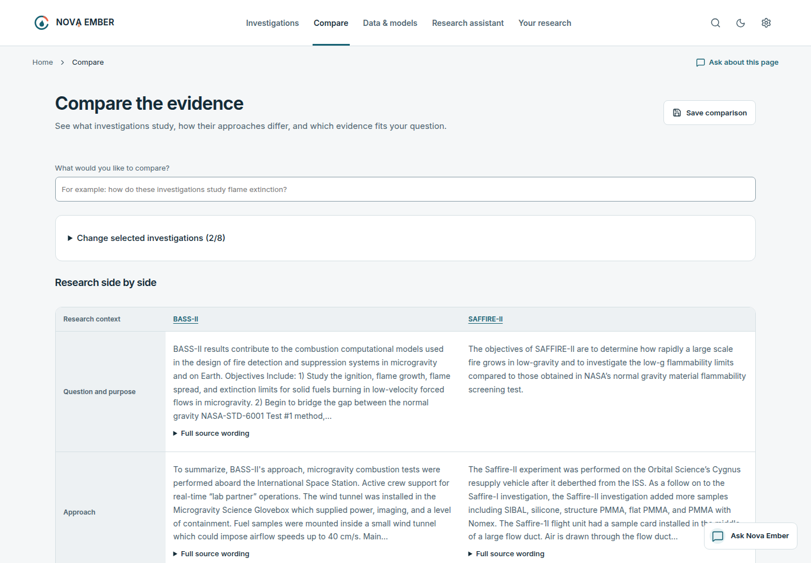
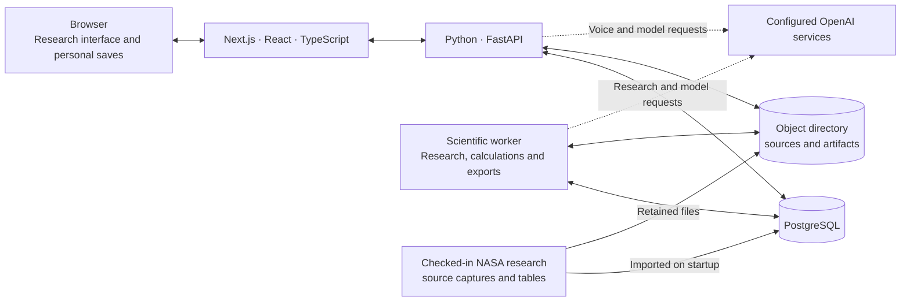

# Nova Ember

**Understand fire. Beyond Earth.**

## 🚀 [Try the live demo](https://nova-ember.duckdns.org/app)

Open the interactive dashboard to explore NASA combustion research, ask questions and follow the evidence.

Nova Ember helps people investigate fire in space. Built by **StrawHat Pirates** for the 2026 NASA Space Apps Challenge, it responds to [Flame in Freefall: SI-Powered Fire Safety Insights from Microgravity Combustion Data](https://www.spaceappschallenge.org/2026/challenges/flame-in-freefall/): making decades of microgravity combustion findings easier to find, compare and interpret for human space exploration.

## The challenge and mission

On Earth, hot combustion gases rise and draw fresh air toward a flame. In microgravity, that buoyancy-driven flow is greatly reduced, so ventilation and diffusion play different roles in how a flame grows, spreads and goes out. Understanding those differences matters when considering fire safety in spacecraft and future habitats.

NASA's investigations span different fuels, atmospheres, apparatus and scales. Their findings are valuable, but navigating individual studies and publications takes time, and results cannot always be compared directly. Nova Ember brings selected research into a connected workflow: start with a question, find relevant evidence, examine the conditions and work with the underlying data.

## Explore the research

- **Ask a question.** The research assistant connects explanations to inspectable sources and scientific tools. For example: “Which NASA investigations could help me understand how ventilation affects flame spread in solid materials?”
- **Discover investigations.** Browse studies, learn what each examines and follow links to original NASA records and publications.
- **Compare and rank evidence.** Examine study objectives and experimental conditions side by side, and use explicit criteria to assess relevant investigations. Differences in fuel, gravity, atmosphere and apparatus remain important to interpretation.
- **Work with data.** Inspect source tables and units, select data to chart or export, and use registered calculations or supported calibrated descriptive fits for further analysis.
- **Continue your research.** Return to questions and analyses saved in your browser, with portable backup for your research; optional research profiles and voice provide additional ways to work with the assistant.

## How it works

Nova Ember combines a curated NASA research collection with a web application, scientific tools and a source-linked assistant. The application imports a checked-in source snapshot into PostgreSQL. A Python API and worker handle research, calculations and exports, while the web interface brings investigations, comparisons and analysis together. Model-backed assistance uses the available evidence to help navigate and explain it; readers can follow citations to check the supporting material.

The catalog currently covers **35 investigations and one SoFIE program entry**. It brings together all 24 investigations in the NASA Physical Sciences Informatics (PSI) Combustion Science category with Saffire IV–VI, five SoFIE studies, FLARE, FM2 and LUCI. The collection includes selected source captures and 14 curated publication tables. Catalog entries do not imply that every original file or raw dataset has been acquired, and this collection is not a mirror of NASA's full archive.

Scientific context stays close to the evidence: source locations and units accompany data, and experimental conditions remain visible in comparisons. Source-reported values, calculations and model interpretations are identified separately. Learn more about the methods in the [data dictionary](docs/data-dictionary.md) and [scientific methods](docs/methods.md).

## See Nova Ember

[Download the 28-second video](media/nova-ember-space-apps/nova-ember-demo-v2-attributed.mp4) · [Video credits and sources](media/nova-ember-space-apps/credits.md)

GitHub does not preview the video at its current size; download it to watch. The screenshots below show the local application on 15 November 2026.



*Compare investigations side by side, with their research context and source wording.*

[Browse investigations](docs/redesign-2026-11-15/investigations-desktop.png) · [Explore data and models](docs/redesign-2026-11-15/data-models-desktop.png) · [Research assistant](docs/redesign-2026-11-15/assistant-desktop.png)

## Architecture

This diagram shows the main components and data paths.



The web app presents the research journey; the API and worker coordinate discovery, analysis and exports through PostgreSQL. Personal research is saved in the browser. The model service supports the assistant and voice, while registered calculations run as defined scientific operations. The frontend uses **Next.js, React and TypeScript**, with **Vega** for visualization and **Three.js** for 3D graphics. The backend uses **Python, FastAPI and PostgreSQL**, with a scientific Python stack and Docker-based local services.

## Run locally

You will need Git, Node.js 24, pnpm 11.20.0, Python 3 with pip, and Docker with Compose. Clone the repository and start the application:

```sh
git clone https://github.com/ScientificAJ/Strawhat-Pirates-2026.git
cd Strawhat-Pirates-2026
pnpm run setup
pnpm dev
```

Open [http://127.0.0.1:3100](http://127.0.0.1:3100). Setup installs the project's locked dependencies and attempts to prepare the local scientific execution environment. Source browsing, registered calculations, saving and exports do not require paid model credentials; live assistant and voice features require a configured backend model service. See [local development](docs/local-development.md) for setup details, configuration and verification commands, and [execution](docs/execution.md) for the isolated Python and shell runtime.

## Team

**StrawHat Pirates** is a one-person team: **Arjun** ([ScientificAJ](https://github.com/ScientificAJ)), responsible for the project’s research, design and engineering.

## AI use

AI tools were used in the project in the following ways:

- **ChatGPT** helped outline the system architecture.
- **Gemini web app (Hydrogen)** helped rapidly prototype visualizations. **Gemini Hydrogen High** also assisted with drafting and refining this README.
- **OpenAI Codex** helped rapidly prototype code, create project files and validate implementation work.
- **ChatGPT Images 2.0** was used to upscale an earlier team image. The current Space Apps team and profile images use an unaltered public-domain photograph from The Met instead.
- **OpenAI text-to-speech**, using the Marin voice, generated the demo video's narration; the [video credits](media/nova-ember-space-apps/credits.md) describe the audio and other media.

The application's optional research assistant, semantic search and voice features also use configured OpenAI models. Their responses and interpretations are distinct from source-reported data and registered calculations.

## Sources and licenses

Nova Ember builds on NASA's public research and the challenge resources:

- [Flame in Freefall challenge](https://www.spaceappschallenge.org/2026/challenges/flame-in-freefall/) — the problem and challenge objectives.
- [NASA PSI combustion research](https://psi.nasa.gov/physci/repo/search?q=combustion) — investigation records and available data.
- [NASA: Studying Combustion and Fire Safety](https://www.nasa.gov/missions/station/iss-research/studying-combustion-and-fire-safety/) — background on combustion research in space.
- [NASA research collection](data/nasa-research/README.md), [source inventory](docs/data-sources.md) and [submission source register](docs/submission-source-register-2026-11-15.md) — retained sources, identifiers, table provenance, coverage and rights notes. The application links individual evidence to its original record or publication.

The Space Apps team and profile images use The Metropolitan Museum of Art’s [*Marble head of a Greek general*](https://www.metmuseum.org/art/collection/search/251493), Roman, 1st–2nd century CE, Fletcher Fund, 1924 (24.97.32). The Met provides the image as [public domain under CC0](https://www.metmuseum.org/policies/image-resources).

The demo uses NASA Glenn’s [candle-flame image](https://images.nasa.gov/details/GRC-1998-C-00486) and footage from [*Great Balls of Fire — FLEX*](https://svs.gsfc.nasa.gov/11318/), credited to Science@NASA and NASA’s Goddard Space Flight Center. Its music is [“Mesmerizing Galaxy” by Kevin MacLeod](https://incompetech.com/music/royalty-free/index.html?isrc=USUAN2300011), licensed under [CC BY 4.0](https://creativecommons.org/licenses/by/4.0/); the track was trimmed, faded and mixed. The [video credits](media/nova-ember-space-apps/credits.md) provide the full source and modification record.

The repository's original code is licensed under [Apache-2.0](LICENSE). Major open-source components include Next.js and React (MIT), Vega (BSD-3-Clause), Three.js (MIT), Lucide (ISC), FastAPI (MIT), and Psycopg (LGPL-3.0). Inter and IBM Plex Mono are distributed under the SIL Open Font License. The [third-party software inventory](docs/third-party-software-2026-11-15.md) lists locked dependencies and recorded licenses; the [local image notice collection](docs/third-party-notices/2026-11-15/README.md) preserves the license and copyright files recovered from inspected application images. NASA data, publications, media and other third-party components retain their own applicable rights and notices; the [source inventory](docs/data-sources.md) records available rights assertions and unresolved cases. The [NASA Space Apps participant terms](https://www.spaceappschallenge.org/legal/) require citations for sources used and applicable third-party license documentation.
